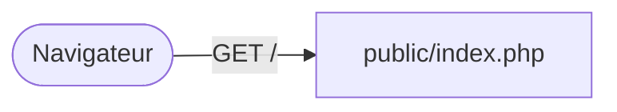
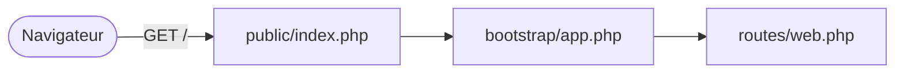
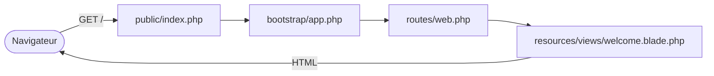

# Suivre une requête dans Laravel

- Suivre une requête de `public/index.php` jusqu'à la vue affichée
- Lire `.env` et la configuration qui en dépend
- Piloter le projet avec Artisan

<!--
Déroulé : slides + livecoding (≈ 35 min, LIVECODING.md étapes b à g) → « À vous » : étapes A7 à A10 du README (≈ 25 min). Tag de rattrapage : `s1-ch4-requete`.
Fil rouge : on ne présente aucun dossier « à plat », on suit UNE requête (GET /) et on ouvre chaque fichier au moment où elle y passe.
Moment léger : casser volontairement la vue (`welcom`) et laisser la page d'erreur raconter le trajet à votre place.
-->

---
transition: slide-up | slide-down
---

# Un fichier PHP pour toutes les URL ?

<Quiz
  question="Vous tapez http://localhost/nimportequoi. Quel fichier PHP du projet reçoit la requête en premier ?"
  :options="[
    'Un fichier nimportequoi.php dans le projet',
    'routes/web.php',
    'public/index.php, toujours le même',
    'app/Http/Controllers/Controller.php'
  ]"
  :answer="2"
/>

<!--
Pré-test : faire voter avant de cliquer. Beaucoup répondront routes/web.php : on corrige en suivant la requête fichier par fichier.
Dans un site PHP « from scratch », chaque URL = un fichier .php. Ici : un seul point d'entrée.
-->

---
transition: slide-up | slide-down
---

# Le trajet de `GET /`

<div class="relative h-72 mt-4">
<div v-click-hide="1" class="absolute inset-0">



</div>
<div v-click="[1,2]" class="absolute inset-0">



</div>
<div v-click="2" class="absolute inset-0">



</div>
</div>

<div v-click="3" class="text-center">

Vous n'écrivez jamais le point de départ : c'est Laravel qui **appelle votre route**.

</div>

<!--
Schéma animé : 3 états. Clic 1 : le framework charge l'application ; clic 2 : la route puis la vue, et la réponse repart vers le navigateur ; clic 3 : retour à l'inversion de contrôle du chapitre 02.
Ensuite on ouvre chaque fichier dans l'éditeur (livecoding, étapes b à e).
-->

---
transition: slide-up | slide-down
---

# Étape 1 : `public/index.php`

Le **<KeyTerm>front controller</KeyTerm>** : le seul fichier PHP accessible depuis le web.

```php {all|5-6|8-9|11-12}
<?php
use Illuminate\Foundation\Application;
use Illuminate\Http\Request;

define('LARAVEL_START', microtime(true));
require __DIR__.'/../vendor/autoload.php';

/** @var Application $app */
$app = require_once __DIR__.'/../bootstrap/app.php';

$app->handleRequest(Request::capture());
```

<v-click>

`Request::capture()` transforme la requête HTTP en objet ; `handleRequest()` cherche la route, produit la <KeyTerm>réponse</KeyTerm> et l'envoie.

</v-click>

<!--
Version légèrement abrégée (le vrai fichier teste aussi le mode maintenance). Livecoding étape b : ouvrir le fichier, montrer que `vendor/autoload.php` vient de Composer.
Le serveur web est configuré pour pointer sur `public/` : tout le reste du projet est hors de portée du navigateur (question 12 de l'exercice).
-->

---
transition: slide-up | slide-down
---

# Étape 2 : `bootstrap/app.php`

Là où l'application déclare **ses fichiers de routes** :

```php {all|6-8|9}
<?php
use Illuminate\Foundation\Application;

return Application::configure(basePath: dirname(__DIR__))
    ->withRouting(
        web: __DIR__.'/../routes/web.php',
        commands: __DIR__.'/../routes/console.php',
        health: '/up',
    )
    ->create();
```

<v-click>

`web` : les routes du site. `commands` : les commandes Artisan. `health` : une URL de santé que vous pouvez visiter.

</v-click>

<!--
Livecoding étape c : visiter `http://localhost/up` (page verte). Version abrégée (les callbacks withMiddleware/withExceptions sont vides pour l'instant et seront utilisés plus tard dans le module).
-->

---
transition: slide-up | slide-down
---

# Étape 3 : `routes/web.php` et la vue

```php
// routes/web.php
Route::get('/', function () {
    return view('welcome');
});
```

<v-click>

`view('welcome')` ouvre `resources/views/welcome.blade.php` : le HTML renvoyé au navigateur. Pas de contrôleur ici : la <KeyTerm>route</KeyTerm> répond directement.

</v-click>

<!--
Livecoding étape d puis e : changer un mot dans welcome.blade.php, rafraîchir (c'est immédiat).
Les routes en détail : séance 2. Ici on se contente de savoir où elles vivent.
-->

---
layout: two-cols-header
layoutClass: gap-x-6
transition: slide-up | slide-down
---

# Quand ça casse, la requête se raconte

::left::

On renomme volontairement la vue :

```php
return view('welcom');
```

<v-click>

La page d'erreur de Laravel affiche **la pile d'appels** : chaque ligne est un fichier traversé par la requête.

</v-click>

::right::

<v-click>

<Alert>

`View [welcom] not found.` Lisez le message **et** la première ligne qui pointe vers *votre* code : c'est presque toujours là qu'est l'erreur.

</Alert>

</v-click>

<!--
Erreur volontaire (étape e) : le moment léger du chapitre. Remettre `welcome` ensuite. Cette page n'existe qu'en environnement local (APP_DEBUG=true) : transition vers `.env`.
-->

---
transition: slide-up | slide-down
---

# Étape 4 : `.env` et configuration

La même application se comporte différemment selon l'**environnement**, réglé dans `.env` :

| Variable | `local` (vous) | `production` |
|---|---|---|
| `APP_ENV` | `local` | `production` |
| `APP_DEBUG` | `true` : pages d'erreur détaillées | `false` : jamais de détails |

<v-click>

```php
// config/app.php
'name' => env('APP_NAME', 'Laravel'),
```

`env('APP_NAME', 'Laravel')` : valeur du `.env`, sinon valeur par défaut. `.env` contient des **secrets** : il n'est jamais versionné, seul `.env.example` l'est.

</v-click>

<!--
Livecoding étape f : changer APP_NAME puis `sail artisan about`. Le fichier .env n'est PAS dans Git : on le montre dans .gitignore.
-->

---
transition: slide-up | slide-down
---

# Étape 5 : Artisan, la console

Le fichier `artisan` est un **second point d'entrée** de l'application, en ligne de commande :

<Terminal title="bash" prompt="$" :clicks="true" :lines="[{ cmd: 'sail artisan list', out: 'Liste de toutes les commandes disponibles.' }, { cmd: 'sail artisan about', out: 'Laravel 12.x · PHP 8.4.x · Environment local.' }, { cmd: 'sail artisan route:list', out: 'GET|HEAD  /  ......  GET|HEAD  up' }]" />

<v-click>

`route:list` confirme ce que vous avez lu dans `bootstrap/app.php` et `routes/web.php`.

</v-click>

<!--
Livecoding étape g. Plus tard : `make:controller`, `migrate`, `db:seed`… (bonus de l'exercice : `list`, `--help`, `tinker`).
-->

---
layout: two-cols-header
layoutClass: gap-x-6
transition: slide-up | slide-down
---

# Où est quoi ?
L'arborescence, maintenant que vous l'avez parcourue

::left::

**✍️ Votre code** <span class="text-xs opacity-70">— les dossiers où vous travaillez chaque jour : <KeyTerm>routes</KeyTerm>, <KeyTerm>contrôleurs</KeyTerm>, vues <KeyTerm>Blade</KeyTerm></span>

<div class="text-sm">

<FileTree :tree="[
  {
    name: 'mon-projet/',
    children: [
      { name: 'app/', highlight: true, comment: 'Votre code PHP : modèles, contrôleurs', children: [
        { name: 'Models/' },
        { name: 'Http/Controllers/' },
        { name: 'Providers/' }
      ]},
      { name: 'database/', highlight: true, children: [
        { name: 'migrations/', comment: 'Versionnement du schéma' },
        { name: 'seeders/', comment: 'Données initiales ou de test' }
      ]},
      { name: 'resources/', highlight: true, comment: 'Templates et assets front', children: [
        { name: 'views/', comment: 'Templates Blade' },
        { name: 'css/' },
        { name: 'js/' }
      ]},
      { name: 'routes/', highlight: true, children: [
        { name: 'web.php', comment: 'Les URLs de votre site' },
        { name: 'api.php', comment: 'Endpoints API' }
      ]},
      { name: 'tests/', comment: 'Tests Feature et Unit' }
    ]
  }
]" />

</div>

::right::

**⚙️ Fourni par Laravel** <span class="text-xs opacity-70">— configuration et fichiers générés, vous y touchez rarement</span>

<div class="text-sm">

<FileTree :tree="[
  {
    name: 'mon-projet/',
    children: [
      { name: 'bootstrap/', children: [
        { name: 'app.php' },
        { name: 'cache/', comment: 'Cache de démarrage' }
      ]},
      { name: 'config/', comment: 'Configuration — valeurs sensibles dans .env' },
      { name: 'public/', children: [
        { name: 'index.php', comment: 'Seul fichier accessible depuis le web' }
      ]},
      { name: 'storage/', comment: 'Logs, caches, fichiers uploadés' },
      { name: 'vendor/', comment: 'Dépendances Composer — ne jamais modifier' },
      { name: '.env', comment: 'Secrets et environnement — jamais versionné' },
      { name: 'artisan', comment: 'Console Laravel' },
      { name: 'composer.json', comment: 'Dépendances PHP' },
      { name: 'package.json', comment: 'Dépendances JS' },
      { name: 'compose.yaml', comment: 'Services Docker de Sail' }
    ]
  }
]" />

</div>

<!--
Récapitulatif : chaque dossier a croisé la requête ou la configuration pendant le chapitre. Insister : app/, resources/views/, routes/ et database/migrations/ sont le code de l'apprenant.
Analogie : app/ c'est votre cuisine, resources/views/ c'est la salle, routes/ c'est le plan d'accès.
vendor/, bootstrap/cache/ et storage/framework/ sont générés ou utilisés par le framework — listés dans .gitignore, ils ne se versionnent pas.
Expliquer que vider `storage/framework/cache/` ou `bootstrap/cache/` peut résoudre certains comportements étranges.
-->

---

<Exercise title="À vous : suivre la requête sur WishFlix" duration="25 min" level="guidé"
  :criteria="[
    'Vous avez noté le premier fichier chargé par index.php et les routes déclarées par bootstrap/app.php',
    'Un mot modifié dans welcome.blade.php apparaît sur http://localhost',
    'APP_NAME modifié dans .env apparaît dans sail artisan about'
  ]">

README de l'exercice `01-installation-architecture`, **étapes A7 à A10**. **Point de contrôle 2.**

Vos observations vont dans `REPONSES.md` (questions 1, 5 et 6).

</Exercise>

<!--
Point de contrôle 2. Palier de rattrapage : tag Campus Quest `s1-ch4-requete` ; relire le diff et refaire les étapes sur WishFlix.
-->
