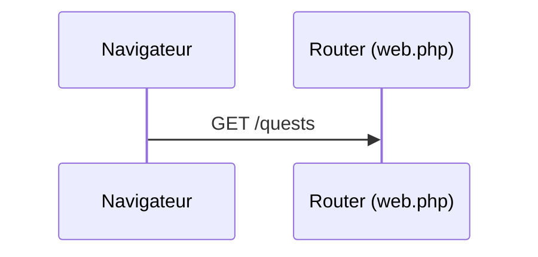
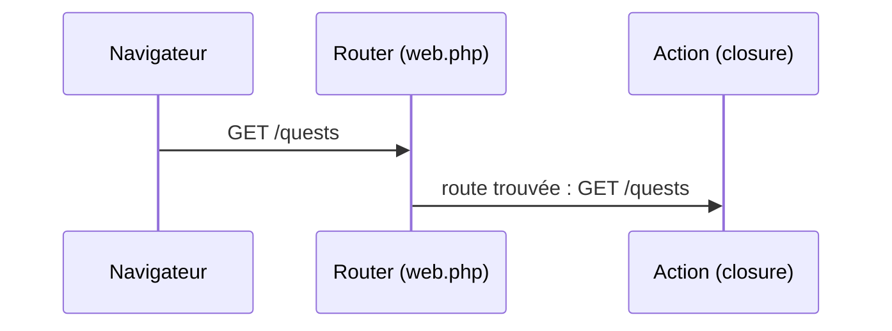
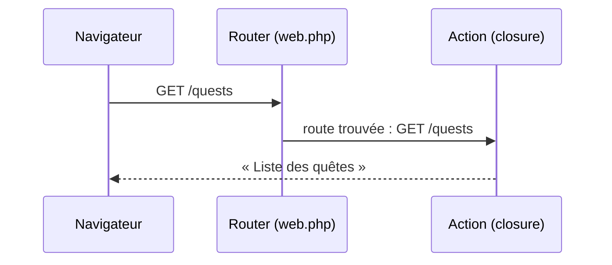

# Routing

- Définir une route : verbe HTTP, URL, action
- Capturer et contraindre des paramètres d'URL
- Nommer les routes et générer leurs URL

<!--
Transition : en S1 on a vu l'architecture ; aujourd'hui on fait répondre le site à de vraies URL.
Durée (35 min) = accueil + slides (≈ 12 min) + livecoding étapes 1 → 3 (≈ 8 min) + « À vous » A1 (≈ 15 min).
Avant d'attaquer : faire lancer l'étape 0 du README (sail up, puis `sail npm install` en arrière-plan, utile au chapitre 5).
-->

---
transition: slide-up | slide-down
---

# Qu'est-ce qu'une route ?

<Definition term="Route">

Une association entre une **URL**, un **verbe HTTP** et l'**action** à exécuter.

</Definition>

<v-click>

<Analogy title="Comme le standard du campus" icon="☎️">

Vous appelez le standard et demandez « la scolarité » : le standardiste vous **aiguille** vers le bon bureau. Le router de Laravel fait pareil : il reçoit l'URL demandée et la transmet à la bonne action.

</Analogy>

</v-click>

<!--
Faire trouver d'autres exemples d'aiguillage : panneaux d'un hall, accueil d'un hôpital.
Le "router" est la partie de Laravel qui lit routes/web.php et choisit la route qui correspond à l'URL.
-->

---
layout: two-cols-header
layoutClass: gap-x-6
transition: slide-up | slide-down
---

# Votre première route

::left::

```php {none|1|2|1-3}
Route::get('/quests', function () {
    return 'Liste des quêtes';
});
```

::right::

<div v-click="1">

`Route::get('/quests', ...)` — « quand le navigateur demande `/quests` en **GET**… »

</div>

<div v-click="2">

`return '...'` — « … exécute cette action et renvoie la réponse. »

</div>

<div v-click="3">

L'action est ici une **closure** : une fonction anonyme définie à la volée. La chaîne retournée devient le corps de la réponse HTTP.

</div>

<!--
Livecoding étape 1 : la route vit dans routes/web.php, la taper en direct.
Question probable : "c'est quoi function () { } ?" → closure, vue en S1.
-->

---
transition: slide-up | slide-down
---

# Le trajet d'une requête

<v-switch>
<template #0>



</template>
<template #1>



</template>
<template #2>



</template>
</v-switch>

<v-click at="3">

Aucune route ne correspond ? Le router répond directement **404**, sans exécuter d'action.

</v-click>

<!--
Dérouler clic par clic : la requête arrive, le router cherche la route, l'action répond.
Le cas 404 du dernier clic prépare la contrainte whereNumber (slide suivante) et le chapitre 6.
-->

---
transition: slide-up | slide-down
---

# Un verbe HTTP par intention

| Verbe | Intention | Exemple Campus Quest |
|-------|-----------|----------------------|
| `GET` | Lire une ressource | Voir la liste des quêtes, une fiche |
| `POST` | Créer une ressource | Proposer une nouvelle quête |
| `PUT` / `PATCH` | Modifier une ressource | Corriger le titre d'une quête |
| `DELETE` | Supprimer une ressource | Retirer une quête terminée |

<!--
En S2 on ne fait que du GET : les formulaires et les autres verbes arrivent en S5.
Mentionner que Route::post, Route::put, Route::delete existent avec la même syntaxe.
-->

---
layout: two-cols-header
layoutClass: gap-x-6
transition: slide-up | slide-down
---

# Faire évoluer la route

::left::

````md magic-move
```php
Route::get('/quests', function () {
    return 'Liste des quêtes';
});
```

```php
Route::get('/quests/{id}', function ($id) {
    return "Quête n°{$id}";
});
```

```php
Route::get('/quests/{id}', function ($id) {
    return "Quête n°{$id}";
})->whereNumber('id');
```

```php
Route::get('/quests/{id}', function ($id) {
    return "Quête n°{$id}";
})->whereNumber('id')->name('quests.show');
```
````

::right::

La route `/quests` de tout à l'heure, **enrichie étape par étape**.

<div v-click="1">

`{id}` — le paramètre **capture** un segment d'URL et le passe à l'action : `/quests/3` → « Quête n°3 ». Sans contrainte, `/quests/abc` est accepté aussi. Un paramètre peut être **optionnel** : `{difficulty?}` répond aussi à `/quests`.

</div>

<div v-click="2">

`->whereNumber('id')` — la **contrainte** filtre les valeurs acceptées : `/quests/abc` → **404** renvoyée par le router, avant même d'entrer dans l'action.

</div>

<div v-click="3">

`->name('quests.show')` — la route est **nommée** : on pourra générer son URL avec `route()`.

</div>

<!--
Livecoding étape 2 : montrer d'abord SANS whereNumber que /quests/abc passe, puis l'ajouter → 404.
Piège classique : oublier le nom identique entre {id} et le paramètre $id.
Autres contraintes : whereAlpha, where('id', '[0-9]+').
Moment léger : la quête n°1 s'appelle « Salle 404 ». Taper /quests/abc → « vous venez de trouver la vraie salle 404 du campus, +50 XP ».
-->

---
transition: slide-up | slide-down
---

# Générer les URL avec route()

L'URL se génère à partir du **nom** de la route :

```php
route('quests.show', 3);   // → http://localhost/quests/3
route('quests.index');     // → http://localhost/quests
```

Vous l'utiliserez dès le chapitre suivant, dans les liens de vos pages.

<v-click>

<KeyPoint variant="rule" title="Règle d'or" icon="📏">

N'écrivez jamais une URL en dur (`href="/quests/3"`). Générez-la avec `route()` : si l'URL change, le nom reste et les liens continuent de fonctionner.

</KeyPoint>

</v-click>

<!--
Anecdote : un projet où l'on passe de /quest/{id} à /defis/{id} — avec route() on change une ligne, en dur on chasse 40 liens.
On peut le montrer en direct avec `sail artisan tinker` puis route('quests.show', 3).
-->

---
transition: slide-up | slide-down
---

# Inspecter toutes les routes de l'application

<Terminal
  title="bash" prompt="$"
  :lines="[
    { cmd: 'sail artisan route:list', out: '  GET|HEAD   / ........................................................\n  GET|HEAD   quests ........................................ quests.index\n  GET|HEAD   quests/{id} .................................... quests.show\n  GET|HEAD   storage/{path} ............................ storage.local\n  GET|HEAD   up ......................................................\n\n                                                  Showing [5] routes' }
  ]"
/>

<!--
Livecoding étape 3.
`up` est la route de santé configurée dans bootstrap/app.php (vue en S1, exercice 1).
`storage/{path}` sert les fichiers du disque public.
Les routes sont encore des closures : la colonne de droite n'affiche que leur nom. Au chapitre 3, on y verra QuestController@index.
-->

---
transition: slide-up | slide-down
---

# Panorama : les routes

<script setup>
import routes from '/references/routes'
</script>

<Panorama :items="routes" doc="https://laravel.com/docs/12.x/routing" at="s2-ch1" />

<!--
Survol de 30 s, pas d'explication détaillée : montrer ce qui a été vu (badges « vu ») et où trouver le reste.
Pendant le « À vous », les apprenants peuvent revenir sur cette slide comme aide-mémoire.
-->

---
transition: slide-up | slide-down
---

# À vous : la route de la fiche jeu

<Exercise title="WishFlix — étapes A1.1 à A1.3" duration="15 min" level="guidé"
  :criteria="[
    '/game/3 affiche « Jeu n°3 »',
    '/game/abc renvoie une 404',
    'sail artisan route:list affiche la route nommée games.show'
  ]">

Consignes : README de l'exercice `02-routing-blade`, **étape 0 puis Partie A, étapes A1**.

Transposez la démo sur WishFlix : une route `GET /game/{id}` qui répond par un simple texte, contrainte et nommée.

</Exercise>

<!--
Point de contrôle 1. Palier de rattrapage : tag Campus Quest s2-ch1-routing (diff = les deux routes closures).
Un élève bloqué sur l'étape 0 (Sail) : ne pas attendre, le dépanner pendant la slide suivante.
Passer dans les rangs : l'erreur la plus fréquente est le nom de paramètre différent entre {id} et $id.
-->
