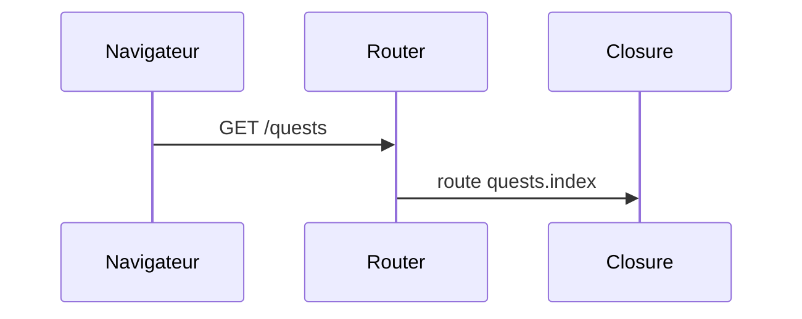
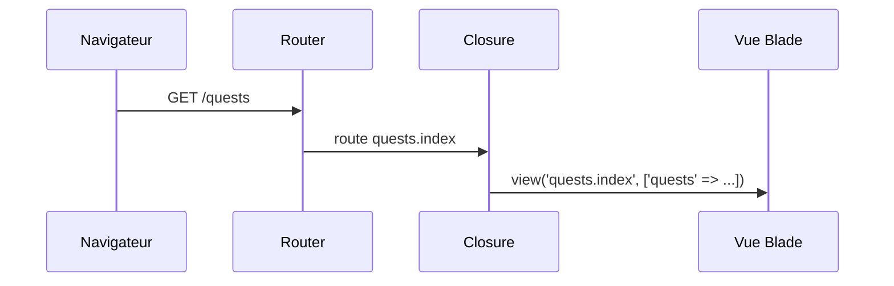
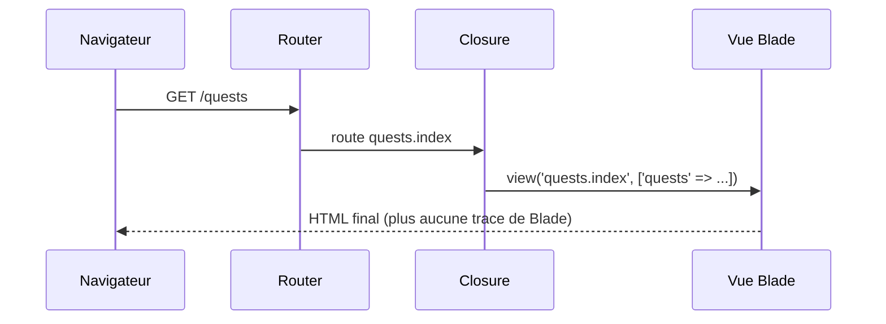

# Blade : la vue

- Faire renvoyer une vraie page HTML par une route
- Afficher une donnée en sécurité avec <code v-pre>{{ }}</code>
- Boucler et conditionner l'affichage avec les directives

<!--
Transition : « Liste des quêtes » en texte brut, ce n'est pas un site. La route doit renvoyer une page.
Ce chapitre couvre la vue seule ; le layout partagé arrive au chapitre 4.
Durée (35 min) = slides (≈ 8 min) + livecoding étapes 4 → 5 (≈ 7 min) + « À vous » A2 (≈ 20 min).
-->

---
layout: two-cols-header
layoutClass: gap-x-6
transition: slide-up | slide-down
---

# De la route à la vue

Renvoyer `'Liste des quêtes'` ne suffit pas : il faut une vraie page HTML.

::left::

<Definition term="Blade">

Le moteur de templates de Laravel : du HTML enrichi de directives `@...` et d'expressions <code v-pre>{{ }}</code>, compilé en PHP.

</Definition>

```php {all|2-5|6|all}
Route::get('/quests', function () {
    $quests = [
        1 => ['title' => 'Salle 404', 'xp' => 50, 'difficulty' => 'easy'],
        2 => ['title' => 'Quiz campus', 'xp' => 30, 'difficulty' => 'easy'],
    ];
    return view('quests.index', ['quests' => $quests]);
})->name('quests.index');
```

::right::

<div v-click="1">

Les données de démo : un **tableau PHP**, remplacé par la base de données en séance 3.

</div>

<div v-click="2">

`view('quests.index', [...])` — `quests.index` → le **point remplace le slash** :

<FileTree :tree="[
  { name: 'resources', children: [
    { name: 'views', children: [
      { name: 'quests', children: [
        { name: 'index.blade.php', highlight: true }
      ]}
    ]}
  ]}
]" />

</div>

<div v-click="3">

Le tableau associatif devient des **variables** dans la vue : `'quests' => ...` crée `$quests`.

</div>

<!--
Livecoding étape 4 : la closure de l'étape a renvoie maintenant une vue.
Piège fréquent : écrire view('quests/index') — ça fonctionne aussi, mais le point est la convention.
-->

---
transition: slide-up | slide-down
---

# Le trajet, avec une vue

<v-switch>
<template #0>



</template>
<template #1>



</template>
<template #2>



</template>
</v-switch>

<!--
Même trajet qu'au chapitre 1, avec un maillon de plus : l'action délègue l'affichage à la vue.
Le navigateur ne reçoit que du HTML : il ne sait pas que Blade existe.
-->

---
layout: two-cols-header
layoutClass: gap-x-6
transition: slide-up | slide-down
---

# Blade en un coup d'œil

::left::

**Expressions**

- <code v-pre>{{ $quest['title'] }}</code> — affiche une donnée **échappée** : la protection XSS est automatique
- <code v-pre>{{-- commentaire --}}</code> — note invisible dans le HTML envoyé

<v-click>

<Alert type="info">

L'affichage de HTML brut (`{!! !!}`) existe, mais n'est pas nécessaire ici : gardez l'échappement par défaut.

</Alert>

</v-click>

::right::

**Directives** — utilisées aujourd'hui :

- `@if` `@elseif` `@else` `@endif` — conditions
- `@forelse` `@empty` `@endforelse` — boucle avec cas « vide »

<v-click>

À connaître, pas d'urgence :

- `@unless` `@isset` `@switch` — autres conditions
- `@foreach` `@for` `@while` — autres boucles

</v-click>

<!--
Toutes les directives listées existent en Laravel 12 (laravel.com/docs/12.x/blade).
Le message : retenir celles d'aujourd'hui, savoir reconnaître les autres dans la doc.
Les directives de layout (@extends, @section, @yield) arrivent au chapitre 4.
La démo {!! !!} vs {{ }} (injection XSS) est approfondie en séance 6 ; la Partie C de l'exercice la fait expérimenter.
-->

---
layout: two-cols-header
layoutClass: gap-x-6
transition: slide-up | slide-down
---

# Les directives : boucles et conditions

::left::

```blade {all|2|3-5|6-8|all}
<h1>Quêtes disponibles</h1>
@forelse ($quests as $id => $quest)
    <a href="{{ route('quests.show', $id) }}">
        {{ $quest['title'] }} — {{ $quest['xp'] }} XP
    </a>
@empty
    <p>Aucune quête pour le moment.</p>
@endforelse
```

::right::

<div v-click="1">

`@forelse ($quests as $id => $quest)` — boucle sur le tableau **avec clé** : `$id` vaut 1, 2, 3.

</div>

<div v-click="2">

Dans la boucle : `route()` (chapitre 1) génère le lien vers la fiche, <code v-pre>{{ }}</code> affiche les champs échappés.

</div>

<div v-click="3">

`@empty` — affiché **seulement si** le tableau est vide. `@endforelse` ferme la boucle.

</div>

<div v-click="4">

Même famille : `@if ($quest['difficulty'] === 'hard') ... @endif` pour un affichage conditionnel.

</div>

<!--
Équivalence PHP : foreach + else. Rappeler que Blade compile vers du PHP natif dans storage/framework/views.
Livecoding étape 5 : la route quests.show renvoie aussi une vue (quests/show.blade.php)… et doit recopier le même tableau de quêtes. Le faire remarquer sans le corriger : c'est le problème du chapitre 3.
Moment léger : ajouter une quête « Trouver une prise libre en amphi » à 9999 XP, « la quête la plus dure du campus ».
-->

---
transition: slide-up | slide-down
---

# À vous : l'accueil devient une vue

<Exercise title="WishFlix — étapes A2.1 à A2.4" duration="20 min" level="guidé"
  :criteria="[
    'La route nommée home renvoie la vue home',
    'L\'accueil affiche une carte par jeu du tableau (au moins 4)',
    'Le bouton « Details » d\'une carte mène à /game/{id}'
  ]">

Consignes : `exercices/framework/02-routing-blade/README.md`, **Partie A, étapes A2**.

Partez de la maquette `home.html` : elle devient une vue Blade, et ses cartes sont générées par une boucle.

</Exercise>

<!--
Point de contrôle 2. Palier de rattrapage : tag Campus Quest s2-ch2-blade-vue.
Rassurer : les couleurs WishFlix manquent encore (seules les classes DaisyUI du CDN s'appliquent), c'est normal — les CSS arrivent au chapitre 5.
-->
