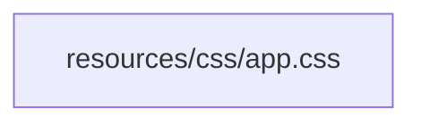
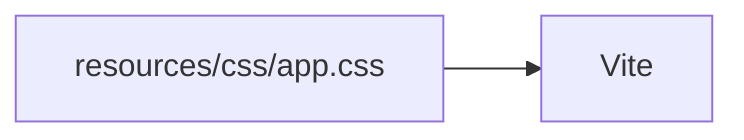
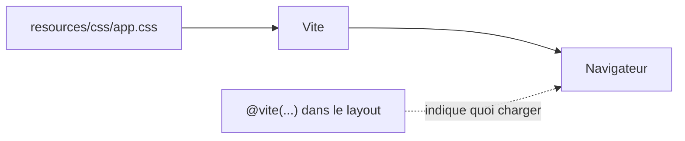

# Vite

- Brancher les CSS de l'application sur le layout
- Servir et compiler vos CSS avec Vite
- Charger une CSS propre à chaque page

<!--
Transition : au chapitre 4, le layout n'a aucun style. C'est le moment de lui donner sa CSS.
Chapitre volontairement réduit : l'essentiel pour l'atelier, pas un cours Vite. Vite est le choix par défaut de Laravel — nécessaire pour Breeze (S6) et le JS fetch (S7).
Durée (30 min) = slides (≈ 8 min) + livecoding étapes 11 → 13 (≈ 7 min) + « À vous » A5 (≈ 15 min).
-->

---
transition: slide-up | slide-down
---

# Le layout réclame sa CSS

````md magic-move
```blade
<head>
    <meta charset="UTF-8">
    <title>@yield('title') — Campus Quest</title>
</head>
```

```blade
<head>
    <meta charset="UTF-8">
    <title>@yield('title') — Campus Quest</title>
    @vite(['resources/css/app.css'])
</head>
```

```blade
<head>
    <meta charset="UTF-8">
    <title>@yield('title') — Campus Quest</title>
    @vite(['resources/css/app.css'])
    @yield('styles')
</head>
```
````

<div v-click="1">

`@vite([...])` — charge la **CSS commune** : elle sert à toutes les pages, donc elle vit dans le layout.

</div>

<div v-click="2">

`@yield('styles')` — un emplacement de plus (chapitre 4) : chaque page y déposera **sa propre CSS**.

</div>

<div v-click="3">

Rechargez la page : Laravel affiche **« Vite manifest not found »**. La page réclame une CSS que personne n'a préparée.

</div>

<!--
Livecoding étape 11 : provoquer l'erreur volontairement, avec npm run dev arrêté. C'est l'erreur n°1 des premiers jours : apprendre à la reconnaître fait gagner du temps à toute la promo.
Les CSS du projet de démo (app.css, quests.css) sont déjà dans resources/css/ : on n'a rien à copier côté Campus Quest.
-->

---
transition: slide-up | slide-down
---

# Vite prépare vos assets

<v-switch>
<template #0>



</template>
<template #1>



</template>
<template #2>



</template>
</v-switch>

<v-click at="3">

Vite **compile** vos CSS/JS, les **sert** pendant le développement et **recharge la page** à chaque modification. La page ne charge que les fichiers que Vite connaît.

</v-click>

<!--
Le schéma : le fichier source n'est pas lu directement par le navigateur ; Vite le sert. @vite() ne contient que le chemin du fichier source, Vite fournit l'URL réelle.
-->

---
transition: slide-up | slide-down
---

# Lancer le serveur Vite

<Terminal
  title="bash" prompt="$"
  :lines="[
    { cmd: 'sail npm install', out: 'added 42 packages in 3s' },
    { cmd: 'sail npm run dev', out: '  VITE v7  ready in 352 ms\n\n  ➜  APP_URL: http://localhost' }
  ]"
/>

<v-click>

<Alert type="info">

Gardez `sail npm run dev` ouvert dans un second terminal, à côté de `sail up`. Pour un rendu sans serveur Vite : `sail npm run build`.

</Alert>

</v-click>

<!--
Livecoding étape 12 : relancer npm run dev, recharger : la page s'affiche. Le premier npm install sous Sail peut être long : c'est normal, il a été lancé au chapitre 1.
Moment léger : arrêter npm run dev en direct, « Vite manifest not found » → « le serveur Vite a pris sa pause café ».
-->

---
layout: two-cols-header
layoutClass: gap-x-6
transition: slide-up | slide-down
---

# Une CSS par page

::left::

```js {none|8-12|13|all}
import { defineConfig } from 'vite';
import laravel from 'laravel-vite-plugin';
import tailwindcss from '@tailwindcss/vite';

export default defineConfig({
    plugins: [
        laravel({
            input: [
                'resources/css/app.css',
                'resources/js/app.js',
                'resources/css/quests.css',
            ],
            refresh: true,
        }),
        tailwindcss(),
    ],
});
```

::right::

<div v-click="1">

`input` — chaque fichier CSS / JS à charger doit être **déclaré** ici. `quests.css` vient d'y être ajouté.

</div>

<div v-click="2">

`refresh: true` — Vite recharge la page quand un fichier `resources/` change.

</div>

<div v-click="3">

Côté Blade : la page charge sa CSS dans le `@yield('styles')` du layout :

```blade
@section('styles')
    @vite('resources/css/quests.css')
@endsection
```

</div>

<!--
Livecoding étape 13. Après chaque ajout dans input, vérifier que npm run dev tourne — sinon l'entrée n'est pas compilée.
Oublier d'ajouter quests.css dans input : « Unable to locate file in Vite manifest » — à montrer volontairement.
-->

---
transition: slide-up | slide-down
---

# À vous : les CSS de WishFlix

<Exercise title="WishFlix — étapes A5.1 à A5.5" duration="15 min" level="guidé"
  :criteria="[
    '`sail npm run dev` tourne, sans erreur « Vite manifest not found »',
    'Les CSS des maquettes sont dans resources/css/ (copiées par le script fourni)',
    'L\'accueil et la fiche jeu ont les couleurs WishFlix'
  ]">

Consignes : `exercices/framework/02-routing-blade/README.md`, **Partie A, étapes A5**.

Un **script fourni** copie les CSS des maquettes dans votre projet : vous n'avez qu'à lui donner le chemin de `wishflix`. Puis déclarez-les à Vite et chargez-les depuis le layout et les pages.

</Exercise>

<!--
Point de contrôle 5. Palier de rattrapage : tag Campus Quest s2-ch5-vite.
Le script se lance depuis exercices/framework du dépôt K.School : montrer la commande au tableau. Erreur fréquente : chemin relatif écrit depuis le mauvais dossier — conseiller un chemin absolu.
-->
