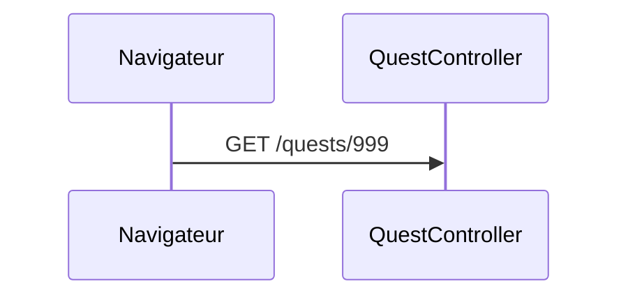
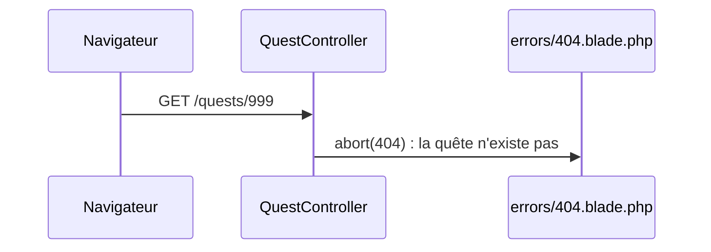
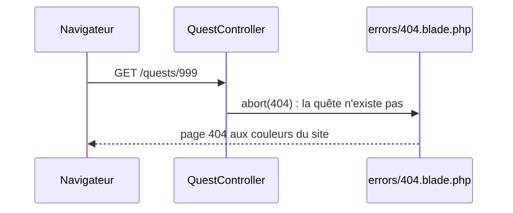

# Pages d'erreur

- Interrompre une action avec `abort()`
- Personnaliser la page 404 de l'application

<!--
Transition : /quests/99 plante avec « Undefined array key » (promis au chapitre 3). Il est temps de répondre proprement.
Chapitre court : la 404 personnalisée est une application directe des layouts du chapitre 4 et de Vite du chapitre 5.
Durée (15 min) = slides (≈ 4 min) + livecoding étape 14 (≈ 4 min) + « À vous » A6 (≈ 7 min).
-->

---
transition: slide-up | slide-down
---

# Le trajet d'une 404

<v-switch>
<template #0>



</template>
<template #1>



</template>
<template #2>



</template>
</v-switch>

<!--
Même logique qu'au chapitre 1 : une URL sans route renvoie aussi la 404, sans passer par l'action. Ici c'est l'action qui décide d'interrompre.
-->

---
layout: two-cols-header
layoutClass: gap-x-6
transition: slide-up | slide-down
---

# La page 404 personnalisée

::left::

```php
public function show(int $id)
{
    abort_unless(isset($this->quests[$id]), 404);

    return view('quests.show',
        ['quest' => $this->quests[$id], 'id' => $id]);
}
```

`abort(404)` cherche `resources/views/errors/404.blade.php` — qui peut `@extends('layouts.app')` comme n'importe quelle page :

- Titre : « Cette quête n'existe pas (encore) »
- Lien retour : `route('quests.index')`
- Déclenchée aussi par **toute URL inconnue**

::right::

<v-click>

<Browser url="localhost/quests/999" title="Campus Quest">
  <Placeholder :w="800" :h="500" text="Erreur 404" />
</Browser>

</v-click>

<!--
Livecoding étape 14. Option : sail artisan vendor:publish --tag=laravel-errors récupère les vues d'erreur par défaut comme point de départ.
Tester en direct : /quests/999 ET /nimportequoi renvoient la même page.
Moment léger : la page 404 propose « Cette quête n'existe pas (encore) — +10 XP pour avoir cherché ».
-->

---
transition: slide-up | slide-down
---

# À vous : la 404 WishFlix

<Exercise title="WishFlix — étapes A6.1 à A6.3" duration="7 min" level="guidé"
  :criteria="[
    '/game/999 affiche la page 404 de WishFlix',
    '/url-inexistante affiche la même page',
    'La page 404 étend le layout et son lien de retour utilise route(\'home\')'
  ]">

Consignes : README de l'exercice `02-routing-blade`, **Partie A, étapes A6**.

Protégez `show()` avec `abort_unless`, puis habillez la 404 avec la maquette `404.html`.

</Exercise>

<!--
Point de contrôle 6 = fin de la Partie A, requis pour la S3. Palier de rattrapage : tag Campus Quest s2-ch6-erreurs.
-->
