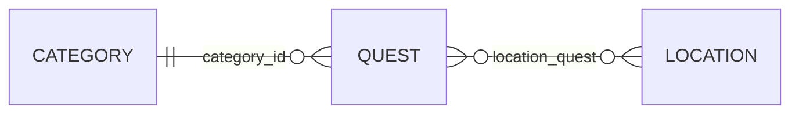

# Campus Quest
La base de données arrive

En S2, les quêtes vivaient dans un **tableau PHP** écrit dans le contrôleur — impossible à modifier sans toucher au code. Aujourd'hui, elles passent dans une **vraie base MariaDB**.

::left::

**Le modèle Campus Quest du jour**

- `quests` — title, description, xp, difficulty, featured
- `categories` — name : Quiz, Mission, Culture G
- `locations` — name : BU, Cafét, Amphi…

::right::

<v-click>

Une quête a **une** catégorie, mais peut se dérouler dans **plusieurs** lieux — d'où la table de lien `location_quest`.

</v-click>

::bottom::

> 🎯 Objectif : lire et écrire ces tables **sans écrire une ligne de SQL**, grâce à Eloquent.

<!--
Rappeler le pacte : tout est démontré sur Campus Quest, puis transposé sur WishFlix en atelier — jamais de recopie.
Faire réagir : qui a encore ses quêtes en tableau PHP ? Ce tableau disparaît aujourd'hui.
Le diagramme est le plan de la journée : categories→quests en 1-N, puis la pivot location_quest en N-N.
-->
