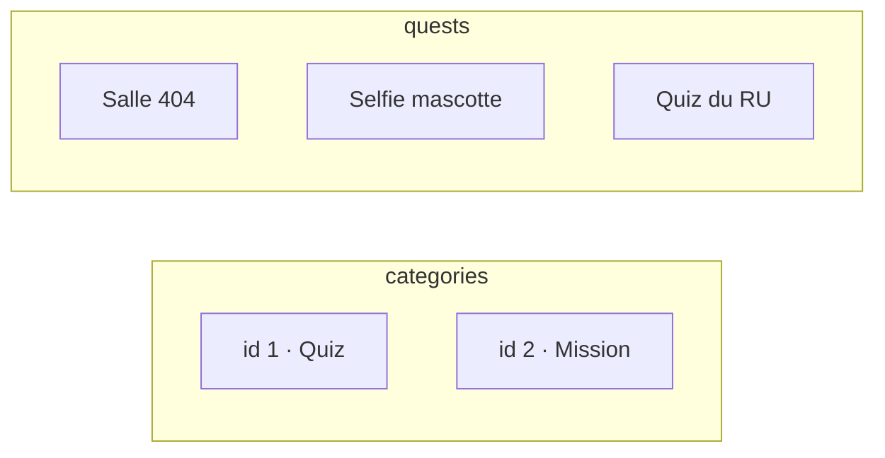
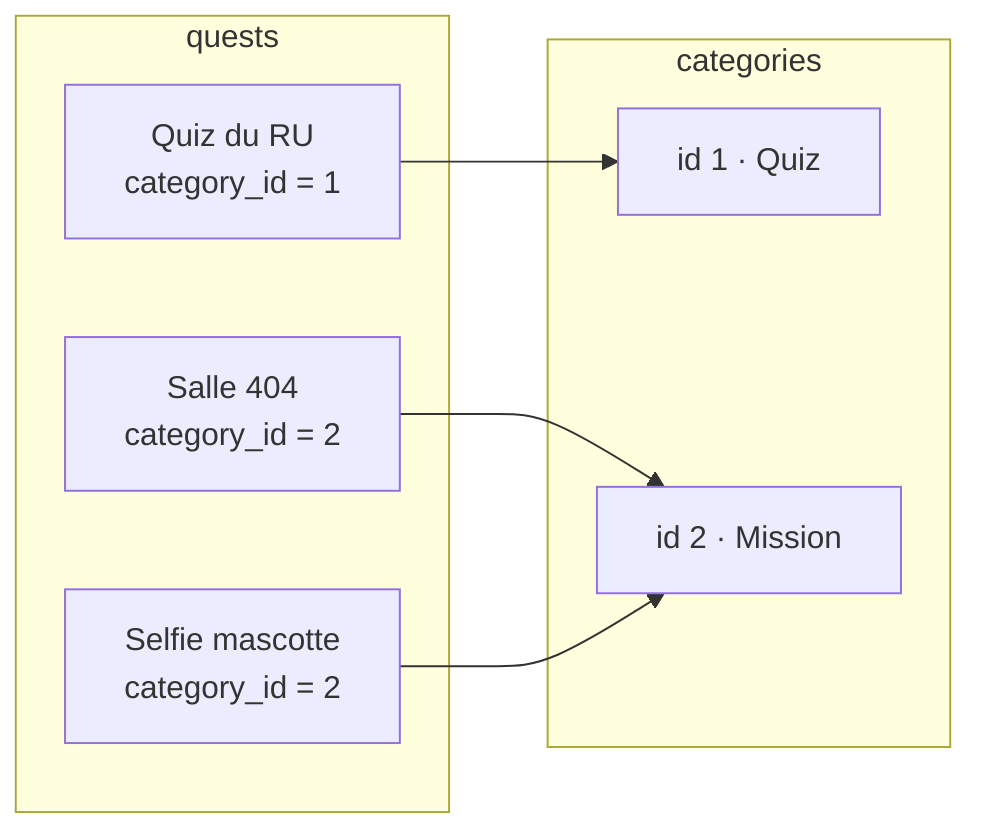
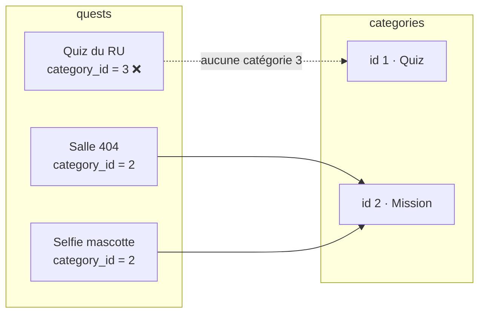

# Relation un-à-plusieurs

- Placer la clé étrangère du bon côté et l'écrire en migration
- Autoriser l'écriture en masse avec `$fillable`
- Déclarer `belongsTo` et `hasMany`, puis naviguer entre les objets

<!--
Transition : une table seule, c'est un carnet. Une quête appartient à une catégorie : il faut relier deux tables.
Découpage (≈ 45 min) : 10 slides (≈ 15 min), livecoding Category + Quest (≈ 15 min), micro-pratique WishFlix « Game appartient à Category » (≈ 15 min).
Tag Campus Quest de fin de chapitre : s3-ch2-relation-1n.
Moment léger du chapitre : la FK violée en direct (voir slide « La clé étrangère protège »).
-->

---
transition: slide-up | slide-down
---

# Où placer la clé étrangère ?
Et vous, où la mettriez-vous ?

<Quiz
  question="Une catégorie contient plusieurs quêtes ; chaque quête a une seule catégorie. Dans quelle table place-t-on la clé étrangère ?"
  :options="[
    'Dans categories : une colonne quest_id',
    'Dans quests : une colonne category_id',
    'Dans une troisième table category_quest',
    'Dans les deux tables, pour être sûr'
  ]"
  :answer="1"
/>

<!--
Pré-test : faites voter la salle à main levée avant de révéler.
L'intuition fausse classique : « la catégorie contient les quêtes, donc elle devrait les lister » — mais une colonne ne stocke qu'UNE valeur : la FK vit toujours du côté « plusieurs ».
Moment léger : la 4e réponse, « dans les deux tables, pour être sûr », est la philosophie de la ceinture ET des bretelles — c'est aussi comme ça qu'on fabrique des incohérences.
-->

---
transition: slide-up | slide-down
---

# La clé étrangère, côté « plusieurs »
Chaque quête pointe vers une catégorie

<div class="relative h-64">

<div class="absolute inset-0" v-click.hide="1">



</div>

<div class="absolute inset-0" v-click="[1,2]">



</div>

<div class="absolute inset-0" v-click="2">



</div>

</div>

<div v-click="1">

<Definition term="Foreign key" translation="(Clé étrangère)">

Une colonne qui stocke la **clé primaire** d'une autre table : `quests.category_id` contient un `categories.id`.

</Definition>

</div>

<div v-click="2">

Rien n'empêche un `category_id` inexistant… sauf une **contrainte** déclarée en migration.

</div>

<!--
Une colonne ne stocke qu'une valeur : plusieurs quêtes peuvent pointer la même catégorie, pas l'inverse. D'où la FK côté « plusieurs ».
Étape 2 : le « 3 » n'existe pas — la base pourrait accepter ce lien orphelin. Sans contrainte, c'est une quête fantôme.
Moment léger : donner un nom à la quête orpheline — « Trouver la salle 404 (elle n'existe pas) » — et ajouter qu'elle est la seule du campus à rapporter 0 XP à 100 %.
-->

---
layout: two-cols-header
layoutClass: gap-x-6
transition: slide-up | slide-down
---

# La FK s'écrit dans la migration
La table pointée d'abord, la table qui pointe ensuite

::left::

````md magic-move
```php
// …_create_categories_table.php
public function up(): void
{
    Schema::create('categories', function (Blueprint $table) {
        $table->id();
        $table->string('name');
        $table->timestamps();
    });
}
```

```php {8}
// …_create_quests_table.php
public function up(): void
{
    Schema::create('quests', function (Blueprint $table) {
        $table->id();
        $table->string('title');
        // … description, xp, difficulty, featured …
        $table->foreignId('category_id')->constrained();
        $table->timestamps();
    });
}
```
````

::right::

On génère `Category` en premier (`make:model Category -m`) : c'est la table **pointée**.

<div v-click="1">

`foreignId('category_id')->constrained()` crée la colonne **et** la contrainte vers `categories.id`.

⚠️ `categories` doit exister **avant** `quests` : le timestamp du nom de fichier fixe l'ordre.

</div>

<!--
Livecoding : make:model Category -m, colonne name, puis make:model Quest -m avec le schéma complet (solution/database/migrations). Artisan ne génère AUCUNE clé étrangère : elle s'écrit à la main.
Si l'ordre est inversé : « Cannot add foreign key constraint » au migrate — regénérer le fichier corrige l'ordre.
Côté quests, rappel du chapitre 1 : le fichier vient d'être créé, personne ne l'a joué ; on le complète puis on migre une seule fois.
Pour migrer : sail artisan migrate (migrate:status pour vérifier le batch).
-->

---
transition: slide-up | slide-down
---

# create() refuse d'écrire
Un modèle vide n'accepte rien en masse

<Terminal
  title="tinker" prompt=">"
  :lines="[
    { cmd: 'Quest::create([\'title\' => \'Salle 404\', \'xp\' => 50, \'difficulty\' => \'easy\'])', out: '   Illuminate\\Database\\Eloquent\\MassAssignmentException\n   Add [title] to fillable property to allow mass assignment on [App\\Models\\Quest].' }
  ]"
/>

`create([...])` remplit le modèle d'un coup : c'est l'**assignation de masse**. Par défaut, Eloquent la **refuse** : sans liste blanche, il ne sait pas quelles colonnes sont sûres.

<!--
Montrer l'erreur en live : c'est le moment où la salle dit « ah ». Avant de corriger, demander à quoi ça sert de refuser.
Réponse : un formulaire qui envoie is_admin=1 ne doit jamais réécrire cette colonne.
Moment léger : l'exception exacte vous dit de quoi vous avez besoin : « Add [title] to fillable property ». C'est la seule fois où une erreur vous donne littéralement la solution — profitez-en.
-->

---
layout: two-cols-header
layoutClass: gap-x-6
transition: slide-up | slide-down
---

# $fillable : la liste blanche
Autoriser les colonnes de confiance

::left::

```php {none|7-10|12-17|all}
namespace App\Models;

use Illuminate\Database\Eloquent\Model;

class Quest extends Model
{
    protected $fillable = [
        'title', 'description', 'xp',
        'difficulty', 'featured', 'category_id',
    ];

    protected function casts(): array
    {
        return [
            'featured' => 'boolean',
        ];
    }
}
```

::right::

<div v-click="1">

`$fillable` — la **liste blanche** des colonnes qu'on peut remplir d'un coup avec `Quest::create([...])`.

</div>

<div v-click="2">

`casts()` — convertit à la volée : `featured` est un `0/1` en base, un **vrai booléen** côté PHP.

</div>

<div v-click="3">

<Alert type="warning">

Une colonne **absente** de `$fillable` est **ignorée en silence** par `create()` (alors qu'un `$fillable` totalement absent lève l'exception vue plus haut).

</Alert>

</div>

<!--
Comportement exact de Laravel 12 (vérifié dans Model::fill) : sans aucun $fillable (ni $guarded), le modèle est « totalement protégé » → MassAssignmentException à la première colonne. Avec un $fillable partiel, les colonnes hors liste sont écartées SANS erreur — c'est le piège du « ça enregistre mais la colonne reste vide ».
Pour que Laravel crie aussi dans ce cas : Model::preventSilentlyDiscardingAttributes() dans AppServiceProvider::boot() (pratique en développement).
Faire la démo des deux comportements : (new Quest(['title' => 'T', 'nope' => 1]))->getAttributes() → seul title reste.
Livecoding : ajouter aussi $fillable = ['name'] à Category et à Location.
Moment léger (erreur volontaire) : oublier 'xp' dans $fillable. La quête s'enregistre… avec 0 XP, la valeur par défaut. Les joueurs vont adorer la quête « Marathon de la BU : 0 XP ».
-->

---
layout: two-cols-header
layoutClass: gap-x-6
transition: slide-up | slide-down
---

# La clé étrangère protège
Une quête ne peut pas pointer dans le vide

::left::

<Terminal
  class="text-sm"
  title="tinker" prompt=">"
  :clicks="true"
  :lines="[
    { cmd: 'Quest::create([\'title\' => \'Salle 404\', \'xp\' => 50, \'difficulty\' => \'easy\', \'description\' => \'…\', \'category_id\' => 2])', out: '   = App\\Models\\Quest {#… id: 1}' },
    { cmd: 'Quest::create([\'title\' => \'Fantôme\', …, \'category_id\' => 999])', out: '   Illuminate\\Database\\QueryException\n   SQLSTATE[23000]: Integrity constraint violation: 1452\n   Cannot add or update a child row: a foreign key constraint fails' }
  ]"
/>

::right::

- `constrained()` fait refuser à la base tout `category_id` **inexistant**
- Même protection à l'envers : on ne supprime pas une catégorie qui a encore des quêtes

<v-click>

On choisit le comportement avec un modificateur de la FK : `->cascadeOnDelete()` supprime les quêtes avec leur catégorie, `->nullOnDelete()` passe la FK à `NULL` (colonne `nullable` requise).

</v-click>

<!--
Créer d'abord des catégories (Category::create(['name' => 'Mission'])) pour que category_id => 2 existe.
Moment léger (erreur volontaire) : lancer la quête « Fantôme » vers la catégorie 999 : la base lit votre intention, prend un air offensé et répond 1452. C'est exactement la protection qu'on a achetée avec constrained().
Sur SQLite (démo), les FK sont aussi vérifiées par Laravel (PRAGMA foreign_keys activé) : le message diffère (FOREIGN KEY constraint failed).
-->

---
layout: two-cols-header
layoutClass: gap-x-6
transition: slide-up | slide-down
---

# belongsTo et hasMany
Déclarer la relation dans les deux modèles

::left::

```php {none|4-7|13-16|all}
// app/Models/Quest.php
class Quest extends Model
{
    public function category(): BelongsTo
    {
        return $this->belongsTo(Category::class);
    }
}

// app/Models/Category.php
class Category extends Model
{
    public function quests(): HasMany
    {
        return $this->hasMany(Quest::class);
    }
}
```

::right::

<div v-click="1">

`Quest::category()` → `belongsTo` — une quête **appartient à** une catégorie : c'est `quests` qui porte `category_id` (vous aviez deviné ?).

</div>

<div v-click="2">

`Category::quests()` → `hasMany` — une catégorie **possède** plusieurs quêtes, retrouvées par leur `category_id`.

</div>

<div v-click="3">

La relation se déclare **des deux côtés**. Eloquent devine la FK `category_id` d'après le nom du modèle.

</div>

<!--
En tête de chaque fichier : use Illuminate\Database\Eloquent\Relations\BelongsTo; / HasMany;
Logique du nommage : category() au singulier (un objet), quests() au pluriel (une collection) — Eloquent s'en sert pour deviner la FK.
Revenir au quiz : qui avait voté « dans quests » ? La clé est du côté de belongsTo.
-->

---
transition: slide-up | slide-down
---

# Propriété magique ou méthode ?
Suivre un lien, ou affiner une requête

| Écriture | Ce que ça renvoie | Requête exécutée ? | À utiliser pour |
|---|---|---|---|
| `$quest->category` | Le **modèle** `Category` | Oui, au premier accès | Lire l'objet lié : `->name`… |
| `$category->quests` | Une **Collection** de `Quest` | Oui, au premier accès | Boucler sur les données |
| `$category->quests()` | La **relation** (constructeur de requête) | Non — rien n'est lancé | Chaîner : `->count()`, `->create([...])` |

<v-click>

« Magique » = `$quest` n'a **pas** de propriété `category` : Laravel intercepte l'accès (`__get`) et appelle la méthode de relation pour vous — puis mémorise le résultat.

</v-click>

<v-click>

<KeyPoint variant="tip" title="Règle de pouce" icon="🪄">

**Propriété** pour lire les données, **méthode** pour affiner ou compter.

</KeyPoint>

</v-click>

<!--
`->count()` sur la méthode = COUNT(*) en SQL ; `->count()` sur la Collection = comptage en PHP. Même résultat, pas la même requête — le distinguo resservira à la fin de la séance.
Le « __get » est exploré dans la Partie C de l'exercice : ne pas tout détailler ici.
-->

---
transition: slide-up | slide-down
---

# Naviguer entre les objets
Tinker : suivre les liens en direct

<Terminal
  title="tinker" prompt=">"
  :clicks="true"
  :lines="[
    { cmd: '$quest = Quest::first()', out: '   = App\\Models\\Quest {#… title: &quot;Salle 404&quot;, category_id: 2, …}' },
    { cmd: '$quest->category->name', out: '   = &quot;Mission&quot;' },
    { cmd: 'Category::find(2)->quests->count()', out: '   = 1' },
    { cmd: 'Category::find(2)->quests()->create([\'title\' => \'Quiz du RU\', …])', out: '   = App\\Models\\Quest {#… category_id: 2}' }
  ]"
/>

Une fois la relation déclarée, naviguer entre les objets coûte **une ligne de PHP** — la jointure SQL est invisible. Et `quests()->create()` renseigne tout seul `category_id`.

<!--
Si la base est vide : créer deux catégories et une quête en Tinker avant.
Montrer $quest->category sans ->name : Eloquent renvoie l'objet Category complet.
Garder en tête le prochain sujet : une quête peut se dérouler dans PLUSIEURS lieux — la FK unique ne suffira plus.
Micro-pratique WishFlix : Game (migration avec category_id), $fillable + casts, belongsTo/hasMany, vérification Tinker.
-->

---
transition: slide-up | slide-down
---

# À vous : Game appartient à Category

<Exercise title="WishFlix — étapes A2.1 à A2.6" duration="15 min" level="guidé"
  :criteria="[
    'La migration games (avec foreignId category_id) est à Ran',
    'Game::create() fonctionne grâce au fillable ; une catégorie inconnue est refusée',
    'Game::first()->category->name et Category::find(1)->games naviguent dans les deux sens'
  ]">

Consignes : README de l'exercice `03-eloquent`, **Partie A, étapes A2**.

Transposez la démo sur WishFlix : le modèle `Game`, sa migration avec la clé étrangère écrite à la main, `$fillable` + `casts()`, puis `belongsTo` / `hasMany` vérifiés dans Tinker.

</Exercise>

<!--
Point de contrôle 2. Palier de rattrapage : tag Campus Quest s3-ch2-relation-1n.
Erreur fréquente : oublier category_id dans le $fillable → le jeu se crée sans catégorie, en silence. Faire vérifier Game::first()->category_id en Tinker.
-->
