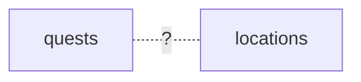
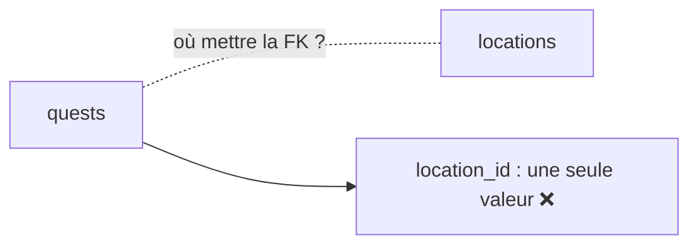
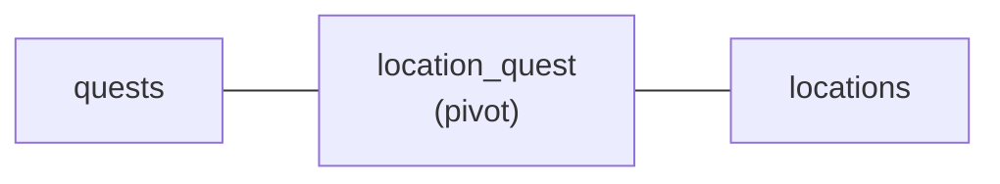
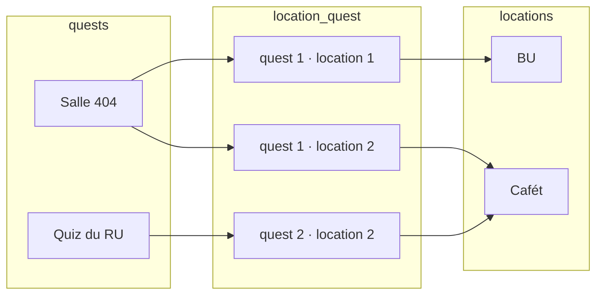

# Relation plusieurs-à-plusieurs

- Expliquer pourquoi une table pivot est nécessaire
- Écrire la migration de la pivot et déclarer `belongsToMany`
- Attacher, détacher et synchroniser les liens

<!--
Transition : une quête peut se dérouler dans PLUSIEURS lieux, et un lieu accueille plusieurs quêtes. La FK unique du chapitre précédent ne suffit plus.
Découpage (≈ 35 min) : 7 slides (≈ 12 min), livecoding pivot (≈ 10 min), micro-pratique WishFlix « Game ↔ Platform » (≈ 13 min).
Tag Campus Quest de fin de chapitre : s3-ch3-relation-nn.
Moment léger du chapitre : attach() deux fois du même couple → violation de clé primaire (voir notes de la slide attach).
-->

---
transition: slide-up | slide-down
---

# Plusieurs lieux par quête ?
Et vous, comment feriez-vous ?

<Quiz
  question="Une quête se déroule dans plusieurs lieux, et un lieu accueille plusieurs quêtes. Que faut-il ajouter à la base ?"
  :options="[
    'Une colonne location_id dans quests',
    'Une colonne quest_id dans locations',
    'Une troisième table qui liste les couples quête/lieu',
    'Une colonne location_ids dans quests, avec la liste des ids séparés par des virgules'
  ]"
  :answer="2"
/>

<!--
Pré-test : l'option 4 est tentante — c'est ce que font les gens qui n'ont jamais eu à retrouver « toutes les quêtes de la BU ».
Réponse : une table qui liste les couples.
Moment léger : la liste d'ids séparés par des virgules, c'est ranger ses chaussettes dans une seule chaussette. Ça tient. Jusqu'au premier tri.
-->

---
layout: two-cols-header
layoutClass: gap-x-6
transition: slide-up | slide-down
---

# Construire la table pivot
Ni `quests.location_id`, ni `locations.quest_id`

::left::

<Definition term="Pivot table" translation="(Table pivot)">

Une table **intermédiaire** : chaque ligne dit « la quête X se déroule au lieu Y ».

</Definition>

<v-click at="4">

<Analogy title="Comme le tableau des matchs" icon="🏟️">

Joueurs ↔ terrains d'un tournoi : aucun ne « contient » l'autre. Le tableau des matchs — une ligne par couple — c'est la pivot.

</Analogy>

</v-click>

::right::

<div class="relative h-72">

<div class="absolute inset-0" v-click.hide="1">



</div>

<div class="absolute inset-0" v-click="[1,2]">



</div>

<div class="absolute inset-0" v-click="[2,3]">



</div>

<div class="absolute inset-0" v-click="3">



</div>

</div>

<!--
Étapes du schéma : 1) le problème, 2) une FK ne stocke qu'une seule valeur, 3) on introduit la pivot, 4) chaque ligne de la pivot = un couple.
Le N-N se décompose toujours en deux 1-N pointant vers la pivot : la pivot porte DEUX clés étrangères. On reconnaît la mécanique du chapitre précédent.
Les v-click de l'Analogy (at=4) arrivent après les 3 clicks du schéma : la dernière révélation est donc au click 4.
Question probable : « pourquoi pas un tableau d'ids dans une colonne ? » → pas de contrainte, pas de requête, pas d'intégrité.
-->

---
layout: two-cols-header
layoutClass: gap-x-6
transition: slide-up | slide-down
---

# La migration de la pivot
Deux clés étrangères et une clé composite

::left::

```php {all|2-3|5|all}
Schema::create('location_quest', function (Blueprint $table) {
    $table->foreignId('location_id')->constrained();
    $table->foreignId('quest_id')->constrained();

    $table->primary(['location_id', 'quest_id']);
});
```

::right::

<div v-click="1">

Deux `foreignId` : chaque ligne relie une ligne de `locations` à une ligne de `quests`. Ni `id()` ni `timestamps()` : la pivot ne porte que le lien.

</div>

<div v-click="2">

`primary([...])` — clé primaire **composite** : le même couple ne peut pas exister deux fois.

</div>

<div v-click="3">

Convention de nom : les deux modèles au **singulier, par ordre alphabétique** → `location_quest` (location < quest).

</div>

<!--
Créée avec : sail artisan make:migration create_location_quest_table — après les migrations locations (chapitre 1) et quests (chapitre 2), sinon la contrainte échoue.
Une pivot peut gagner des colonnes (ex. unlocked_at) quand le lien porte de la donnée — pas nécessaire aujourd'hui.
Moment léger : si on la nomme quest_location « parce que c'est plus joli », Eloquent ne la trouvera pas. L'alphabet, seul juge.
Puis sail artisan migrate : migrate:status doit afficher la pivot au batch suivant.
-->

---
layout: two-cols-header
layoutClass: gap-x-6
transition: slide-up | slide-down
---

# belongsToMany
La relation, des deux côtés

::left::

```php
// app/Models/Quest.php
public function locations(): BelongsToMany
{
    return $this->belongsToMany(Location::class);
}

// app/Models/Location.php
public function quests(): BelongsToMany
{
    return $this->belongsToMany(Quest::class);
}
```

::right::

- `belongsToMany` des **deux côtés** : la relation est symétrique
- `$quest->locations` → une Collection de `Location`
- `$location->quests` → une Collection de `Quest`

<v-click>

Eloquent devine la pivot `location_quest` à partir des noms des deux modèles — la convention fait encore le travail.

</v-click>

<!--
En tête : use Illuminate\Database\Eloquent\Relations\BelongsToMany;
Si la convention n'est pas respectée, belongsToMany accepte le nom de la table en 2e argument — à éviter.
Comment il la devine ? Partie C de l'exercice : joiningTable.
-->

---
layout: two-cols-header
layoutClass: gap-x-6
transition: slide-up | slide-down
---

# attach, detach, sync
Écrire dans la pivot

::left::

<Terminal
  class="text-sm"
  title="tinker" prompt=">"
  :clicks="true"
  :lines="[
    { cmd: '$quest->locations()->attach(2)', out: '   = null   // couple inséré' },
    { cmd: '$quest->locations()->attach([1, 3])', out: '   = null   // deux lignes d\'un coup' },
    { cmd: '$quest->locations()->detach(2)', out: '   = 1      // une ligne supprimée' },
    { cmd: '$quest->locations()->sync([1, 3])', out: '   = […]    // la pivot vaut exactement [1, 3]' }
  ]"
/>

::right::

<div v-click="1">

`attach($id)` — **ajoute** un lien (le doublon est bloqué par la clé composite).

</div>

<div v-click="3">

`detach($id)` — **retire** un lien.

</div>

<div v-click="4">

`sync([ids])` — **remplace** tous les liens par exactement cette liste.

</div>

<div v-click="4">

On écrit dans la **relation** — `locations()` avec parenthèses — pas dans la propriété `$quest->locations`.

</div>

<!--
Clicks du Terminal : 1 attach, 2 attach multiple, 3 detach, 4 sync.
sync() est le couteau suisse : il ajoute ce qui manque et supprime ce qui est en trop — idéal pour les cases à cocher en S5.
Moment léger (erreur volontaire) : rejouer attach(2) deux fois. « Integrity constraint violation: Duplicate entry » : la clé composite vient de refuser que la Salle 404 se déroule deux fois à la BU. Elle ne peut pas être à deux endroits identiques en même temps.
Écrire en Tinker les liens préparatoires : $quest = Quest::first() ; Location::create(['name' => ...]) si besoin.
Micro-pratique WishFlix : Platform + pivot game_platform + belongsToMany + attach, vérifié dans Tinker.
-->

---
transition: slide-up | slide-down
---

# À vous : Game ↔ Platform

<Exercise title="WishFlix — étapes A3.1 à A3.3" duration="13 min" level="guidé"
  :criteria="[
    'Les migrations platforms et game_platform sont à Ran',
    'belongsToMany est déclaré des deux côtés (Game::platforms, Platform::games)',
    'attach() et sync() écrivent les liens en Tinker'
  ]">

Consignes : README de l'exercice `03-eloquent`, **Partie A, étapes A3**.

Transposez la démo sur WishFlix : le modèle `Platform`, la pivot `game_platform` (singulier, ordre alphabétique, clé composite), puis `belongsToMany` des deux côtés et quelques `attach` en Tinker.

</Exercise>

<!--
Point de contrôle 3. Palier de rattrapage : tag Campus Quest s3-ch3-relation-nn.
Nom de pivot le plus souvent raté : games_platform ou platform_game. Faire relire la convention (singulier + alphabétique) plutôt que donner la réponse.
-->
