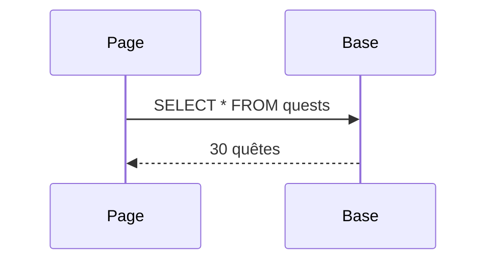
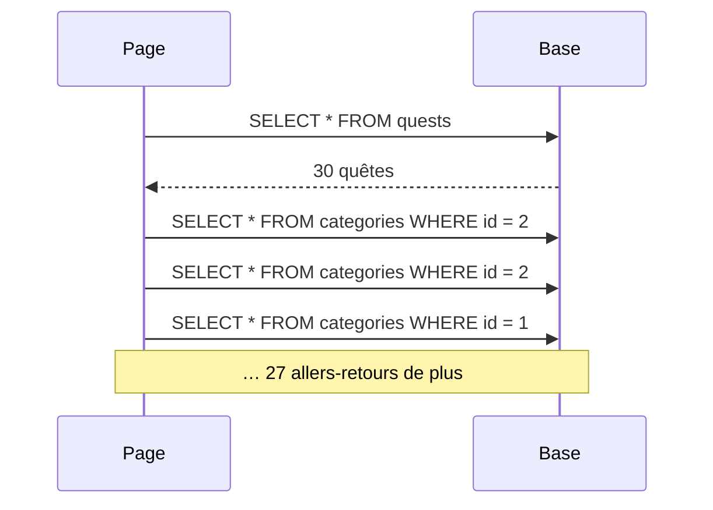

# Brancher le catalogue sur la base

- Remplacer le tableau PHP du contrôleur par Eloquent
- Adapter les vues : tableaux → objets, relations en boucle
- Constater à l'écran le piège N+1 (la solution est pour la séance 4)

<!--
Transition : la base est peuplée, les relations marchent en Tinker. Il reste à ce que les pages la lisent.
Découpage du chapitre (35 min) : slides ≈ 10 min, démo flash ≈ 4 min (moments : `/quests` lit la base, `/quests/999` → 404, N+1 constaté via `DB::enableQueryLog()`), micro-pratique WishFlix « le catalogue lit la base » ≈ 20 min.
Tag Campus Quest de fin de chapitre : s3-ch5-catalogue-n1.
Moment léger du chapitre : /quests/999 renvoie une 404 « gratuite », et la page qui affiche 30 quêtes envoie 31 requêtes — dont 30 pour se répéter.
-->

---
layout: two-cols-header
layoutClass: gap-x-6
transition: slide-up | slide-down
---

# Du tableau PHP à la base
Le contrôleur de la S2, branché sur Eloquent

::left::

````md magic-move
```php
class QuestController extends Controller
{
    private array $quests = [
        1 => ['title' => 'Salle 404', /* … */],
        // …
    ];

    public function index()
    {
        return view('quests.index',
            ['quests' => $this->quests]);
    }

    public function show(int $id)
    {
        abort_unless(isset($this->quests[$id]), 404);
        return view('quests.show',
            ['quest' => $this->quests[$id]]);
    }
}
```

```php
use App\Models\Quest;

class QuestController extends Controller
{
    public function index()
    {
        return view('quests.index',
            ['quests' => Quest::all()]);
    }

    public function show(int $id)
    {
        return view('quests.show',
            ['quest' => Quest::findOrFail($id)]);
    }
}
```
````

::right::

Le contrôleur de la S2, **branché sur la base**.

<div v-click="1">

- `Quest::all()` remplace le tableau : la vue reçoit une **Collection**, qui se boucle pareil
- `findOrFail($id)` remplace `abort_unless` : la **404** est levée toute seule si la quête n'existe pas

</div>

<!--
Compter les lignes : le contrôleur fond de moitié, et les données deviennent modifiables sans déployer.
find() renvoie null si absent (à vous de gérer) ; findOrFail() lance la 404 directement.
On se limite aujourd'hui aux opérations simples : where(), orderBy(), paginate() arrivent en S4.
Tester /quests/999 → 404 : moment léger, la page d'erreur personnalisée de la S2 resurgit sans qu'on y touche.
-->

---
layout: two-cols-header
layoutClass: gap-x-6
transition: slide-up | slide-down
---

# Adapter les vues
Les tableaux deviennent des objets

::left::

<Compare badLabel="❌ Tableau (S2)" goodLabel="✅ Objet Eloquent">
  <template #bad>

```blade
{{ $quest['title'] }}
{{ $quest['category'] }}
```

  </template>
  <template #good>

```blade
{{ $quest->title }}
{{ $quest->category->name }}
```

  </template>
</Compare>

::right::

```blade
<!-- quests/show.blade.php -->
@forelse ($quest->locations as $location)
    <li>{{ $location->name }}</li>
@empty
    <li>Aucun lieu rattaché.</li>
@endforelse
```

<v-click>

`$quest->locations` est une **Collection** : on la boucle comme n'importe quelle liste (`@forelse` gère le cas vide).

</v-click>

<!--
Le filtre ?difficulty= de la S2 disparaît à cette étape (where() = S4) : retirer les liens de filtre.
La relation en Blade : $quest->category->name = une jointure invisible.
Revenir sur /quests : la page affiche désormais les 30 quêtes seedées.
-->

---
transition: slide-up | slide-down
---

# Combien de requêtes ?
À votre avis ?

<Quiz
  question="La page /quests affiche 30 quêtes, chacune avec le nom de sa catégorie. Combien de requêtes SQL pensez-vous qu'elle exécute ?"
  :options="[
    '1',
    '2',
    '31',
    '60'
  ]"
  :answer="2"
/>

<!--
Faites voter la salle : la plupart répondent 1 ou 2. La slide suivante dévoile le vrai chiffre, mesuré en direct.
Moment léger : celui qui répond 60 a compris qu'il y aurait des allers-retours, il n'est pas loin.
-->

---
layout: two-cols-header
layoutClass: gap-x-6
transition: slide-up | slide-down
---

# N+1 : les allers-retours
Une requête pour la liste, une par ligne

::left::

```blade
@foreach ($quests as $quest)
    {{ $quest->title }} — {{ $quest->category->name }}
@endforeach
```

<v-click at="1">

Chaque `$quest->category` dans la boucle exécute **sa propre requête** : la propriété magique interroge la base à chaque ligne.

</v-click>

::right::

<div class="relative h-80">

<div class="absolute inset-0" v-click.hide="1">



</div>

<div class="absolute inset-0" v-click="1">



</div>

</div>

<!--
Avant le clic : la liste en 1 requête. Au clic : à chaque tour de boucle, Laravel va chercher la catégorie — même quand c'est la même (on voit deux fois « id = 2 »).
Analogie : le service des archives. Vous avez 30 dossiers à consulter : soit 30 allers-retours à la salle des archives (le N+1), soit un seul chariot chargé de tout.
Moment léger : compter les allers-retours à voix haute, « et un, et deux, et trois… » jusqu'à ce que la salle proteste.
-->

---
layout: two-cols-header
layoutClass: gap-x-6
transition: slide-up | slide-down
---

# N+1 : constaté à l'écran
Compter les requêtes dans Tinker

::left::

<Terminal
  title="tinker" prompt=">"
  :clicks="true"
  :lines="[
    { lang: 'php', cmd: 'DB::enableQueryLog()' },
    { lang: 'php', cmd: '$quests = Quest::all()' },
    { lang: 'php', cmd: '$quests->each(fn ($q) => $q->category->name)' },
    { lang: 'php', cmd: 'count(DB::getQueryLog())', out: '   = 31   // 1 + 30' }
  ]"
/>

::right::

30 quêtes → **31 requêtes** : 1 pour la liste, plus 1 par quête.

<v-click>

<Alert type="info">

Aujourd'hui : on **constate**. La **correction** et les outils de mesure arrivent en séance 4.

</Alert>

</v-click>

<!--
DB::enableQueryLog() + DB::getQueryLog() enregistrent chaque requête exécutée — en S4, la Debugbar fera la même chose en mieux, directement dans la page.
Le count (31) dépend du nombre de quêtes seedées : 30 dans la solution.
-->

---
layout: fact
transition: slide-up | slide-down
---

# Le coût grandit avec les données

<div class="grid grid-cols-3 gap-8">
  <Stat value="31" label="requêtes pour 30 quêtes" color="blue" />
  <Stat value="101" label="requêtes pour 100 quêtes" color="orange" />
  <Stat value="1 001" label="requêtes pour 1 000 quêtes" color="red" />
</div>

<!--
Le coût grandit avec les données, pas avec le code : la page ralentit insensiblement puis s'écroule. C'est pour ça que ce bug passe inaperçu en dev (3 lignes de test) et explose en production.
Teaser pour la séance 4, en une phrase : « Quest::with('category')->get() fait 2 requêtes au lieu de 31 — on le démonte la prochaine fois. » Ne PAS dérouler with() ici.
Moment léger : « Votre catalogue a 1 000 jeux ? Le serveur vous remercie de l'avoir fait attendre. »
Fin de séance : exercice WishFlix (Partie A déjà guidée par les points de contrôle).
-->

---
transition: slide-up | slide-down
---

# Panorama : les requêtes Eloquent

<script setup>
import queries from '/references/queries'
</script>

<Panorama :items="queries" doc="https://laravel.com/docs/12.x/queries" at="s3-ch5" />

<!--
Survol de 30 s, pas d'explication détaillée : montrer ce qui a été vu (badges « vu ») et où trouver le reste.
Pendant le « À vous », les apprenants peuvent revenir sur cette slide comme aide-mémoire.
-->

---
transition: slide-up | slide-down
---

# À vous : le catalogue lit la base

<Exercise title="WishFlix — étapes A5.1 à A5.3" duration="20 min" level="guidé"
  :criteria="[
    'GameController utilise Game::all() et findOrFail — plus aucun tableau PHP',
    '/ et /game/{id} affichent les jeux depuis la base ; /game/999 renvoie une 404',
    'Le N+1 est constaté en Tinker : 1 + le nombre de jeux requêtes'
  ]">

Consignes : README de l'exercice `03-eloquent`, **Partie A, étapes A5**.

Transposez la démo sur WishFlix : le contrôleur branché sur Eloquent, les vues passées en syntaxe objet avec `$game->category->name`, puis le N+1 mesuré sur votre propre catalogue.

**Spécificités WishFlix** : `Game::all()` renvoie une liste (clés 0, 1, 2…), plus le tableau indexé par id de la S2 — bouclez `@forelse ($games as $game)` et utilisez `route('games.show', $game->id)`. Vos routes et vues gardent leurs noms (`home`, `games.show`) et la contrainte `whereNumber` sur `{id}`.

</Exercise>

<!--
Point de contrôle 5 (fin de la Partie A, requis pour la S4 : le tableau PHP sera remplacé… non, il EST remplacé — en S4 on interroge cette base). Palier de rattrapage : tag Campus Quest s3-ch5-catalogue-n1.
Vérifier que chacun a bien supprimé la propriété $games : un oubli laisse un mélange tableau/base silencieux.
-->
