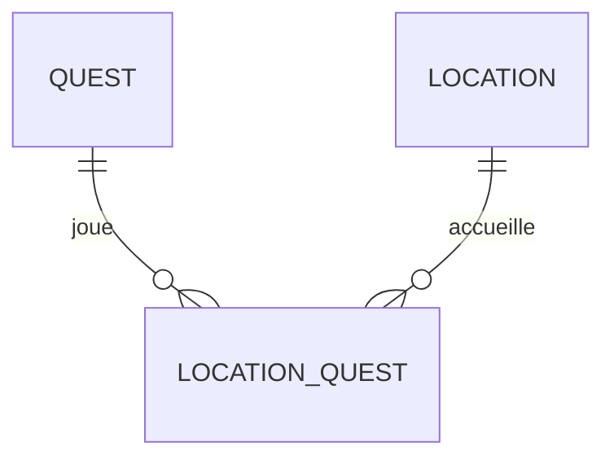

# Relations plusieurs-à-plusieurs

- Comprendre le rôle d'une table pivot
- Déclarer `belongsToMany` des deux côtés de la relation
- Attacher, détacher et synchroniser les liens

<!--
Transition : une quête peut avoir PLUSIEURS lieux — la FK unique du chapitre précédent ne suffit plus.
-->

---
layout: two-cols-header
layoutClass: gap-x-6
transition: slide-up | slide-down
---

# Relations plusieurs-à-plusieurs
Pourquoi une table pivot ?

Une quête se déroule dans **plusieurs lieux**, un lieu accueille **plusieurs quêtes** : ni `quests.location_id` ni `locations.quest_id` ne suffit — il faut une troisième table qui liste les **couples**.

::left::

<v-click>

<Analogy title="Comme le tableau des matchs" icon="🏟️">

Joueurs ↔ terrains d'un tournoi : aucun ne « contient » l'autre. Le tableau des matchs — une ligne par couple joueur/terrain — c'est la table pivot.

</Analogy>

</v-click>

::right::



<v-click>

`location_quest` — la table pivot : chaque ligne dit « la quête X se déroule au lieu Y ».

</v-click>

<!--
Question probable : "pourquoi pas un tableau d'ids dans une colonne ?" → pas de contrainte, pas de requête, pas d'intégrité.
Le N-N se décompose toujours en deux 1-N pointant vers la pivot — c'est ce que le diagramme montre.
-->

---
layout: two-cols-header
layoutClass: gap-x-6
transition: slide-up | slide-down
---

# Relations plusieurs-à-plusieurs
La migration de la table pivot

::left::

```php {all|2-3|5|all}
Schema::create('location_quest', function (Blueprint $table) {
    $table->foreignId('location_id')->constrained();
    $table->foreignId('quest_id')->constrained();

    $table->primary(['location_id', 'quest_id']);
});
```

::right::

<div v-click="1">

Deux `foreignId` : chaque ligne relie une ligne de `locations` à une ligne de `quests`. Ni `id()` ni `timestamps()` — la pivot ne porte que le lien.

</div>

<div v-click="2">

`primary([...])` — clé primaire **composite** : le même couple ne peut pas exister deux fois.

</div>

<div v-click="3">

Convention : le nom de la pivot = les deux modèles au **singulier, dans l'ordre alphabétique** → `location_quest` (location < quest). Eloquent la trouve seul via `belongsToMany`.

</div>

<!--
Créée avec : sail artisan make:migration create_location_quest_table — après les migrations locations et quests.
Une pivot peut gagner des colonnes (ex. unlocked_at) quand le lien porte de la donnée — pas nécessaire aujourd'hui.
-->

---
layout: two-cols-header
layoutClass: gap-x-6
transition: slide-up | slide-down
---

# Relations plusieurs-à-plusieurs
belongsToMany, des deux côtés

::left::

```php
// app/Models/Quest.php
public function locations(): BelongsToMany
{
    return $this->belongsToMany(Location::class);
}

// app/Models/Location.php
public function quests(): BelongsToMany
{
    return $this->belongsToMany(Quest::class);
}
```

::right::

- `belongsToMany` des **deux côtés** : la relation est symétrique
- `$quest->locations` → une Collection de `Location`
- `$location->quests` → une Collection de `Quest`

<v-click>

Eloquent devine la pivot `location_quest` à partir des noms des deux modèles — la convention fait encore le travail.

</v-click>

<!--
En tête : use Illuminate\Database\Eloquent\Relations\BelongsToMany;
Si la convention n'est pas respectée, belongsToMany accepte le nom de la table en 2e argument — à éviter.
-->

---
layout: two-cols-header
layoutClass: gap-x-6
transition: slide-up | slide-down
---

# Relations plusieurs-à-plusieurs
Attacher et détacher les liens

::left::

<Terminal
  title="bash" prompt="$"
  :lines="[
    { cmd: '$quest->locations()->attach(2)', out: '   = null   // couple inséré dans location_quest' },
    { cmd: '$quest->locations()->attach([1, 3])', out: '   = null   // deux lignes d\'un coup' },
    { cmd: '$quest->locations()->detach(2)', out: '   = 1      // une ligne pivot supprimée' },
    { cmd: '$quest->locations()->sync([1, 3])', out: '   = […]    // le pivot vaut exactement [1, 3]' }
  ]"
/>

::right::

- `attach($id)` — **ajoute** un lien (le doublon est bloqué par la clé composite)
- `detach($id)` — **retire** un lien
- `sync([ids])` — **remplace** tous les liens par exactement cette liste

<v-click>

On écrit dans la **relation** — `locations()` avec parenthèses — pas dans la propriété `$quest->locations`.

</v-click>

<!--
sync() est le couteau suisse : il ajoute ce qui manque et supprime ce qui est en trop — idéal pour les cases à cocher en S5.
attach() sur un couple existant lève une violation de clé primaire — à savoir si l'erreur apparaît.
-->

---
transition: slide-up | slide-down
---

# Relations plusieurs-à-plusieurs
Afficher les lieux d'une quête

```blade
<h2>{{ $quest->title }}</h2>
<p>Catégorie : {{ $quest->category->name }}</p>

<p>
    Lieux :
    @foreach ($quest->locations as $location)
        <span class="badge">{{ $location->name }}</span>
    @endforeach
</p>
```

<v-click>

`$quest->locations` est une **Collection** : elle se boucle comme n'importe quelle liste — `@foreach`, `->count()`, `$quest->locations->isEmpty()`…

</v-click>

<!--
La propriété exécute une jointure invisible : quests × location_quest × locations.
Même piège N+1 que pour category dans une liste de quêtes — on y revient en S4.
-->
