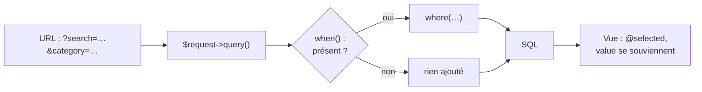

# Les filtres optionnels

- Lire les paramètres d'URL avec `Request::query()`
- Enchaîner les filtres avec `when()`
- Construire le formulaire GET qui « se souvient » de la saisie

<!--
Transition : le catalogue sait filtrer en SQL — il ne sait pas encore lire l'URL.
Aujourd'hui on branche : ?search= et ?category= deviennent des clauses WHERE.
Tag Campus Quest de fin de chapitre : s4-ch2-filtres-optionnels.
Moment léger : « le formulaire GET n'a pas de submit button caché, il a une URL » — la query string EST le formulaire.
Découpage : ≈ 10 min de slides (≈ 7 slides), démo flash ≈ 3 min — moments : `/quests?search=…&category=…`,
recherche + filtre combinés, version `->get()` ; micro-pratique ≈ 22 min (slide « À vous », étape A2 — filtre catégorie).
-->

---
transition: slide-up | slide-down
---

# À votre avis ?

<Quiz
  question="La requête `/quests` arrive SANS `?search=` dans l'URL. Que vaut cette ligne ?"
  :options="[
    'Une chaîne vide : le paramètre existe toujours, juste vide',
    '`null` : le paramètre est absent',
    '`0` : Laravel compte les paramètres manquants',
    'Une exception : le paramètre est requis'
  ]"
  :answer="1"
>

```php
$request->query('search');
```

</Quiz>

<!--
Réponse : null. C'est toute la logique des filtres optionnels : absent = pas de filtre,
présent = filtre — jamais de crash, jamais de where('title','like','%%') involontaire.
-->

---
layout: two-cols-header
layoutClass: gap-x-6
transition: slide-up | slide-down
---

# Lire l'URL : `Request::query()`

::left::

```php
// GET /quests?search=quiz&category=2
$request->query('search');    // "quiz"
$request->query('category');  // "2"  — une chaîne
$request->query('page');      // null — absent de l'URL
```

::right::

- `Request $request` est **injecté** par Laravel — pas de `new`, pas de `$_GET`
- `query('nom')` lit la <KeyTerm>query string</KeyTerm> : la partie de l'URL après le `?`
- Les paramètres arrivent en **chaînes** : `'2'`, pas `2` — la base s'en charge

<v-click>

Absent = `null` : c'est ce qui rendra chaque filtre **optionnel** — slide suivante.

</v-click>

<!--
Insister : query() = paramètres d'URL ; input() = champs de formulaire POST (S5 s'en servira).
Le nom du paramètre est un contrat : name="search" dans le formulaire ↔ query('search') dans le contrôleur.
-->

---
layout: two-cols-header
layoutClass: gap-x-6
transition: slide-up | slide-down
---

# `when()` : le filtre **optionnel**

::left::

````md magic-move
```php {3-5}
public function index(Request $request)
{
    $quests = Quest::query()
        ->orderByDesc('xp')
        ->get();

    return view('quests.index',
        ['quests' => $quests]);
}
```

```php {4-8}
public function index(Request $request)
{
    $quests = Quest::query()
        ->when(
            $request->query('search'),
            fn ($query, $search) =>
                $query->where('title', 'like', "%{$search}%")
        )
        ->orderByDesc('xp')
        ->get();

    return view('quests.index',
        ['quests' => $quests]);
}
```

```php {9-13}
public function index(Request $request)
{
    $quests = Quest::query()
        ->when(
            $request->query('search'),
            fn ($query, $search) =>
                $query->where('title', 'like', "%{$search}%")
        )
        ->when(
            $request->query('category'),
            fn ($query, $categoryId) =>
                $query->where('category_id', $categoryId)
        )
        ->orderByDesc('xp')
        ->get();

    return view('quests.index',
        ['quests' => $quests]);
}
```
````

::right::

Le catalogue, avant les filtres : toutes les quêtes, triées par XP.

<div v-click="1">

**Recherche** — `when($search, …)` n'exécute le `where` **que si `?search=` est présent** ; sinon la chaîne continue comme si de rien n'était.

</div>

<div v-click="2">

**Filtre catégorie** — un `when()` par filtre optionnel : `?search=quiz&category=2` cumule les deux, `?category=2` filtre sans chercher.

</div>

<!--
when() évite la cascade de if : la requête reste une seule chaîne lisible.
Le callback reçoit (la requête, la valeur) — la signature fn ($query, $search) mérite 10 secondes d'explication.
Lecture du when() dans le code du framework : Partie C de l'exercice (chez vous).
-->

---
layout: two-cols-header
layoutClass: gap-x-6
transition: slide-up | slide-down
---

# Le formulaire GET
Dans `quests/index.blade.php`, au-dessus de la liste

::left::

```blade
<form method="GET" action="{{ route('quests.index') }}">
    <input type="search" name="search"
           value="{{ request('search') }}"
           placeholder="Rechercher une quête…">

    <select name="category">
        <option value="">Toutes les catégories</option>
        @foreach ($categories as $category)
            <option value="{{ $category->id }}"
                @selected(request('category') == $category->id)>
                {{ $category->name }}
            </option>
        @endforeach
    </select>

    <button type="submit">Filtrer</button>
    <a href="{{ route('quests.index') }}">Réinitialiser</a>
</form>
```

::right::

<div v-click="1">

`method="GET"` : les champs voyagent dans **l'URL** — `?search=quiz&category=2` est visible, partageable, mettable en favori. C'est le bon verbe pour une **lecture** filtrée (cf. S5 pour le POST).

</div>

<div v-click="2">

Chaque `name` devient un paramètre : `name="search"` ↔ `query('search')`, `name="category"` ↔ `query('category')`.

</div>

<div v-click="3">

`value="{{ request('search') }}"` et `@selected(request('category') == $category->id)` : le formulaire **se souvient** de la saisie après envoi.

</div>

<!--
Un GET n'envoie pas de corps : tout est dans l'URL — d'où la règle « GET = sans effet de bord » (S5 la reprendra).
request() lit le paramètre courant dans la vue — pas besoin de le repasser depuis le contrôleur.
-->

---
layout: two-cols-header
layoutClass: gap-x-6
transition: slide-up | slide-down
---

# Les catégories viennent du contrôleur

::left::

```php {all|9-11|all}
public function index(Request $request)
{
    $quests = Quest::query()
        ->when($request->query('search'), /* … */)
        ->when($request->query('category'), /* … */)
        ->orderByDesc('xp')
        ->get();

    return view('quests.index', [
        'quests' => $quests,
        'categories' => Category::all(),   // pour le <select>
    ]);
}
```

::right::

- Le `<select>` des catégories a besoin de **la liste** — `Category::all()` est passée à la vue comme `quests`

<v-click>

Un `<select>` sans `value` dans une option enverrait le **texte** — ici `value="{{ $category->id }}"` envoie l'identifiant, que `where('category_id', …)` comprend.

</v-click>

<!--
Piège : oublier de passer $categories → « Undefined variable $categories » dans la vue.
La chaîne est complète : URL → query() → when() → where → SQL → vue qui se souvient.
-->

---
transition: slide-up | slide-down
---

# Le catalogue filtrable



<div v-click="1">

Chaque `when()` teste **son** paramètre : présent → le `where` s'ajoute ; absent → la chaîne continue sans lui — c'est la branche « non ».

</div>

<div v-click="2">

Tout se lit dans l'URL : `?search=quiz&category=2` est visible, partageable — le formulaire GET n'est qu'une écriture de la query string.

</div>

<div v-click="3">

La vue boucle sur le résultat **et** réaffiche la saisie (`@selected`, `value`) : la chaîne est bouclée.

</div>

<!--
La cartographie URL → clause SQL est complète : le catalogue filtre, cherche, trie.
Reste un problème silencieux : chaque carte lit category->name — direction les chapitres 03-04 (mesure, puis correction).
-->

---
transition: slide-up | slide-down
---

# Panorama : Blade

<script setup>
import blade from '/references/blade'
</script>

<Panorama :items="blade" doc="https://laravel.com/docs/12.x/blade" at="s4-ch2" />

<!--
Survol de 30 s : @selected est le seul nouveau badge du jour — le reste du Blade est déjà vu
(depuis la S2) — les formulaires POST arriveront en S5. L'annuaire complet reste sous les yeux.
-->

---
transition: slide-up | slide-down
---

# À vous : filtrer les jeux

<Exercise title="WishFlix — filtre par catégorie" duration="22 min" level="guidé"
  :criteria="[
    '/?category=<id> n\'affiche que les jeux de cette catégorie',
    '/ sans paramètre affiche tout le catalogue',
    'La catégorie choisie reste sélectionnée après filtrage',
    'Le formulaire de filtre est en GET et envoie category'
  ]"
  :hints="[
    'Injectez Request $request dans index() et passez categories à la vue',
    'Un when() par filtre : il n\'agit que si le paramètre est présent',
    'Le select reste sur la bonne option avec @selected(request(\'category\') == $category->id)',
    'L\'option « Toutes les catégories » envoie une chaîne vide : falsy, pas de filtre'
  ]">

**Exercice** `04-requetes` — étape **A2** du README (point de contrôle 1 avec A1).

Un `select` de catégories au-dessus de la grille, un `when()` dans la requête, `@selected` pour la mémoire.

**Spécificités WishFlix** : votre accueil est `GameController::index` + la vue `home` — les catégories passent par `Category::all()` (le `withCount` arrive au chapitre 05). Le `select` s'appelle `category` et envoie l'`id` en valeur : la règle `where('category_id', $id)` fait le pont entre le nom du paramètre et la colonne. **Pas de champ `search` pour l'instant** : la recherche par titre est une user story de la Partie B — votre formulaire ne contient que le `select`.

</Exercise>

<!--
Point de contrôle 1 du README (après A2, avec A1). Palier de rattrapage : tags Campus Quest
s4-ch1-filtrer-trier et s4-ch2-filtres-optionnels — relire les diffs, refaire sur WishFlix.
-->
