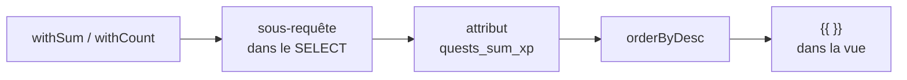

# Agrégats et classement

- Compter et sommer sans charger les lignes : `count`, `sum`, `avg`, `max`
- Construire le classement Campus Quest avec `withSum` / `withCount`

<!--
Transition : le fil du jour annonce une page Classement. Un classement, c'est
des agrégats triés — la base calcule, on récupère juste les chiffres.
Tag Campus Quest de fin de chapitre : s4-ch5-agregats.
Moment léger : « compter 30 lignes en PHP, c'est faire faire à PHP ce que MySQL fait en une passe ».
Découpage : ≈ 6 min de slides (≈ 5 slides), micro-pratique ≈ 12 min (slide « À vous », étape A5 —
compteur de jeux par catégorie dans le select) — démo 3 min inchangée ;
moments : agrégats en Tinker (count/sum/avg/max) puis page /classement.
-->

---
transition: slide-up | slide-down
---

# À votre avis ?

<Quiz
  question="Pour afficher « Action (5) » dans un select de catégories, la meilleure requête est…"
  :options="[
    '`Category::all()` puis un `foreach` PHP qui compte les jeux de chaque catégorie',
    '`Category::withCount(\'games\')` : une requête de plus, le compteur vient avec',
    '`Category::with(\'games\')->count()` : `with()` compte déjà les relations',
    'Un `Game::count()` par catégorie dans la boucle Blade'
  ]"
  :answer="1"
/>

<!--
Pré-test : withCount() est LA réponse — le compteur arrive dans games_count sans boucle.
Le piège with(\'games\')->count() : count() sur un modèle ignore le with et compte les catégories.
-->

---
layout: two-cols-header
layoutClass: gap-x-6
transition: slide-up | slide-down
---

# La base calcule, pas PHP

::left::

<Terminal
  title="tinker" prompt=">"
  :lines="[
    { cmd: 'Quest::count()', out: '   = 30' },
    { cmd: 'Quest::sum(\'xp\')', out: '   = 3 128' },
    { cmd: 'Quest::avg(\'xp\')', out: '   = 104.3' },
    { cmd: 'Quest::max(\'xp\')', out: '   = 198' }
  ]"
/>

::right::

- Ces méthodes génèrent `SELECT count(*)`, `sum(xp)`, `avg(xp)`, `max(xp)` — **un seul chiffre** revient
- La base fait le calcul : pas de Collection à parcourir en PHP

<v-click>

À ne pas confondre : `$quests->count()` sur une Collection déjà chargée compte **en PHP** — les lignes ont déjà voyagé pour rien.

</v-click>

<!--
Faire sentir le gaspillage : Quest::all()->count() ramène 30 lignes pour en compter 30 — Quest::count() ramène le chiffre 30.
-->

---
transition: slide-up | slide-down
---

# `withCount`, `withSum`, `withAvg`

Le comptage **sans charger la relation** — une sous-requête dans le SELECT :

| Écrire | Attribut créé sur chaque modèle |
|---|---|
| `Location::withCount('quests')` | `quests_count` |
| `Category::withSum('quests', 'xp')` | `quests_sum_xp` |
| `Category::withAvg('quests', 'xp')` | `quests_avg_xp` |
| `Category::withMax('quests', 'xp')` | `quests_max_xp` |

<v-click>

<KeyPoint variant="rule" title="Nommage" icon="📏">

L'attribut suit le moule `{relation}_{fonction}_{colonne}` — on lit ensuite `$category->quests_sum_xp` comme une colonne ordinaire.

</KeyPoint>

</v-click>

<!--
withCount est le cas de base — withSum, withAvg, withMax suivent le même principe : la sous-requête calcule, l'attribut transporte.
withSum : 2 arguments — la relation, puis la colonne à sommer.
-->

---
layout: two-cols-header
layoutClass: gap-x-6
transition: slide-up | slide-down
---

# La page Classement de Campus Quest

::left::

```php
// LeaderboardController
public function index()
{
    return view('leaderboard.index', [
        'categories' =>
            Category::withSum('quests', 'xp')
                ->orderByDesc('quests_sum_xp')
                ->get(),
        'locations' =>
            Location::withCount('quests')
                ->orderByDesc('quests_count')
                ->get(),
    ]);
}
```

::right::

```blade
{{-- podium des catégories --}}
{{ $category->name }}
— {{ $category->quests_sum_xp }} XP

{{-- lieux les plus chargés --}}
{{ $location->name }}
— {{ $location->quests_count }} quêtes
```

<v-click>

Route : `GET /classement` → `leaderboard.index` — **2 requêtes** pour tout le podium.

</v-click>

<!--
Le tri porte sur l'attribut calculé : orderByDesc('quests_sum_xp') — la base trie les catégories par leur total d'XP.
Le « classement de la promo » (XP par joueur) n'est PAS faisable aujourd'hui : il n'existe pas encore de table user ↔ quest —
le lien arrive en S6 avec l'authentification. On classe donc les catégories et les lieux : même mécanique, même code.
-->

---
transition: slide-up | slide-down
---

# Compter en base, afficher en Blade



<v-click>

<KeyPoint variant="tip" title="Le bon réflexe" icon="🧮">

Un classement, un compteur, une moyenne = **le calcul se fait en SQL**, l'attribut voyage dans le modèle, la vue l'affiche. Pas de boucle PHP pour additionner.

</KeyPoint>

</v-click>

<!--
La chaîne complète : sous-requête → attribut → tri → affichage. Chaque étape est une ligne — le résultat tient dans le contrôleur de 10 lignes.
-->

---
transition: slide-up | slide-down
---

# Panorama : les requêtes Eloquent

<script setup>
import queries from '/references/queries'
</script>

<Panorama :items="queries" doc="https://laravel.com/docs/12.x/queries" at="s4-ch5" />

<!--
Second passage sur le même panorama : les badges « vu » se sont déplacés — la moitié « Agréger »
(count, sum, avg) s'est allumée depuis le chapitre 1. withCount/withSum vivent dans le
Panorama des relations (chapitre 04).
-->

---
transition: slide-up | slide-down
---

# À vous : compter les jeux par catégorie

<Exercise title="WishFlix — le select affiche ses compteurs" duration="12 min" level="guidé"
  :criteria="[
    'Le select de catégories affiche « Action (5) » — nom + nombre de jeux entre parenthèses',
    'La requête des catégories utilise withCount(\'games\')',
    'Le filtre par catégorie fonctionne toujours après l\'ajout du compteur'
  ]"
  :hints="[
    'Remplacez Category::all() par Category::withCount(\'games\') dans index()',
    'Le compteur arrive dans $category->games_count — la relation games() existe déjà (S3)',
    '{{ $category->name }} ({{ $category->games_count }}) dans l\'option'
  ]">

**Exercice** `04-requetes` — étape **A5** du README.

Une ligne dans le contrôleur, une parenthèse dans la vue : le select filtre **et** informe.

**Spécificités WishFlix** : votre `Category` a déjà la relation `games()` (hasMany de la S3) — `withCount('games')` marche sans rien ajouter. Le `select` affiche déjà `name` : ajoutez juste `({{ $category->games_count }})` après le nom.

</Exercise>

<!--
Pas de point de contrôle dédié : il suit la pagination (chapitre 06, fin du socle).
Palier de rattrapage : tag Campus Quest s4-ch5-agregats.
-->
