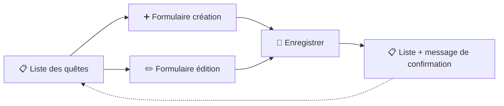

# Campus Quest
Le Maître du jeu prend la main

Jusqu'ici, les quêtes sont créées dans **Tinker** ou par les **seeders** — réservé à qui sait coder. Le Maître du jeu veut les gérer **depuis le navigateur**, sans toucher une ligne de PHP.

::left::

**Aujourd'hui, dans Campus Quest**

- Les quêtes existent en base — Eloquent sait les lire et les écrire
- Mais aucun écran ne permet de les créer, modifier ou supprimer
- Objectif : un vrai back-office des quêtes, **sécurisé**

::right::

<v-click>

Trois écrans, un aller-retour : **formulaire → enregistrement → redirection**.

</v-click>

::bottom::

> 🎯 Objectif : créer, éditer et supprimer des quêtes depuis le navigateur — avec des données **validées** et des formulaires **protégés**.

<!--
Faire réagir : et si le Maître du jeu voulait ajouter une quête demain matin ? Aujourd'hui il faudrait… ouvrir Tinker. Inacceptable.
Le schéma est le plan de la journée : le formulaire de création (ch. 1), sa protection CSRF (ch. 2), la validation (ch. 3),
l'édition et la suppression (ch. 4), Route::resource et le binding (ch. 5), les Form Requests (ch. 6),
puis la logique métier sortie du contrôleur, en annexe (services — lecture / bonus).
-->
