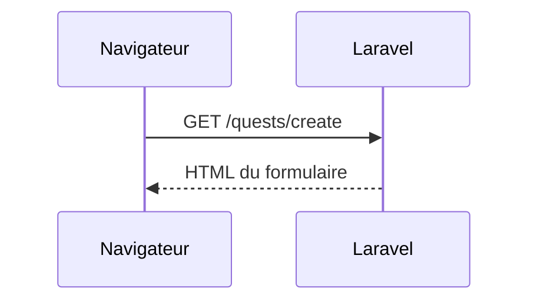
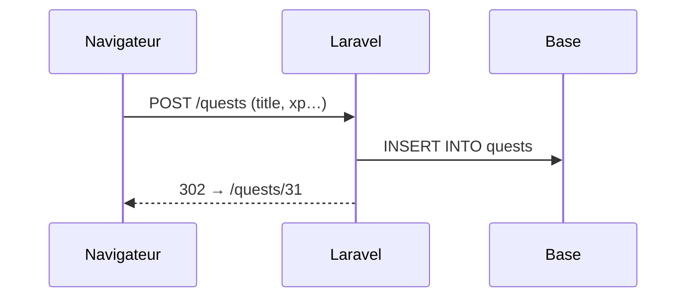

# Le formulaire de création

- Choisir entre GET et POST pour envoyer des données
- Afficher un formulaire avec une route GET
- Traiter l'envoi avec une route POST, puis rediriger

<!--
Transition : le Maître du jeu veut créer ses quêtes dans le navigateur. Première brique : le formulaire.
Moment léger (running gag Campus Quest) : « Hier, le Maître du jeu a voulu ajouter une quête… il a ouvert Tinker,
tapé Quest::create( et refermé le terminal en pleurant. » Aujourd'hui, on lui offre un vrai écran.
Tag Campus Quest de fin de chapitre : s5-ch1-formulaire.
Découpage : ≈ 12 min de slides (≈ 12 slides), démo flash ≈ 3 min — moment : envoyer le formulaire → **419** (le tag ch1 n'a pas `@csrf`) ; pas de micro-pratique ici, le « À vous » est au chapitre 02.
-->

---
transition: slide-up | slide-down
---

# À votre avis ?

<Quiz
  question="Campus Quest gagne deux formulaires : une recherche de quêtes et l'inscription d'une nouvelle quête. Lequel doit partir en POST ?"
  :options="[
    'Le formulaire de recherche : ses critères doivent rester cachés',
    'Le formulaire de création : il modifie les données du serveur',
    'Les deux : POST est toujours plus sécurisé que GET',
    'Aucun des deux : le choix GET/POST est purement cosmétique'
  ]"
  :answer="1"
/>

<!--
Faites voter : beaucoup répondent « POST = plus sécurisé » — non, POST n'est ni chiffré ni caché, il transporte juste
autrement. La slide suivante compare concrètement les deux méthodes.
-->

---
transition: slide-up | slide-down
---

# GET ou POST ?

| **Critère** | GET | POST |
|---|---|---|
| **Où voyagent les données** | Dans l'URL (`?difficulty=easy`) | Dans le corps de la requête, invisibles |
| **Marque-page / partage d'URL** | Oui, l'URL suffit | Non, les données ne sont pas dans l'URL |
| **Effet sur le serveur** | Lecture seule, sans effet de bord | Peut créer, modifier, supprimer |
| **Usage typique** | Recherche, filtres, navigation | Inscription, paiement, suppression |

Une recherche en GET peut être **enregistrée en favori** ou partagée ; une création en POST ne doit **jamais** être rejouée en rechargeant une URL.

<!--
POST n'est pas « plus sûr » : les données sont simplement dans le corps, lisibles dans les DevTools.
Le vrai critère : la requête modifie-t-elle quelque chose ? Oui → POST. Non → GET.
Lien avec S2 : le filtre ?difficulty=easy de la liste était un GET — logique, il ne modifie rien.
-->

---
layout: center
transition: slide-up | slide-down
---

# Un formulaire = deux requêtes

<div class="grid grid-cols-2 gap-8 mt-4">
<div>

**1. Afficher** — une route **GET**



</div>
<div v-click>

**2. Envoyer** — une route **POST**



</div>
</div>

<!--
Deux allers-retours distincts : on affiche (GET, sans effet), puis on envoie (POST, avec effet).
Le 302 de la fin est le sujet de la slide « Post/Redirect/Get » un peu plus loin.
-->

---
layout: two-cols-header
layoutClass: gap-x-6
transition: slide-up | slide-down
---

# Les routes et l'action `create()`

::left::

```php {all|2|3|5-11|all}
// routes/web.php
Route::get('/quests/create', [QuestController::class, 'create'])->name('quests.create');
Route::post('/quests', [QuestController::class, 'store'])->name('quests.store');

// app/Http/Controllers/QuestController.php
public function create()
{
    return view('quests.create', [
        'categories' => Category::all(),
    ]);
}
```

::right::

<div v-click="1">

Le **GET** affiche le formulaire. `/quests/create` n'est pas capturée par `/quests/{id}` : le `whereNumber('id')` de la S2 n'accepte que des chiffres.

</div>

<div v-click="2">

Le **POST** vise la **même URL que la liste** : c'est le verbe qui change l'action.

</div>

<div v-click="3">

`create()` passe `Category::all()` à la vue : le `<select>` des catégories en a besoin.

</div>

<div v-click="4">

Retenez : **une route GET pour afficher, une route POST pour traiter**.

</div>

<!--
N'oubliez pas l'import use App\Models\Category; en tête du contrôleur.
Un lien « Nouvelle quête » dans partials/nav.blade.php : route('quests.create').
-->

---
layout: two-cols-header
layoutClass: gap-x-6
transition: slide-up | slide-down
---

# Le formulaire Blade
`resources/views/quests/create.blade.php`

::left::

```blade {all|1|2-9|11-16|18-23|25|all}{maxHeight:'360px'}
<form method="POST" action="{{ route('quests.store') }}">
    <label for="title">Titre</label>
    <input id="title" name="title" type="text">

    <label for="description">Description</label>
    <textarea id="description" name="description"></textarea>

    <label for="xp">XP</label>
    <input id="xp" name="xp" type="number">

    <label for="difficulty">Difficulté</label>
    <select id="difficulty" name="difficulty">
        <option value="easy">Facile</option>
        <option value="medium">Moyenne</option>
        <option value="hard">Difficile</option>
    </select>

    <label for="category_id">Catégorie</label>
    <select id="category_id" name="category_id">
        @foreach ($categories as $category)
            <option value="{{ $category->id }}">{{ $category->name }}</option>
        @endforeach
    </select>

    <button type="submit">Créer la quête</button>
</form>
```

::right::

<div v-click="1">

`method="POST"` vers la **route nommée** `quests.store`.

</div>

<div v-click="2">

Chaque champ a un `name` : c'est la **clé** sous laquelle la saisie arrivera au serveur (`$request->input('title')`…).

</div>

<div v-click="3">

`<select>` difficulté : les **mêmes valeurs** que la `QuestFactory` — `easy`, `medium`, `hard`.

</div>

<div v-click="4">

`<select>` catégories : on boucle sur `$categories`, **fournie par le contrôleur** — `value` = l'`id`, le texte = le `name`.

</div>

<div v-click="5">

Le `<button type="submit">` envoie **tout le formulaire** en POST vers `quests.store`.

</div>

<div v-click="6">

Retenez : **`name` = clé, saisie = valeur** — le serveur reçoit un tableau associatif.

</div>

<!--
La vue complète étend le layout (@extends('layouts.app'), @section('content')) comme les vues de la S2.
Piège classique : oublier le name → le champ n'arrive jamais au serveur, sans erreur visible.
Les <label for> ne sont pas décoratifs : clic sur le libellé = focus dans le champ + accessibilité.
Volontairement, AUCUN @csrf ici : on le découvre à la fin du chapitre.
-->

---
layout: two-cols-header
layoutClass: gap-x-6
transition: slide-up | slide-down
---

# L'action `store()`

::left::

```php {all|3|5|7-9|all}
public function store(Request $request)
{
    $data = $request->only(['title', 'description', 'xp', 'difficulty', 'category_id']);

    $quest = Quest::create($data);

    return redirect()
        ->route('quests.show', $quest)
        ->with('success', 'Quête créée !');
}
```

::right::

<div v-click="1">

`Request` est **injecté** par Laravel ; `only()` ne garde que les champs attendus.

</div>

<div v-click="2">

`Quest::create()` insère la ligne — grâce au `$fillable` écrit en S3.

</div>

<div v-click="3">

`redirect()->route(...)` renvoie vers **la fiche de la nouvelle quête** ; `with()` y joint un message.

</div>

<div v-click="4">

Le cycle complet : **soumettre → insérer → rediriger**.

</div>

<!--
route('quests.show', $quest) : on passe le modèle, Laravel en extrait l'id pour construire /quests/31.
Question probable : « pourquoi pas return view() après la création ? » → c'est la slide suivante (PRG).
-->

---
transition: slide-up | slide-down
---

# Post/Redirect/Get

<Steps
  :clicks="true"
  :items="[
    { title: 'POST /quests', desc: 'Le formulaire envoie les saisies', icon: '📮' },
    { title: 'INSERT', desc: 'store() enregistre la quête en base' },
    { title: '302 Redirect', desc: 'Le serveur répond « va voir /quests/31 »', icon: '↩️' },
    { title: 'GET /quests/31', desc: 'Le navigateur affiche la fiche créée', icon: '✅' }
  ]"
/>

<v-click>

<Definition term="Post/Redirect/Get">

Le pattern <KeyTerm>PRG</KeyTerm> : après un POST réussi, on répond par une **redirection** vers une page en GET — jamais par la page elle-même.

</Definition>

</v-click>

<v-click>

Sans redirection, un **F5** renverrait le formulaire une seconde fois — et créerait un doublon. Avec la redirection, F5 ne recharge qu'un inoffensif GET.

</v-click>

<!--
C'est la réponse à « pourquoi redirect() et pas view() » : la dernière requête de l'historique devient un GET,
rafraîchir ou partager la page est alors sans danger.
-->

---
layout: two-cols-header
layoutClass: gap-x-6
transition: slide-up | slide-down
---

# Le message flash
Dans `layouts/app.blade.php`, commun à toutes les pages

::left::

```blade
{{-- resources/views/layouts/app.blade.php --}}
<main>
    @if (session('success'))
        <div class="flash">{{ session('success') }}</div>
    @endif

    @yield('content')
</main>
```

::right::

- `with('success', '…')` écrit en session une <KeyTerm>donnée flash</KeyTerm> : elle ne survit qu'à **une seule** requête
- `session('success')` la lit au prochain chargement — puis elle est oubliée : la bannière ne se répète pas à chaque page

<!--
Comparé à une session classique (panier, login) qui persiste, le flash s'auto-détruit après lecture.
On le verra fonctionner… dès que le formulaire passera. Slide suivante : premier essai.
-->

---
layout: center
transition: slide-up | slide-down
---

# Premier envoi…

<Browser url="localhost/quests" title="Campus Quest">
  <div class="flex flex-col items-center justify-center h-60 text-2xl tracking-widest opacity-70">
    419 | PAGE EXPIRED
  </div>
</Browser>

<v-click>

Le formulaire est correct, les routes existent, le contrôleur aussi. **Qui refuse votre requête ?**

</v-click>

<!--
Moment léger : jouez la surprise (« ça marchait chez moi ! »), faites lancer des hypothèses dans la salle.
« Page Expired » alors qu'on vient d'ouvrir la page : le message est trompeur, c'est voulu par Laravel.
Ne donnez pas la réponse : elle ouvre le chapitre suivant.
-->
