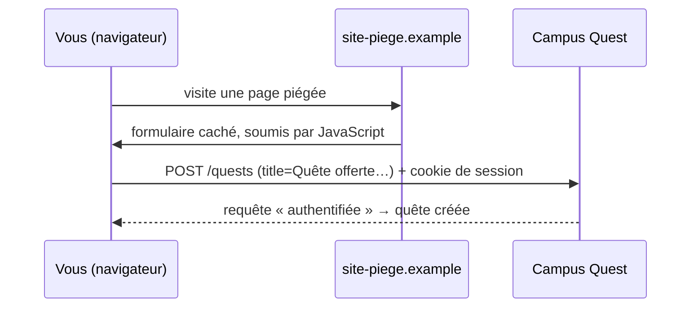

# Le jeton CSRF

- Décrire l'attaque par requête intersite forgée
- Expliquer le rôle du jeton `_token`
- Protéger chaque formulaire avec `@csrf`

<!--
Transition : un formulaire, ça s'écrit… mais aussi ça se détourne. Petit détour sécurité avant le CRUD complet.
-->

---
transition: slide-up | slide-down
---

# À votre avis ?

<Quiz
  question="Un site piégé contient un formulaire caché, auto-soumis, qui poste vers campus-quest.test/quests avec title = « Quête offerte ». Vous êtes connecté·e à Campus Quest. Sans protection, que se passe-t-il ?"
  :options="[
    'Rien : le navigateur refuse d\'envoyer un formulaire vers un autre site',
    'Une quête spam est créée : la requête part avec votre session, le serveur ne voit pas la différence',
    'Rien : seul un clic volontaire peut soumettre un formulaire',
    'Le site piégé récupère votre mot de passe en échange'
  ]"
  :answer="1"
/>

<!--
Faites voter : beaucoup croient que le navigateur bloque — non : il attache vos cookies à TOUTE requête
vers campus-quest.test, d'où qu'elle vienne. La slide suivante rejoue l'attaque pas à pas.
On reste en POST simple vers store() : _method=DELETE n'est vu qu'au chapitre 3.
-->

---
layout: two-cols-header
layoutClass: gap-x-6
transition: slide-up | slide-down
---

# L'attaque, pas à pas

::left::



::right::

<Definition term="CSRF" translation="(Cross-Site Request Forgery)">

Un site tiers fait émettre par **votre** navigateur une requête authentifiée que vous n'avez jamais voulue.

</Definition>

<v-click>

<Analogy title="Comme un badge présenté automatiquement" icon="🪪">

À chaque visite, votre navigateur présente votre **badge** (le cookie de session) — y compris quand la demande part d'un formulaire caché d'un autre site. Le portier (le serveur) ne sait pas qui a demandé.

</Analogy>

</v-click>

<!--
Le cookie est envoyé par le navigateur pour TOUTE requête vers le domaine — c'est le principe même des cookies.
La parade : exiger une info que le site piégé ne peut PAS connaître — le jeton, slide suivante.
-->

---
layout: two-cols-header
layoutClass: gap-x-6
transition: slide-up | slide-down
---

# Le jeton `_token`

::left::

```blade
<form method="POST" action="{{ route('quests.store') }}">
    @csrf
    {{-- compilé en : --}}
    <input type="hidden" name="_token" value="aBc9X…">
    {{-- … vos champs --}}
</form>
```

::right::

- Laravel génère un **jeton aléatoire** par session et le stocke côté serveur — `@csrf` l'affiche dans chaque formulaire
- Le middleware `ValidateCsrfToken` **compare** le `_token` reçu au jeton de session : identiques → la requête passe
- Jeton **absent ou faux** → erreur **419 « Page Expired »**, la requête est jetée

<v-click>

Le site piégé ne connaît pas votre jeton — impossible de forger une requête qui passe.

</v-click>

<!--
ValidateCsrfToken (Illuminate\Foundation\Http\Middleware\ValidateCsrfToken) est dans le groupe de middlewares
web, actif par défaut : aucune configuration à faire.
Le jeton change à chaque régénération de session — il ne peut ni se deviner ni se réutiliser.
-->

---
transition: slide-up | slide-down
---

# `@csrf` partout, tout le temps

<Compare badLabel="❌ Sans @csrf" goodLabel="✅ Avec @csrf">
  <template #bad>

```blade
<form method="POST" action="/quests">
    {{-- champs… --}}
</form>
```

→ erreur **419 « Page Expired »** au premier envoi

  </template>
  <template #good>

```blade
<form method="POST" action="/quests">
    @csrf
    {{-- champs… --}}
</form>
```

→ le jeton accompagne la requête, le formulaire passe

  </template>
</Compare>

<v-click>

<KeyPoint variant="rule" title="Règle d'or" icon="📏">

Tout formulaire **POST, PUT, PATCH ou DELETE** contient `@csrf` — un oubli = un 419 pour vous, une faille pour le site.

</KeyPoint>

</v-click>

<!--
Le 419 en dev est le signal d'un @csrf oublié — c'est même rassurant : la protection fonctionne.
Périmètre : le CSRF protège les formulaires « session + cookie ». XSS, authentification et autorisation = séance 6.
-->
