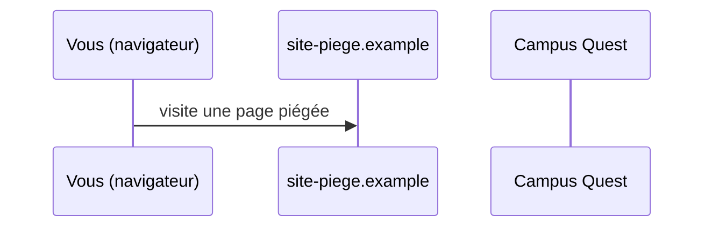
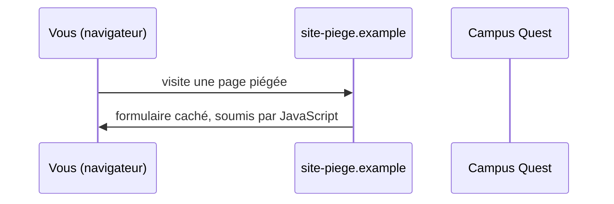
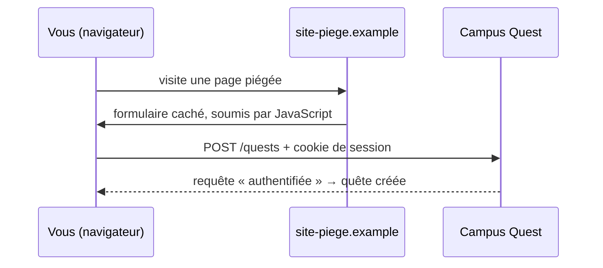

# Le jeton CSRF

- Comprendre l'erreur 419 du chapitre précédent
- Décrire l'attaque par requête intersite forgée
- Protéger chaque formulaire avec `@csrf`

<!--
Transition : le 419 n'est pas un bug, c'est une protection. Pour la comprendre, il faut voir l'attaque qu'elle bloque.
Découpage : ≈ 6 min de slides (≈ 6 slides), démo flash ≈ 2 min — moments : ajouter `@csrf`, le 419 disparaît, `_token` visible dans les DevTools ; micro-pratique ≈ 20 min (slide « À vous », étapes A1-A2 du README).
Moment léger : « 419, c'est le code HTTP de l'oubli » — laisser un @csrf manquant volontairement dans un second formulaire, puis le retrouver ensemble.
Tag Campus Quest de fin de chapitre : s5-ch2-csrf.
-->

---
transition: slide-up | slide-down
---

# À votre avis ?

<Quiz
  question="Un site piégé contient un formulaire caché, auto-soumis, qui poste vers `campus-quest.test/quests` avec `title` = « Quête offerte ». Vous êtes connecté·e à Campus Quest. Sans protection, que se passe-t-il ?"
  :options="[
    'Rien : le navigateur refuse d\'envoyer un formulaire vers un autre site',
    'Une quête spam est créée : la requête part avec votre session, le serveur ne voit pas la différence',
    'Rien : seul un clic volontaire peut soumettre un formulaire',
    'Le site piégé récupère votre mot de passe en échange'
  ]"
  :answer="1"
/>

<!--
Faites voter : beaucoup croient que le navigateur bloque — non : il attache vos cookies à TOUTE requête
vers campus-quest.test, d'où qu'elle vienne. La slide suivante rejoue l'attaque pas à pas.
-->

---
layout: two-cols-header
layoutClass: gap-x-6
transition: slide-up | slide-down
---

# L'attaque, pas à pas

::left::

<v-switch>
<template #0>



</template>
<template #1>



</template>
<template #2>



</template>
</v-switch>

::right::

<Definition term="CSRF" translation="(Cross-Site Request Forgery)">

Un site tiers fait émettre par **votre** navigateur une requête authentifiée que vous n'avez jamais voulue.

</Definition>

<div v-click="3">

<Analogy title="Comme un badge présenté automatiquement" icon="🪪">

À chaque visite, votre navigateur présente votre **badge** (le cookie de session) — y compris quand la demande part d'un formulaire caché d'un autre site. Le portier (le serveur) ne sait pas qui a demandé.

</Analogy>

</div>

<!--
Le cookie est envoyé par le navigateur pour TOUTE requête vers le domaine — c'est le principe même des cookies.
La parade : exiger une info que le site piégé ne peut PAS connaître — le jeton, slide suivante.
-->

---
layout: two-cols-header
layoutClass: gap-x-6
transition: slide-up | slide-down
---

# Le jeton `_token`

::left::

```blade {all|2|3-4|all}
<form method="POST" action="{{ route('quests.store') }}">
    @csrf
    {{-- compilé en : --}}
    <input type="hidden" name="_token" value="aBc9X…">
    {{-- … vos champs --}}
</form>
```

::right::

<div v-click="1">

`@csrf` : **une ligne** à ajouter juste après la balise `<form>`.

</div>

<div v-click="2">

Blade la compile en champ caché `_token`, qui contient un **jeton aléatoire** propre à votre session.

</div>

<div v-click="3">

Le middleware `ValidateCsrfToken` **compare** le `_token` reçu au jeton de session : identiques → la requête passe. Absent ou faux → **419**. Le site piégé ne connaît pas votre jeton : impossible de forger une requête qui passe.

</div>

<!--
Démo : ajouter @csrf dans create.blade.php, recharger, renvoyer → la quête est créée, redirection vers la fiche,
bannière « Quête créée ! ». Ouvrir DevTools > Éléments : montrer l'input caché _token.
ValidateCsrfToken (Illuminate\Foundation\Http\Middleware\ValidateCsrfToken) est dans le groupe de middlewares
web, actif par défaut : aucune configuration à faire. Les GET ne sont pas vérifiés (lecture seule).
-->

---
transition: slide-up | slide-down
---

# `@csrf` partout, tout le temps

<Compare badLabel="❌ Sans @csrf" goodLabel="✅ Avec @csrf">
  <template #bad>

```blade
<form method="POST" action="/quests">
    {{-- champs… --}}
</form>
```

→ erreur **419 « Page Expired »** au premier envoi

  </template>
  <template #good>

```blade
<form method="POST" action="/quests">
    @csrf
    {{-- champs… --}}
</form>
```

→ le jeton accompagne la requête, le formulaire passe

  </template>
</Compare>

<v-click>

<KeyPoint variant="rule" title="Règle d'or" icon="📏">

Tout formulaire **POST** contient `@csrf` — un oubli = un 419 pour vous, une faille pour le site.

</KeyPoint>

</v-click>

<!--
Le 419 en dev est le signal d'un @csrf oublié — c'est même rassurant : la protection fonctionne.
Moment léger : « 419, c'est le code HTTP de l'oubli. Vous allez le croiser souvent, et c'est très bien. »
Périmètre : le CSRF protège les formulaires « session + cookie ». XSS, authentification et autorisation = séance 6.
-->

---
transition: slide-up | slide-down
---

# À vous : créer un jeu

<Exercise title="WishFlix — formulaire de création d'un jeu" duration="20 min" level="guidé"
  :criteria="[
    '/games/create affiche un formulaire avec tous les champs du jeu et le select des catégories',
    'L\'envoi crée le jeu puis redirige vers sa fiche /game/{id}',
    'Un message flash « Jeu créé » s\'affiche une seule fois'
  ]"
  :hints="[
    'Deux routes : un GET pour afficher, un POST pour traiter',
    'Un 419 ? Il manque @csrf sous la balise form',
    'Le chapitre 01 donne l\'ordre : routes → create() → vue → store() → flash dans le layout'
  ]">

**Exercice** `05-formulaires-validation` — étapes **A1 à A2** du README.

Transposez la démo sur les **jeux** WishFlix : formulaire, `@csrf`, enregistrement, redirection.

**Spécificités WishFlix** : votre formulaire a plus de champs que la démo — des cases `platform_ids[]` et `featured` (la saisie arrive en **tableau**) et le `select` des catégories. `Game::create()` ne reçoit que les colonnes du modèle ; les plateformes se rattachent par `platforms()->sync(...)`, mécanique `belongsToMany` déjà vue en S3.

</Exercise>

<!--
Pas encore de point de contrôle : il tombe après la validation (chapitre 03). Palier de rattrapage : tag Campus Quest s5-ch2-csrf (relire le diff, refaire sur WishFlix).
Les champs « simples » du formulaire sont fournis dans le README pour ne pas perdre de temps à taper du HTML.
-->
