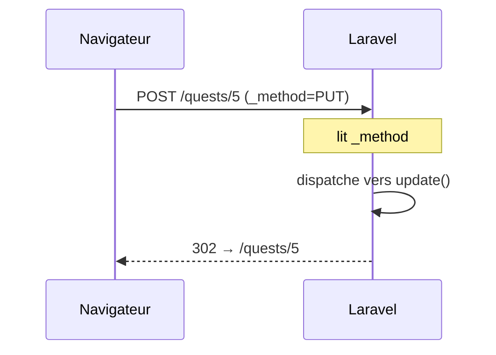

# Éditer et supprimer

- Écrire à la main les routes d'édition et de suppression
- Faire passer un `PUT` et un `DELETE` dans un formulaire HTML
- Supprimer sans casser les relations

<!--
Transition : créer, c'est fait. Le Maître du jeu veut aussi corriger une faute dans une quête, et en supprimer une.
Ce chapitre est volontairement « à la main » : on écrit chaque route et chaque findOrFail, pour sentir la répétition.
Elle est le problème que le chapitre 05 résout.
Découpage : ≈ 13 min de slides (≈ 13 slides), démo flash ≈ 4 min — moments : `_method=PUT` visible dans le source HTML, suppression sans `detach()` → 500 (clé étrangère pivot), puis avec ; micro-pratique ≈ 22 min (slide « À vous », étape A4).
Moment léger : supprimer en direct « la quête du café gratuit » — et découvrir une erreur 500 (voir slide destroy).
Tag Campus Quest de fin de chapitre : s5-ch4-edition.
-->

---
transition: slide-up | slide-down
---

# À votre avis ?

<Quiz
  question="Vous écrivez ce formulaire pour modifier une quête. Que fait le navigateur à l'envoi ?"
  :options="[
    'Il envoie une requête PUT, comme demandé',
    'Il refuse d\'envoyer le formulaire et affiche une erreur',
    'Il envoie un GET : la valeur de `method` est ignorée, et vos champs partent dans l\'URL',
    'Il envoie un POST, par défaut pour toute méthode inconnue'
  ]"
  :answer="2"
>

```html
<form method="PUT" action="/quests/5">
```

</Quiz>

<!--
Piège : un formulaire HTML ne connaît que GET et POST. Toute autre valeur de method retombe sur GET (valeur par défaut).
Résultat : la quête n'est pas modifiée et les champs apparaissent dans l'URL. La slide « Method spoofing » donne la parade.
-->

---
layout: two-cols-header
layoutClass: gap-x-6
transition: slide-up | slide-down
---

# Les routes, écrites à la main

::left::

```php {all|2|3|4|all}
// routes/web.php
Route::get('/quests/{id}/edit', [QuestController::class, 'edit'])->name('quests.edit');
Route::put('/quests/{id}', [QuestController::class, 'update'])->name('quests.update');
Route::delete('/quests/{id}', [QuestController::class, 'destroy'])->name('quests.destroy');
```

::right::

<div v-click="1">

Un **GET** affiche le formulaire pré-rempli : `/quests/5/edit`.

</div>

<div v-click="2">

Un **PUT** enregistre : même URL que la fiche (`/quests/{id}`) — c'est le **verbe** qui change l'action.

</div>

<div v-click="3">

Un **DELETE** supprime : encore la même URL. `edit`, `update`, `destroy` — trois routes de plus à tenir à jour.

</div>

<!--
Ajouter aussi dans le contrôleur les trois méthodes (vides pour l'instant) : edit(int $id), update(Request $request, int $id), destroy(int $id).
Rappel S2 : le verbe fait partie de la route — la même URI peut porter plusieurs verbes.
-->

---
layout: two-cols-header
layoutClass: gap-x-6
transition: slide-up | slide-down
---

# Le formulaire d'édition
`resources/views/quests/edit.blade.php`

::left::

```blade {all|1|2-3|5-6|8-9|all}
<form method="POST" action="{{ route('quests.update', $quest->id) }}">
    @csrf
    @method('PUT')

    <label for="title">Titre</label>
    <input id="title" name="title" type="text" value="{{ old('title', $quest->title) }}">
    {{-- description, xp, difficulty, category_id : mêmes champs, pré-remplis --}}

    <button type="submit">Enregistrer les modifications</button>
</form>
```

::right::

<div v-click="1">

Le `method` reste **`POST`** : c'est le seul verbe d'écriture qu'un formulaire HTML sait envoyer.

</div>

<div v-click="2">

`@csrf` **et** `@method('PUT')` : le jeton protège la requête, `@method` ajoute un champ caché `_method`.

</div>

<div v-click="3">

Chaque champ est **pré-rempli** : `old('title', $quest->title)` — la saisie ratée si elle existe, sinon la valeur actuelle de la quête.

</div>

<div v-click="4">

Pour un `<select>` : `@selected(old('difficulty', $quest->difficulty) === 'easy')` — même idée, valeur actuelle en **repli**.

</div>

<!--
edit() charge la quête et la passe à la vue : $quest = Quest::findOrFail($id); return view('quests.edit', ['quest' => $quest, 'categories' => Category::all()]).
Duplication create/edit : les champs sont identiques — le partial @include('quests._form') est une amélioration possible, pas indispensable ici.
-->

---
layout: two-cols-header
layoutClass: gap-x-6
transition: slide-up | slide-down
---

# Method spoofing : un PUT dans un POST

::left::



::right::

<div v-click="1">

Au submit, le navigateur envoie un **POST** `/quests/5` avec le champ caché `_method=PUT`.

</div>

<div v-click="2">

Laravel lit `_method` et **route la requête comme un PUT** : c'est `update()` qui s'exécute.

</div>

<div v-click="3">

<Definition term="Method spoofing" translation="(Usurpation de méthode)">

Le champ caché `_method` fait passer un PUT, PATCH ou DELETE **dans** un POST — seule façon pour un formulaire HTML.

</Definition>

</div>

<!--
@method('PUT') se compile en <input type="hidden" name="_method" value="PUT">. C'est ce champ, pas le verbe réel, qui décide de la route.
Depuis JavaScript (fetch), on pourrait envoyer un vrai PUT : c'est l'objet de la S7.
-->

---
layout: two-cols-header
layoutClass: gap-x-6
transition: slide-up | slide-down
---

# `edit()` et `update()`

::left::

```php {all|1-5|7-17|all}
public function edit(int $id)
{
    $quest = Quest::findOrFail($id);
    return view('quests.edit', ['quest' => $quest, 'categories' => Category::all()]);
}

public function update(Request $request, int $id)
{
    $quest = Quest::findOrFail($id);
    $validated = $request->validate([
        'title' => ['required', 'string', 'max:100'],
        'description' => ['required', 'string'],
        'xp' => ['required', 'integer', 'min:0', 'max:500'],
        'difficulty' => ['required', Rule::in(['easy', 'medium', 'hard'])],
        'category_id' => ['required', 'exists:categories,id'],
    ]);
    $quest->update($validated);
    return redirect()->route('quests.show', $quest)->with('success', 'Quête mise à jour !');
}
```

::right::

<div v-click="1">

`edit()` — un `findOrFail`, puis la vue avec la quête et les catégories.

</div>

<div v-click="2">

`update()` — un `findOrFail` **de plus**, les cinq règles **recopiées** de `store()`, puis `$quest->update($validated)` et une redirection avec message.

</div>

<div v-click="3">

Notez la **répétition** : `findOrFail` et les règles reviennent encore. Gardez ça en tête, deux chapitres la font disparaître.

</div>

<!--
Même squelette que store() : valider → toucher le modèle → redirect()->route(...)->with(...).
Import de Rule et de Category en tête du contrôleur.
Demander à la salle de compter les findOrFail : show, edit, update, destroy — quatre. Et les règles : deux copies.
-->

---
layout: two-cols-header
layoutClass: gap-x-6
transition: slide-up | slide-down
---

# `destroy()` et la clé étrangère

::left::

```php {all|3|4|all}
public function destroy(int $id)
{
    $quest = Quest::findOrFail($id);
    $quest->locations()->detach();
    $quest->delete();

    return redirect()->route('quests.index')->with('success', 'Quête supprimée !');
}
```

::right::

<div v-click="1">

On charge la quête, **comme partout**.

</div>

<div v-click="2">

Sans `detach()`, une quête qui a des lieux fait une **erreur 500** : la table pivot `location_quest` la référence encore — la clé étrangère (S3) refuse la suppression.

</div>

<div v-click="3">

`delete()` supprime la ligne, puis on revient à la liste — toujours en **PRG**.

</div>

<!--
Faire l'erreur en direct : supprimer d'abord SANS detach() → Integrity constraint violation (FOREIGN KEY constraint failed). Laisser deviner, puis ajouter detach().
Alternative en base : ->cascadeOnDelete() dans la migration pivot — choix de schéma, hors périmètre ici.
-->

---
transition: slide-up | slide-down
---

# Supprimer : un formulaire, pas un lien
Le bouton « Supprimer » sur la fiche de chaque quête

<Compare badLabel="❌ Un lien GET" goodLabel="✅ Un formulaire DELETE">
  <template #bad>

```blade
<a href="/quests/5/delete">Supprimer</a>
```

Un **GET destructeur** : déclenché par un prefetch ou un aspirateur de liens — et forgeable depuis n'importe quel site piégé.

  </template>
  <template #good>

```blade
<form method="POST" action="{{ route('quests.destroy', $quest->id) }}">
    @csrf
    @method('DELETE')
    <button type="submit">Supprimer</button>
</form>
```

Verbe **DELETE** + jeton **CSRF** : seule la page qui affiche le formulaire peut supprimer.

  </template>
</Compare>

<!--
Faire le lien avec le chapitre 02 : le lien GET ne peut même pas porter de jeton — il serait à la fois
dangereux ET sans protection. Le formulaire DELETE coche les deux cases : bon verbe, jeton inclus.
Anecdote : les aspirateurs hors-ligne et les prefetch de navigateurs ont déjà vidé des bases via des liens « delete ».
-->

---
transition: slide-up | slide-down
---

# Panorama : Blade

<script setup>
import blade from '/references/blade'
</script>

<Panorama :items="blade" doc="https://laravel.com/docs/12.x/blade" at="s5-ch4" />

<!--
Survol de 30 s, pas d'explication détaillée : montrer ce qui a été vu (badges « vu ») et où trouver le reste.
Pendant le « À vous », les apprenants peuvent revenir sur cette slide comme aide-mémoire.
-->

---
transition: slide-up | slide-down
---

# À vous : éditer et supprimer un jeu

<Exercise title="WishFlix — modifier et supprimer un jeu" duration="22 min" level="guidé"
  :criteria="[
    'GET /games/{id}/edit affiche le formulaire pré-rempli du jeu',
    'PUT /games/{id} enregistre les modifications avec les mêmes règles que la création',
    'Un titre invalide ramène au formulaire avec ses erreurs',
    'Un bouton Supprimer (formulaire DELETE + @csrf) retire le jeu, même s\'il a des plateformes'
  ]"
  :hints="[
    'Trois routes à la main : un GET, un PUT, un DELETE — et @method dans les formulaires',
    'Une erreur 500 à la suppression ? Pensez à la table pivot game_platform',
    'Valeur actuelle en repli : old(\'title\', $game->title)'
  ]">

**Exercice** `05-formulaires-validation` — étape **A4** du README.

Ajoutez l'édition et la suppression à vos **jeux**, avec des routes écrites une par une.

**Spécificités WishFlix** : à l'édition, pré-cochez les plateformes du jeu via `$game->platforms->pluck('id')` et `@checked` — la directive n'est pas dans la démo (seul `@selected` l'est). `update()` synchronise les plateformes (`sync()`) et `destroy()` les détache (`platforms()->detach()`) avant `delete()` : la pivot `game_platform` refuse la suppression sinon.

</Exercise>

<!--
Pas de point de contrôle ici : il tombe après le chapitre 05 (Route::resource). Palier de rattrapage : tag Campus Quest s5-ch4-edition.
-->
