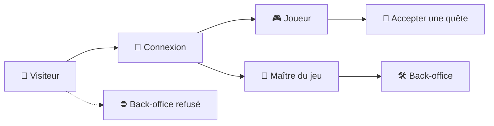

# Campus Quest
N'importe qui est Maître du jeu

Le back-office de la S5 fonctionne… pour **tout le monde**. Un visiteur anonyme peut créer, modifier ou supprimer toutes les quêtes.

::left::

**Aujourd'hui, dans Campus Quest**

- Les joueurs **se connectent** avec un compte
- Seul le **Maître du jeu** accède au back-office
- Chaque joueur **accepte** ses quêtes
- Deux attaques testées puis bloquées : **XSS**, **injection SQL**

::right::

<v-click>

Une même porte d'entrée, **deux niveaux de droits**.

</v-click>

::bottom::

> 🎯 Objectif : savoir **qui** visite Campus Quest, décider **ce qu'il a le droit de faire**, et fermer les deux failles les plus courantes du web.

<!--
Faire réagir : « Hier soir, quelqu'un a supprimé les 30 quêtes. Qui ? Impossible à dire : le site ne sait pas qui le visite. »
Le schéma est le plan de la journée : Breeze et la connexion (ch. 01-02), le mot de passe haché (ch. 03),
le middleware auth (ch. 04), le rôle Maître du jeu (ch. 05), les quêtes de chaque joueur (ch. 06),
puis les deux attaques : XSS (ch. 07) et injection SQL (ch. 08).
Rappel : le CSRF a été vu en S5 — on ne le refait pas, mais le chapitre 07 montre qu'une faille XSS le contourne.
-->
