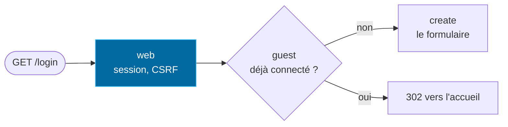
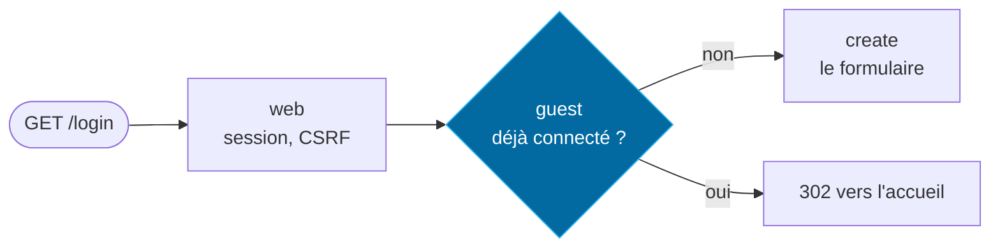
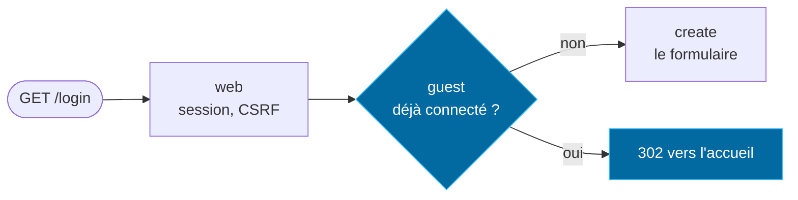

# Le starter kit Breeze

- Distinguer authentification et autorisation
- Installer Breeze sur un projet existant sans perdre votre code
- Repérer les routes de connexion générées

<!--
Transition : avant de protéger le back-office, il faut savoir QUI visite le site. C'est le rôle de la connexion — et on ne va pas l'écrire à la main.
Découpage : ≈ 13 min de slides (≈ 9 slides), démo flash ≈ 5 min — moments : `breeze:install` en direct, `git status` (fichiers écrasés), `git restore .`, `route:list --path=login` ; micro-pratique ≈ 12 min (slide « À vous », étape A1 du README).
Moment léger : « Breeze, c'est une brise… qui renverse votre layout. Heureusement, Git a gardé une photo. »
Tag Campus Quest de fin de chapitre : s6-ch1-breeze.
-->

---
transition: slide-up | slide-down
---

# À votre avis ?

<Quiz
  question="Un joueur est connecté à Campus Quest. Il clique sur « Supprimer » sous une quête et le site refuse. Quelle question le serveur vient-il de trancher ?"
  :options="[
    '« Qui êtes-vous ? » : il ne sait pas encore qui est ce joueur',
    '« Avez-vous le droit ? » : il sait qui c\'est, mais ce joueur n\'est pas Maître du jeu',
    '« Le formulaire est-il authentique ? » : le jeton CSRF ne correspond pas',
    '« La quête existe-t-elle ? » : elle a déjà été supprimée'
  ]"
  :answer="1"
/>

<!--
Faites voter : la confusion entre « qui » et « quoi » est la plus fréquente de la séance.
- « Qui êtes-vous ? » : non, il est connecté — le serveur le connaît déjà.
- CSRF : bonne réflexe (S5), mais un formulaire avec @csrf passe ce contrôle-là.
- La quête existe : le binding renverrait une 404, pas un refus.
- Le refus vient d'une RÈGLE sur un utilisateur connu : c'est l'autorisation. La slide suivante pose les deux mots.
-->

---
layout: two-cols-bottom
layoutClass: gap-x-6
transition: slide-up | slide-down
---

# Authentification ou autorisation ?

::left::

<Definition term="Authentification" translation="(Authentication)">

Vérifier **qui vous êtes** : un identifiant, un mot de passe, et le site vous reconnaît.

</Definition>

<v-click>

<Analogy title="L'accueil du campus" icon="🪪">

Vous montrez votre carte étudiante : l'agent sait **qui** vous êtes.

</Analogy>

</v-click>

::right::

<v-click>

<Definition term="Autorisation" translation="(Authorization)">

Décider **ce que vous avez le droit de faire**, une fois identifié.

</Definition>

</v-click>

<v-click>

<Analogy title="La salle des serveurs" icon="🔐">

Votre carte ouvre l'amphi, pas la salle des serveurs : votre identité ne vous donne pas **tous** les droits.

</Analogy>

</v-click>

::bottom::

<v-click>

Toujours **dans cet ordre** : impossible de décider de vos droits sans savoir qui vous êtes. Chapitres 01 à 04 : l'<KeyTerm>authentification</KeyTerm>. Chapitre 05 : l'<KeyTerm>autorisation</KeyTerm>.

</v-click>

<!--
Moyen mnémotechnique : authentiFICATION = IDENTIFICATION (qui) ; autoriSATION = PERMISSION (quoi).
Les codes HTTP suivent la même logique, on les verra en situation : 302 vers /login quand on ne sait pas qui vous êtes (ch. 04), 403 quand on sait mais que c'est interdit (ch. 05).
-->

---
transition: slide-up | slide-down
---

# Une connexion, c'est beaucoup de code

<Steps
  :clicks="true"
  :items="[
    { title: 'Formulaire', desc: 'Email et mot de passe, protégé par @csrf', icon: '📝' },
    { title: 'Vérifier', desc: 'Comparer le mot de passe sans le stocker en clair', icon: '🔍' },
    { title: 'Session', desc: 'Se souvenir de vous de page en page', icon: '🍪' },
    { title: 'Limiter', desc: 'Bloquer après 5 essais ratés', icon: '⏳' },
    { title: 'Déconnexion', desc: 'Oublier la session proprement', icon: '🚪' }
  ]"
/>

<v-click>

Sans compter l'**inscription**, le **mot de passe oublié** et la **vérification d'email**. Chaque étape a ses pièges de sécurité.

</v-click>

<v-click>

<KeyPoint variant="rule" title="Règle d'or" icon="📏">

N'écrivez pas vous-même un code de sécurité que le framework fournit déjà, testé par des milliers de projets.

</KeyPoint>

</v-click>

<!--
Faites compter les pièges : stocker le mot de passe en clair, oublier de régénérer la session, laisser un robot essayer 10 000 mots de passe, une déconnexion en lien GET…
Tout cela est déjà écrit et testé dans un starter kit : c'est la slide suivante.
-->

---
layout: two-cols-header
layoutClass: gap-x-6
transition: slide-up | slide-down
---

# Breeze, un starter kit

::left::

<Definition term="Starter kit" translation="(Kit de démarrage)">

Une commande qui **génère du code dans votre projet** : routes, contrôleurs, vues. Une fois généré, ce code vous appartient : vous le lisez et vous l'adaptez.

</Definition>

Le <KeyTerm>starter kit</KeyTerm> officiel en Blade s'appelle <Tag label="Laravel">Breeze</Tag>.

::right::

<v-click>

<ProsCons
  :pros="['Connexion, inscription, mot de passe oublié prêts', 'Limitation des essais incluse', 'Code lisible, rangé comme le vôtre']"
  :cons="['Pensé pour un projet neuf', 'Écrase certains de vos fichiers', 'Vues en Tailwind à adapter à votre design']"
  prosTitle="Ce qu'il apporte" consTitle="Ce qu'il faut gérer"
/>

</v-click>

<!--
Breeze n'est pas une bibliothèque qu'on appelle : c'est un générateur. Après l'installation, plus rien ne dépend de lui — on pourrait même le désinstaller.
Laravel 12 propose aussi de nouveaux starter kits (React, Vue, Livewire) : ils créent un projet neuf, ce n'est pas notre cas.
Sanctum (souvent cité dans les tutoriels) sert aux jetons d'API pour une application mobile ou une SPA : inutile pour un site Blade avec session.
L'inconvénient « écrase vos fichiers » est le sujet des deux slides suivantes.
-->

---
layout: two-cols-header
layoutClass: gap-x-6
transition: slide-up | slide-down
---

# Installer Breeze

::left::

<Terminal
  title="bash" prompt="$" :clicks="true"
  :lines="[
    { cmd: 'git status', out: 'nothing to commit, working tree clean' },
    { cmd: 'sail composer require laravel/breeze --dev', out: '  - Installing laravel/breeze (v2.4.2)' },
    { cmd: 'sail artisan breeze:install blade', out: '   INFO  Breeze scaffolding installed successfully.' }
  ]"
/>

::right::

<div v-click="1">

**Avant tout** : un `git status` propre. Si Breeze casse quelque chose, Git a gardé la version d'avant.

</div>

<div v-click="2">

`--dev` : Breeze ne sert qu'à **générer** le code, pas à faire tourner le site.

</div>

<div v-click="3">

`blade` : la variante en vues Blade, comme le reste du projet. L'installation lance aussi un `npm install` : comptez une minute.

</div>

<!--
Démo : partir de l'état de fin de S5, `git status` propre à l'écran. Lancer les deux commandes en direct (composer est en cache : quelques secondes).
Si le réseau est lent, montrer directement le résultat au tag s6-ch1-breeze et garder l'installation pour la micro-pratique.
-->

---
layout: two-cols-bottom
layoutClass: gap-x-6
transition: slide-up | slide-down
---

# Ce que Breeze a touché

::left::

<Terminal
  title="bash" prompt="$"
  :lines="[
    { cmd: 'git status --short', out: ' M package.json\n M resources/css/app.css\n M resources/js/app.js\n M resources/views/layouts/app.blade.php\n M routes/web.php\n M vite.config.js\n?? app/Http/Controllers/Auth/\n?? app/Http/Requests/Auth/\n?? resources/views/auth/\n?? routes/auth.php\n?? postcss.config.js\n?? tailwind.config.js\n…' }
  ]"
/>

::right::

<div v-click="1">

`M` (*modified*) : **vos** fichiers, **écrasés** par Breeze. Votre layout, vos routes et votre CSS ont disparu.

</div>

<div v-click="2">

`??` (*untracked*) : les **nouveaux** fichiers de Breeze. C'est eux qu'on veut garder.

</div>

::bottom::

<div v-click="3">

Retenez : Breeze a été écrit pour un projet **vide**. Sur votre projet, il faut **trier** ce qu'il a fait.

</div>

<!--
Démo : ouvrir http://localhost/quests juste après l'installation → erreur 500 « Route [quests.index] not defined » : routes/web.php a été remplacé par celui de Breeze, plus aucune route quests (même la page 404 de la S2 plante, elle pointe vers quests.index).
Faire lire un `git diff routes/web.php` de 5 secondes : nos routes ont été remplacées par /dashboard et /profile.
-->

---
layout: two-cols-bottom
layoutClass: gap-x-6
transition: slide-up | slide-down
---

# Récupérer vos fichiers

::left::

<Terminal
  title="bash" prompt="$" :clicks="true"
  :lines="[
    { cmd: 'git restore .' },
    { cmd: 'rm tailwind.config.js postcss.config.js' },
    { cmd: 'sail npm install' }
  ]"
/>

<div v-click="4">

```php
// routes/web.php — dernière ligne
require __DIR__.'/auth.php';
```

</div>

::right::

<div v-click="1">

`git restore .` remet **vos** fichiers modifiés tels qu'au dernier commit. Les nouveaux fichiers de Breeze ne sont pas suivis : ils restent.

</div>

<div v-click="2">

Ces deux fichiers configurent l'ancienne version de Tailwind voulue par Breeze : ils casseraient votre Vite.

</div>

<div v-click="3">

`npm install` réinstalle les paquets de **votre** `package.json` restauré.

</div>

<div v-click="4">

Vos routes ignorent encore celles de Breeze : on **inclut** `routes/auth.php` à la fin de `web.php`.

</div>

::bottom::

<div v-click="5">

Retenez : **modifié** → `git restore` ; **nouveau** → on garde. Le commit d'avant l'installation était votre filet de sécurité.

</div>

<!--
Démo : enchaîner les trois commandes, puis relancer `sail npm run dev` (second terminal) et recharger /quests : tout est revenu.
Le require va À LA FIN du fichier : c'est exactement ce que faisait le web.php de Breeze (on l'a vu dans le diff).
Piège : un `git restore .` avec des modifications non commitées les efface aussi — d'où le git status propre AVANT l'installation.
-->

---
transition: slide-up | slide-down
---

# Ce qu'on garde

<FileTree :tree="[
  { name: 'app/Http', children: [
    { name: 'Controllers/Auth', children: [
      { name: 'AuthenticatedSessionController.php', highlight: true, comment: 'Connexion et déconnexion' },
      { name: 'RegisteredUserController.php', comment: 'Inscription' },
      { name: '… (mot de passe oublié, vérification)' }
    ]},
    { name: 'Requests/Auth/LoginRequest.php', comment: 'Valide et vérifie les identifiants' }
  ]},
  { name: 'resources/views', children: [
    { name: 'auth', children: [
      { name: 'login.blade.php', highlight: true, comment: 'La page de connexion, à adapter' },
      { name: 'register.blade.php, …' }
    ]},
    { name: 'layouts/guest.blade.php', comment: 'Layout de Breeze, inutilisé chez nous' }
  ]},
  { name: 'routes/auth.php', comment: 'Toutes les routes de connexion' }
]" />

<!--
Les deux fichiers en surbrillance sont ceux qu'on modifie au chapitre 02.
Restent dans le projet sans être branchés : ProfileController, dashboard.blade.php, les vues profile/ et les tests tests/Feature/Auth (ils visent /dashboard ; les tests sont hors programme).
Breeze a aussi généré des composants Blade (resources/views/components) utilisés par ses propres vues : on ne s'en sert pas.
-->

---
layout: two-cols-bottom
class: '!grid-cols-[minmax(0,13fr)_minmax(0,7fr)] gap-x-6'
transition: slide-up | slide-down
---

# Les routes de `routes/auth.php`

::left::

```php {all|1,8|2-6|10-14|all}
Route::middleware('guest')->group(function () {
    Route::get('login',
        [AuthenticatedSessionController::class, 'create'])
        ->name('login');
    Route::post('login',
        [AuthenticatedSessionController::class, 'store']);
    // register, forgot-password, reset-password…
});

Route::middleware('auth')->group(function () {
    Route::post('logout',
        [AuthenticatedSessionController::class, 'destroy'])
        ->name('logout');
});
```

::right::

<div v-click="1">

Un **groupe** de routes réservé aux **invités** (`guest`) : connecté, vous êtes renvoyé ailleurs.

</div>

<div v-click="2">

`GET login` affiche le formulaire, `POST login` le traite : le duo `create()` / `store()` de la S5.

</div>

<div v-click="3">

La déconnexion est un `POST` réservé aux connectés (`auth`, au chapitre 04).

</div>

::bottom::

<div v-click="4">

Retenez : la route s'appelle **`login`** — c'est ce nom que Laravel utilise pour renvoyer un visiteur vers la connexion.

</div>

<!--
Démo : `sail artisan route:list --path=login` → GET et POST login, contrôleur AuthenticatedSessionController.
Les middlewares guest et auth sont là, déjà écrits par Breeze : on ne fait que les lire. La slide suivante explique ce qu'est un middleware ; le chapitre 04 en pose un nous-mêmes.
Ouvrir /login : la page de Breeze s'affiche, avec son propre style — elle ne ressemble pas à Campus Quest. Chapitre suivant.
-->

---
transition: slide-up | slide-down
---

# C'est quoi, un middleware ?

Un <KeyTerm>middleware</KeyTerm> est une **couche** que la requête traverse avant d'atteindre le contrôleur : il la laisse passer, ou répond à sa place.

<v-switch>
<template #0>



</template>
<template #1>



</template>
<template #2>



</template>
</v-switch>

<div class="grid grid-cols-3 gap-6 mt-4 text-sm">

<div>

**Déjà là** : le groupe `web` (session, CSRF de la S5) s'applique à toutes vos routes.

</div>

<div v-click="1">

**Une couche en plus** : `Route::middleware('guest')->group(…)` place `guest` devant chaque route du groupe.

</div>

<div v-click="2">

**Exemple** : déjà connecté, vous ouvrez `/login` → `guest` vous renvoie à l'accueil. `create()` n'est **jamais** appelé.

</div>

</div>

<!--
Analogie : un pipeline, ou les portiques d'un aéroport — chaque portique contrôle une chose, et peut vous arrêter avant l'avion (le contrôleur).
Ajouter un middleware = ajouter un portique, sans toucher au contrôleur : c'est tout l'intérêt.
D'où viennent guest et auth ? Ce sont des alias fournis par Laravel (Illuminate\Foundation\Configuration\Middleware::defaultAliases) : guest → RedirectIfAuthenticated, auth → Authenticate. Le groupe web est branché sur routes/web.php par bootstrap/app.php (withRouting) ; c'est aussi là, dans withMiddleware(), qu'on déclarerait les nôtres.
« L'accueil » : RedirectIfAuthenticated vise la route dashboard, sinon home, sinon / — Campus Quest n'a ni l'une ni l'autre, donc /.
Pas de démo ici (aucun compte encore) : au chapitre 02, une fois connecté, retaper /login pour montrer la redirection.
-->

---
transition: slide-up | slide-down
---

# À vous : installer Breeze

<Exercise title="WishFlix — Breeze sans perdre votre code" duration="12 min" level="guidé"
  :criteria="[
    'git status est propre avant l\'installation',
    'Après git restore, l\'accueil et la fiche jeu s\'affichent comme avant',
    'route:list --path=login montre GET et POST login vers AuthenticatedSessionController'
  ]"
  :hints="[
    'Une page cassée après l\'installation ? C\'est normal : vous n\'avez pas encore fait git restore .',
    'Vite plante sur PostCSS ? Il reste tailwind.config.js ou postcss.config.js',
    'Deux routes login ? Supprimez votre ancienne route GET /login de la S2'
  ]">

**Exercice** `06-authentification-securite` — étape **A1** du README.

Installez Breeze, triez ses fichiers comme dans la démo, puis branchez `routes/auth.php`.

</Exercise>

<!--
Point de vigilance : faire vérifier le git status AVANT l'installation (commit « avant Breeze »). Un étudiant qui a du travail non commité le perdrait au git restore.
WishFlix a déjà une route GET /login nommée login (S2, US2) : elle doit être supprimée, Breeze fournit la sienne — on la rebranchera sur la vue existante au chapitre 02.
Palier de rattrapage : tag Campus Quest s6-ch1-breeze (relire le diff, refaire sur WishFlix).
-->
