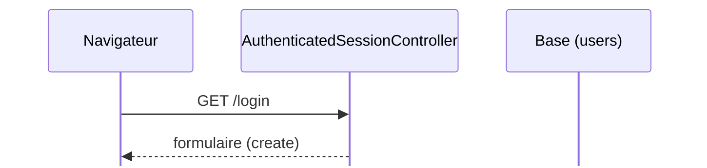
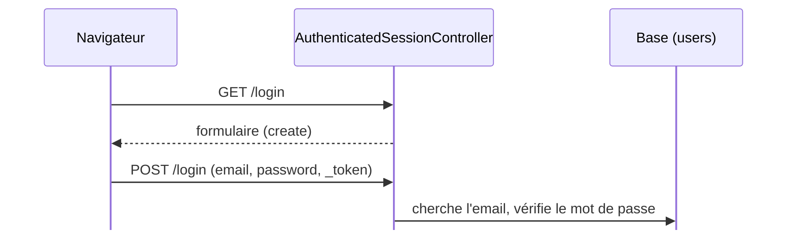
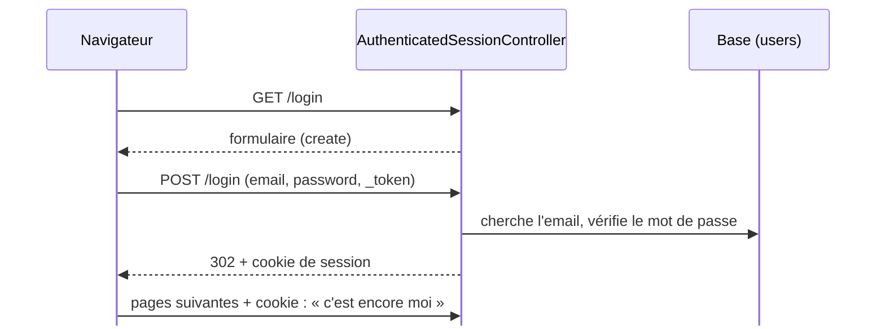

# La connexion

- Suivre une connexion, du formulaire à la session
- Brancher la page de connexion sur votre layout
- Afficher l'utilisateur connecté et le déconnecter

<!--
Transition : Breeze a posé les routes et le contrôleur. Reste à comprendre ce qu'ils font, et à faire ressembler la page de connexion à Campus Quest.
Découpage : ≈ 11 min de slides (≈ 8 slides), démo flash ≈ 3 min — moments : connexion ratée (message d'erreur, email conservé), compte créé dans Tinker puis connexion réussie (nom dans la barre), déconnexion ; micro-pratique ≈ 14 min (slide « À vous », étape A2 du README).
Moment léger : « 5 essais ratés et Breeze vous met au coin 60 secondes. Le Maître du jeu l'a découvert en direct, devant toute la promo. »
Tag Campus Quest de fin de chapitre : s6-ch2-connexion.
-->

---
transition: slide-up | slide-down
---

# Le trajet d'une connexion

<v-switch>
<template #0>



</template>
<template #1>



</template>
<template #2>



</template>
</v-switch>

<div class="grid grid-cols-3 gap-6 mt-2 text-sm">

<div>

**Afficher** : un `GET` renvoie le formulaire, comme `create()` en S5.

</div>

<div v-click="1">

**Vérifier** : le `POST` envoie email et mot de passe ; le contrôleur interroge la table `users`.

</div>

<div v-click="2">

**Se souvenir** : la <KeyTerm>session</KeyTerm> retient votre identifiant ; le cookie, renvoyé à chaque requête, vous fait reconnaître.

</div>

</div>

<!--
La session est stockée côté serveur (table sessions, SESSION_DRIVER=database) ; le navigateur ne garde qu'un identifiant dans le cookie laravel_session.
C'est le même cookie que celui de l'attaque CSRF de la S5 : il est envoyé automatiquement à chaque requête vers le site.
-->

---
layout: two-cols-bottom
class: '!grid-cols-[minmax(0,1fr)_minmax(0,1fr)] gap-x-6'
transition: slide-up | slide-down
---

# Le contrôleur de Breeze
`app/Http/Controllers/Auth/AuthenticatedSessionController.php`

::left::

```php {all|3|6,8|10|12-14|all}
public function create(): View
{
    return view('auth.login');
}

public function store(LoginRequest $request): RedirectResponse
{
    $request->authenticate();

    $request->session()->regenerate();

    return redirect()->intended(
        route('dashboard', absolute: false)
    );
}
```

::right::

<div v-click="1">

`create()` renvoie la vue `auth.login`, celle qu'on va réécrire.

</div>

<div v-click="2">

Une **Form Request** (S5) valide `email` et `password` ; `authenticate()` les vérifie.

</div>

<div v-click="3">

`regenerate()` : **nouvel identifiant** de session, un identifiant volé avant ne sert plus.

</div>

<div v-click="4">

`intended()` : retour à la page demandée **avant** la connexion. Ex. : vous ouvrez `/quests/create` sans être connecté → `/login` → une fois connecté, retour direct sur le formulaire.

Sans page mémorisée : `dashboard`, une route **qu'on a retirée**.

</div>

::bottom::

<div v-click="5">

Retenez : le code généré est **à vous** — on corrige la redirection, on change la vue.

</div>

<!--
Démo : se connecter avec un compte inexistant → erreur. Avec un compte valide au tag s6-ch1-breeze → RouteNotFoundException « Route [dashboard] not defined » : la preuve qu'il faut adapter le code généré.
destroy() (la déconnexion) : logout(), invalidate() de la session, regenerateToken() du jeton CSRF, puis redirection vers /. Rien à changer.
-->

---
transition: slide-up | slide-down
---

# Adapter la redirection

<Compare badLabel="❌ Généré par Breeze" goodLabel="✅ Adapté à Campus Quest">
  <template #bad>

```php
return redirect()->intended(
    route('dashboard', absolute: false)
);
```

→ **Route [dashboard] not defined** après une connexion réussie

  </template>
  <template #good>

```php
return redirect()->intended(
    route('quests.index', absolute: false)
);
```

→ la liste des quêtes, ou la page demandée avant la connexion

  </template>
</Compare>

<!--
absolute: false génère /quests au lieu de http://localhost/quests : c'est le choix de Breeze, on le garde.
Le « page demandée avant la connexion » prendra tout son sens au chapitre 04, avec le middleware auth.
-->

---
layout: two-cols-bottom
class: '!grid-cols-[minmax(0,3fr)_minmax(0,2fr)] gap-x-6'
transition: slide-up | slide-down
---

# Vérifier les identifiants
`app/Http/Requests/Auth/LoginRequest.php`

::left::

```php {all|4-7|3,8|9-11|all}
public function authenticate(): void
{
    $this->ensureIsNotRateLimited();
    if (! Auth::attempt(
        $this->only('email', 'password'),
        $this->boolean('remember')
    )) {
        RateLimiter::hit($this->throttleKey());
        throw ValidationException::withMessages([
            'email' => trans('auth.failed'),
        ]);
    }
    RateLimiter::clear($this->throttleKey());
}
```

::right::

<div v-click="1">

`Auth::attempt()` cherche l'**email**, compare le mot de passe (chapitre 03). `remember` : « Se souvenir de moi ».

</div>

<div v-click="2">

Chaque échec est compté : au 5ᵉ, connexion **bloquée** un moment. Fini les robots qui testent des milliers de mots de passe.

</div>

<div v-click="3">

Un échec devient une **erreur de validation** sur `email`, comme en S5.

</div>

::bottom::

<div v-click="4">

Retenez : le message d'échec ne dit **jamais** si c'est l'email ou le mot de passe qui est faux — sinon il confirmerait qu'un compte existe.

</div>

<!--
Le message trans('auth.failed') est en anglais : « These credentials do not match our records. » (fichiers de traduction non publiés — `sail artisan lang:publish` les copie dans lang/ si vous voulez les traduire, bonus).
Rien à modifier dans ce fichier : on le lit pour savoir quels noms de champs la vue doit envoyer (email, password, remember).
-->

---
layout: two-cols-bottom
class: '!grid-cols-[minmax(0,13fr)_minmax(0,7fr)] gap-x-6'
transition: slide-up | slide-down
---

# La page de connexion
`resources/views/auth/login.blade.php`, réécrite dans le layout

::left::

```blade {all|1-2|4-9|11-12|14-17|all}{maxHeight:'300px'}
<form method="POST" action="{{ route('login') }}">
    @csrf

    <label for="email">Email</label>
    <input id="email" name="email" type="email"
           value="{{ old('email') }}" required autofocus>
    @error('email')
        <p class="error">{{ $message }}</p>
    @enderror

    <label for="password">Mot de passe</label>
    <input id="password" name="password" type="password" required>

    <label>
        <input type="checkbox" name="remember" value="1">
        Se souvenir de moi
    </label>

    <button type="submit">Se connecter</button>
</form>
```

::right::

<div v-click="1">

`POST` vers la route nommée `login`, avec `@csrf` (S5).

</div>

<div v-click="2">

`name="email"` : le nom attendu par `LoginRequest`. L'erreur d'identifiants arrive sur ce champ.

</div>

<div v-click="3">

`password` : **jamais** de `old()` — un mot de passe ne repart jamais dans la page.

</div>

<div v-click="4">

`remember` : lu par `$this->boolean('remember')`.

</div>

::bottom::

<div v-click="5">

Retenez : Breeze impose les **noms des champs**, pas le HTML. La vue étend votre layout, comme toutes vos pages.

</div>

<!--
La vue complète commence par @extends('layouts.app'), @section('title', 'Connexion') et charge forms.css avec @section('styles') — comme quests/create de la S5.
Le HTML généré par Breeze (composants x-guest-layout, x-text-input…) est remplacé entièrement : on ne garde que le nom du fichier.
Chez vous (WishFlix) : vous avez déjà une page de connexion depuis la S2 — l'exercice vous fait pointer create() vers elle plutôt que de la recopier.
-->

---
layout: two-cols-header
layoutClass: gap-x-6
transition: slide-up | slide-down
---

# Qui est connecté ?
`resources/views/partials/nav.blade.php`

::left::

```blade {all|1,7|2|3-6|9-11}
@auth
    <span>{{ Auth::user()->name }}</span>
    <form method="POST" action="{{ route('logout') }}">
        @csrf
        <button type="submit">Déconnexion</button>
    </form>
@endauth

@guest
    <a href="{{ route('login') }}">Se connecter</a>
@endguest
```

::right::

<div v-click="1">

`@auth` … `@endauth` : affiché **seulement** si quelqu'un est connecté.

</div>

<div v-click="2">

`Auth::user()` : le modèle `User` connecté (`null` pour un invité). Dans un contrôleur, on écrit `$request->user()`.

</div>

<div v-click="3">

La déconnexion est un **formulaire `POST`** avec `@csrf` : un lien `GET /logout` pourrait être déclenché par une simple image sur un autre site.

</div>

<div v-click="4">

`@guest` : l'inverse, pour les visiteurs non connectés.

</div>

<!--
Lien avec la S5 : une action qui modifie l'état (ici, détruire la session) ne passe jamais par un GET.
Le bouton est stylé comme un lien dans app.css (.nav__user button) : visuellement, rien ne trahit le formulaire.
-->

---
layout: two-cols-bottom
layoutClass: gap-x-6
transition: slide-up | slide-down
---

# Un premier compte

::left::

<Terminal
  title="tinker" prompt=">" :legend="true"
  :lines="[
    { lang: 'php', cmd: 'User::create([\'name\' => \'Alice\', \'email\' => \'alice@campus-quest.test\', \'password\' => \'secret123\'])', out: '= App\\Models\\User {#6210\n    name: &quot;Alice&quot;,\n    email: &quot;alice@campus-quest.test&quot;,\n    id: 1,\n  }' }
  ]"
/>

::right::

<v-click>

<Browser url="localhost/quests" title="Campus Quest">
  <div class="flex items-center gap-6 px-4 py-3 text-sm font-semibold bg-slate-800 text-sky-300">
    <span>Campus Quest</span><span>Quêtes</span><span>Classement</span>
    <span class="ml-auto text-slate-200">Alice</span><span>Déconnexion</span>
  </div>
  <div class="p-6">Quêtes disponibles…</div>
</Browser>

</v-click>

::bottom::

<v-click>

Vous avez tapé `secret123` en clair. Qu'est-ce que la base a **vraiment** enregistré ?

</v-click>

<!--
Démo : créer le compte dans Tinker, se connecter avec alice@campus-quest.test / secret123 → redirection vers /quests, « Alice » dans la barre. Toujours connecté, retaper /login → renvoyé à l'accueil : le middleware guest du chapitre 01 en action. Déconnexion → retour à l'accueil, « Se connecter » réapparaît.
Puis volontairement un mauvais mot de passe : message d'erreur sous l'email, email conservé.
Ne répondez pas à la question du bas : elle ouvre le chapitre 03.
-->

---
transition: slide-up | slide-down
---

# À vous : se connecter

<Exercise title="WishFlix — la connexion qui marche" duration="14 min" level="guidé"
  :criteria="[
    'La page /login est votre page WishFlix, dans votre layout',
    'Un mauvais mot de passe affiche une erreur et garde l\'email saisi',
    'Connecté : votre nom et « Déconnexion » remplacent « Invité » dans la barre'
  ]"
  :hints="[
    'create() doit renvoyer votre vue (login), store() rediriger vers la route home',
    'Les champs doivent s\'appeler email, password et remember',
    'Pas de compte ? Créez-en un dans Tinker avec User::create([...])'
  ]">

**Exercice** `06-authentification-securite` — étape **A2** du README.

Branchez votre page de connexion de la S2 sur le contrôleur de Breeze, puis affichez l'utilisateur connecté dans la barre.

</Exercise>

<!--
WishFlix a déjà resources/views/login.blade.php (S2, US2) dans son layout : create() renvoie view('login') au lieu de view('auth.login'). Le README fournit un squelette pour ceux qui n'ont pas fait l'US2.
Le bloc « Invité / Se connecter » de la maquette devient @guest ; le bloc connecté @auth.
Palier de rattrapage : tag Campus Quest s6-ch2-connexion (relire le diff, refaire sur WishFlix).
-->
