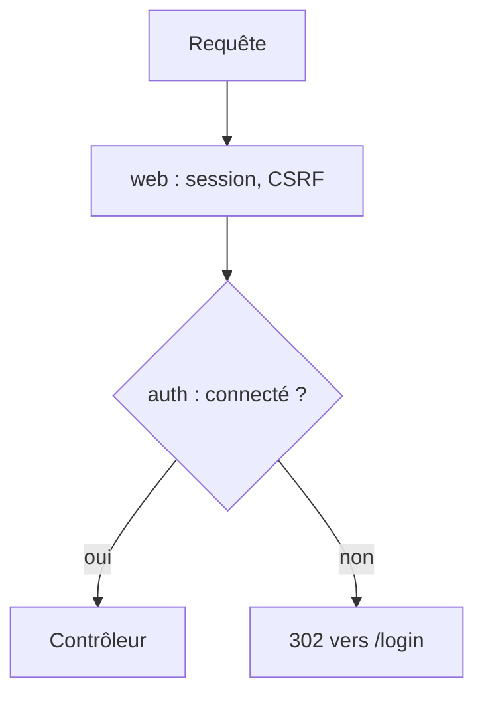

# Le middleware d'authentification

- Constater qu'un visiteur accède encore au back-office
- Réserver des routes aux utilisateurs connectés
- Revenir à la page demandée après la connexion

<!--
Transition : on sait qui est connecté… mais on ne s'en sert encore nulle part. Le back-office est toujours ouvert.
Découpage : ≈ 5 min de slides (≈ 5 slides, le rappel est court : le middleware est défini au chapitre 01), démo flash ≈ 2 min — moments : déconnecté, /quests/create → redirection vers /login ; connexion → retour automatique sur /quests/create ; micro-pratique ≈ 7 min (slide « À vous », étape A4 du README).
Moment léger : « Le middleware auth, c'est le vigile de la BU : pas de carte, pas d'entrée — mais il vous indique gentiment l'accueil. »
Tag Campus Quest de fin de chapitre : s6-ch4-middleware.
-->

---
layout: center
transition: slide-up | slide-down
---

# Déconnecté… et pourtant

<Browser url="localhost/quests/create" title="Campus Quest">
  <div class="flex items-center gap-6 px-4 py-3 text-sm font-semibold bg-slate-800 text-sky-300">
    <span>Campus Quest</span><span>Quêtes</span><span class="ml-auto">Se connecter</span>
  </div>
  <div class="p-6 text-left">
    <div class="text-xl font-bold mb-3">Nouvelle quête</div>
    <div class="h-8 w-80 rounded bg-slate-700 mb-2"></div>
    <div class="h-8 w-80 rounded bg-slate-700 mb-2"></div>
    <div class="h-8 w-40 rounded bg-sky-400"></div>
  </div>
</Browser>

<v-click>

La barre affiche « Se connecter », mais le formulaire de création s'ouvre **quand même**. Cacher un lien n'empêche personne de **taper l'URL**.

</v-click>

<!--
Démo : se déconnecter, taper /quests/create à la main → le formulaire s'affiche ; le remplir → la quête est créée par un anonyme.
Rien dans le code ne relie encore la connexion aux routes du back-office : c'est le rôle du middleware.
-->

---
layout: two-cols-header
layoutClass: gap-x-6 !grid-cols-[minmax(0,1fr)_minmax(0,1fr)]
transition: slide-up | slide-down
---

# Rappel : le middleware

::left::

<Definition term="Middleware">

Un **filtre** que la requête traverse avant d'atteindre le contrôleur. Il la laisse passer, ou répond à sa place.

</Definition>

Vous en avez déjà croisé deux : `ValidateCsrfToken` (S5), qui répond **419** sans jeton, et `guest` (chapitre 01), qui renvoie un connecté loin de `/login`.

::right::

<v-click>



</v-click>

<!--
Le groupe web (session, cookies, CSRF) s'applique à toutes les routes de routes/web.php. Le middleware auth s'ajoute route par route.
« Vers /login » : vers la route NOMMÉE login (chapitre 01) — si elle n'existait pas, Laravel planterait ici.
-->

---
layout: two-cols-bottom
class: '!grid-cols-[minmax(0,13fr)_minmax(0,7fr)] gap-x-6'
transition: slide-up | slide-down
---

# Protéger le back-office
`routes/web.php`

::left::

```php {all|1-3|5,9|6-8|all}
Route::resource('quests', QuestController::class)
    ->only(['index', 'show'])
    ->where(['quest' => '[0-9]+']);

Route::middleware('auth')->group(function () {
    Route::resource('quests', QuestController::class)
        ->except(['index', 'show'])
        ->where(['quest' => '[0-9]+']);
});
```

::right::

<div v-click="1">

La **lecture** reste publique : liste et fiche, pour tout le monde.

</div>

<div v-click="2">

`Route::middleware('auth')->group()` : chaque route déclarée **dans** la fonction passe par `auth`.

</div>

<div v-click="3">

Les cinq routes d'écriture : `create`, `store`, `edit`, `update`, `destroy`.

</div>

::bottom::

<div v-click="4">

Retenez : on protège **la route**, pas le bouton. Mêmes noms de routes qu'en S5 : aucune vue à modifier.

</div>

<!--
Démo : sail artisan route:list --name=quests → toujours 7 routes, mêmes noms. Le ->where() est répété dans les deux déclarations : chaque resource a ses propres routes.
Variante courte pour une seule route : ->middleware('auth') à la fin de la déclaration (Panorama).
-->

---
transition: slide-up | slide-down
---

# Retour à la page demandée

<Steps
  :clicks="true"
  :items="[
    { title: 'GET /quests/create', desc: 'Un invité demande le formulaire', icon: '👤' },
    { title: '302 → /login', desc: 'auth mémorise l\'URL demandée en session', icon: '🔒' },
    { title: 'POST /login', desc: 'Connexion réussie', icon: '🔑' },
    { title: '302 → /quests/create', desc: 'intended() renvoie vers l\'URL mémorisée', icon: '✅' }
  ]"
/>

<v-click>

C'est le `redirect()->intended()` du chapitre 02 : sans URL mémorisée, il renvoie vers la liste des quêtes.

</v-click>

<!--
Démo : déconnecté, taper /quests/create → redirection vers /login ; se connecter avec le joueur démo → on arrive directement sur /quests/create.
Problème visible : le JOUEUR démo arrive sur le formulaire de création… Être connecté ne devrait pas suffire. Chapitre 05.
-->

---
transition: slide-up | slide-down
---

# Panorama : l'authentification

<script setup>
import auth from '/references/auth'
</script>

<Panorama :items="auth" doc="https://laravel.com/docs/12.x/authentication" at="s6-ch4" />

<!--
Survol de 30 s, pas d'explication détaillée : montrer ce qui a été vu (badges « vu ») et où trouver le reste.
Pendant le « À vous », les apprenants peuvent revenir sur cette slide comme aide-mémoire.
-->

---
transition: slide-up | slide-down
---

# À vous : fermer le back-office

<Exercise title="WishFlix — back-office réservé aux connectés" duration="7 min" level="guidé"
  :criteria="[
    'Déconnecté, /games/create redirige vers /login',
    'Après la connexion, vous arrivez directement sur /games/create',
    'L\'accueil et les fiches jeu restent visibles sans connexion'
  ]"
  :hints="[
    'Route::middleware(\'auth\')->group(function () { … })',
    'Votre Route::resource du back-office des jeux va dans le groupe',
    'Testez dans une fenêtre de navigation privée : vous y êtes déconnecté'
  ]">

**Exercice** `06-authentification-securite` — étape **A4** du README.

Placez les routes d'écriture des jeux derrière le middleware `auth`.

</Exercise>

<!--
WishFlix n'a qu'un Route::resource (->except(['index', 'show'])) : la fiche publique reste /game/{id} (games.show). Une seule déclaration à envelopper.
Palier de rattrapage : tag Campus Quest s6-ch4-middleware (relire le diff, refaire sur WishFlix).
-->
