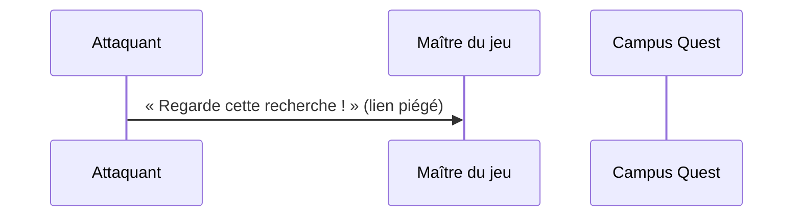
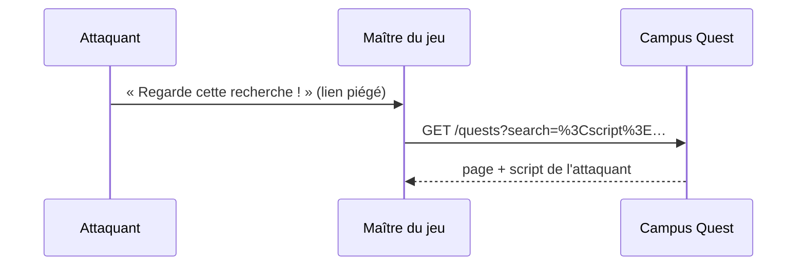
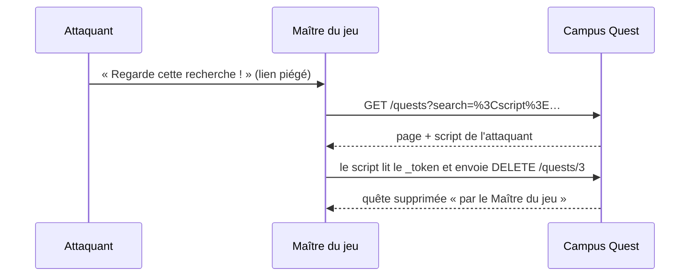

# La faille XSS

- Injecter un script dans une page, puis le neutraliser
- Comprendre ce que <code v-pre>{{ }}</code> fait pour vous
- Utiliser `{!! !!}` sans ouvrir de faille

<!--
Transition : le site est verrouillé — connexion, rôles. Mais une porte fermée ne sert à rien si on peut passer par la fenêtre : le contenu des pages.
Rappel : `{!! !!}` a été montré en S2 (chapitre Blade) et la Partie C de l'exercice 02 le faisait expérimenter.
Découpage : ≈ 6 min de slides (≈ 6 slides), démo flash ≈ 2 min — moments : recherche `<script>alert('XSS')</script>` → texte affiché tel quel ; une ligne passée en `{!! !!}` en direct → l'alerte s'ouvre ; retour à <code v-pre>{{ }}</code> ; micro-pratique ≈ 7 min (slide « À vous », étape A7 du README).
Moment léger : la première alerte « XSS » qui s'ouvre fait toujours rire la salle — profitez-en, puis rappelez qu'un vrai attaquant n'ouvre jamais d'alerte.
Tag Campus Quest de fin de chapitre : s6-ch7-xss.
-->

---
transition: slide-up | slide-down
---

# À votre avis ?

<Quiz
  question="La liste des quêtes affiche « Résultats pour « … » » avec le texte recherché. Vous cherchez le texte ci-dessous. Que se passe-t-il ?"
  :options="[
    'Le navigateur exécute le script : une alerte « XSS » s\'ouvre',
    'Le texte s\'affiche tel quel, balises comprises',
    'La recherche est refusée par la validation',
    'Le navigateur bloque toujours les scripts venus d\'une URL'
  ]"
  :answer="1"
>

```html
<script>alert('XSS')</script>
```

</Quiz>

<!--
Faites voter : la moitié de la salle s'attend à l'alerte… et c'est ce qui arriverait sur un site PHP écrit avec echo.
- Validation : le paramètre de recherche n'est pas validé (S4) — et ce ne serait pas la bonne défense.
- Le navigateur bloque : les anciens filtres des navigateurs ont été retirés, on ne compte pas dessus.
- Blade échappe par défaut : la slide suivante montre comment.
-->

---
transition: slide-up | slide-down
---

# Ce que fait <code v-pre>{{ }}</code>

```blade
{{-- resources/views/quests/index.blade.php --}}
<p>Résultats pour « {{ request('search') }} »</p>
```

<v-click>

```php
// storage/framework/views/… (compilé par Blade)
<p>Résultats pour « <?php echo e(request('search')); ?> »</p>
```

</v-click>

<v-click>

```html
<!-- HTML envoyé au navigateur -->
<p>Résultats pour « &lt;script&gt;alert(&#039;XSS&#039;)&lt;/script&gt; »</p>
```

`e()` remplace `<`, `>`, `"`, `'` et `&` par leur **entité HTML** : le navigateur les **affiche** au lieu de les interpréter.

</v-click>

<v-click>

<KeyPoint variant="tip" title="À retenir" icon="💡">

<code v-pre>{{ }}</code> **échappe** toujours. La protection est automatique… tant que vous ne l'enlevez pas.

</KeyPoint>

</v-click>

<!--
Démo : `/quests?search=<script>alert('XSS')</script>` → la phrase s'affiche avec les balises visibles. Ctrl+U : montrer les &lt; dans le source.
La vue compilée est réellement dans storage/framework/views : la Partie C de l'exercice 02 (S2) y emmenait déjà.
-->

---
layout: two-cols-header
layoutClass: gap-x-6
transition: slide-up | slide-down
---

# Sans échappement

::left::

```blade
<p>Résultats pour « {!! request('search') !!} »</p>
```

<Browser url="localhost/quests?search=%3Cscript%3E…" title="Campus Quest">
  <div class="flex items-center justify-center h-32">
    <div class="rounded bg-slate-200 text-slate-900 px-6 py-4 shadow-lg">
      localhost indique<br><strong>XSS</strong>
    </div>
  </div>
</Browser>

::right::

<Definition term="XSS" translation="(Cross-Site Scripting)">

Un attaquant fait **exécuter son script** dans la page d'un site, dans le navigateur d'une autre personne.

</Definition>

<v-click>

Avec `{!! !!}`, la saisie part **brute** dans le HTML : la balise `<script>` est exécutée.

</v-click>

<!--
Démo : remplacer {{ }} par {!! !!} dans index.blade.php, sauvegarder, recharger la même URL → l'alerte. Remettre {{ }} immédiatement.
Ici, le script vient de l'URL : c'est une XSS « réfléchie ». La slide suivante montre pourquoi c'est grave.
-->

---
layout: two-cols-header
layoutClass: gap-x-6 !grid-cols-[minmax(0,3fr)_minmax(0,2fr)]
transition: slide-up | slide-down
---

# Pourquoi c'est grave

::left::

<v-switch>
<template #0>



</template>
<template #1>



</template>
<template #2>



</template>
</v-switch>

::right::

<div>

Le lien vient d'un message, d'un forum, d'un mail…

</div>

<div v-click="1">

Le script s'exécute **dans la session** du Maître du jeu.

</div>

<div v-click="2">

Il lit le jeton `_token` **dans la page** et envoie un formulaire valide : la protection CSRF de la S5 ne sert plus à rien.

</div>

<!--
Le CSRF protège contre un AUTRE site qui forge une requête ; une XSS s'exécute DANS votre site : elle a accès à tout ce que la page contient.
Le cookie de session de Laravel est HttpOnly (illisible en JavaScript) : le script ne peut pas le voler… mais il n'en a pas besoin, il agit directement.
Deuxième forme : la XSS « stockée » — le script est enregistré en base (titre, description) et frappe chaque visiteur de la page.
-->

---
transition: slide-up | slide-down
---

# `{!! !!}` sans danger

<Compare badLabel="❌ HTML brut de la saisie" goodLabel="✅ Échapper d'abord, puis ajouter son HTML">
  <template #bad>

```blade
<p>{!! nl2br($quest->description) !!}</p>
```

→ les retours à la ligne s'affichent… et un `<script>` dans la description aussi

  </template>
  <template #good>

```blade
<p>{!! nl2br(e($quest->description)) !!}</p>
```

→ `e()` neutralise la saisie, **puis** `nl2br()` ajoute **vos** `<br>`

  </template>
</Compare>

<v-click>

<KeyPoint variant="rule" title="Règle d'or" icon="📏">

Une saisie utilisateur ne passe **jamais** brute dans `{!! !!}`. Par défaut : <code v-pre>{{ }}</code>. Avant chaque `{!! !!}`, demandez-vous d'où vient la donnée.

</KeyPoint>

</v-click>

<!--
C'est le code de la fiche quête au tag s6-ch7-xss : la description garde ses retours à la ligne, sans faille.
Réflexe d'audit : Ctrl+Shift+F sur {!! dans resources/views — chaque occurrence doit se justifier.
-->

---
transition: slide-up | slide-down
---

# À vous : attaquez votre fiche jeu

<Exercise title="WishFlix — XSS provoquée puis bloquée" duration="7 min" level="guidé"
  :criteria="[
    'Un jeu dont le titre contient une balise script s\'affiche en texte sur sa fiche',
    'Avec {!! !!}, l\'alerte s\'ouvre ; vous avez remis l\'échappement',
    'Une recherche de {!! dans resources/views ne trouve aucune saisie affichée brute'
  ]"
  :hints="[
    'Connectez-vous en admin pour créer le jeu piégé',
    'Le titre est affiché dans game-detail.blade.php',
    'VS Code : Ctrl+Shift+F, puis cherchez {!!'
  ]">

**Exercice** `06-authentification-securite` — étape **A7** du README.

Créez un jeu piégé, faites sauter la protection une minute, puis remettez-la.

</Exercise>

<!--
Pas de point de contrôle ici : il tombe après l'injection SQL (chapitre 08).
Palier de rattrapage : tag Campus Quest s6-ch7-xss.
Bien vérifier que chacun a REMIS {{ }} avant de passer à la suite.
-->
