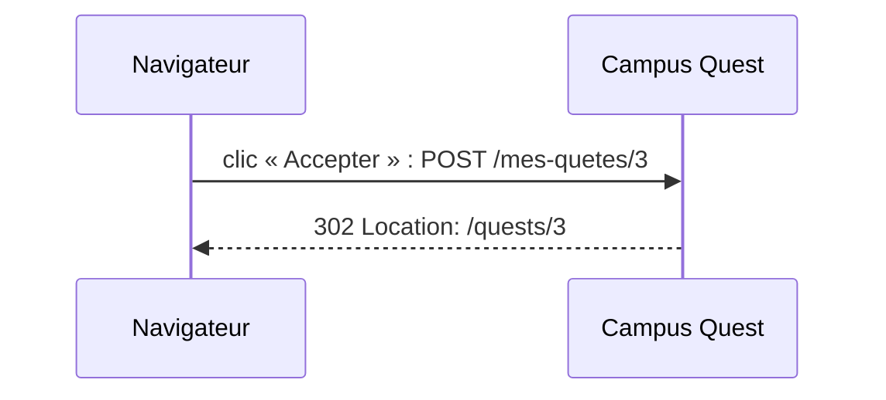
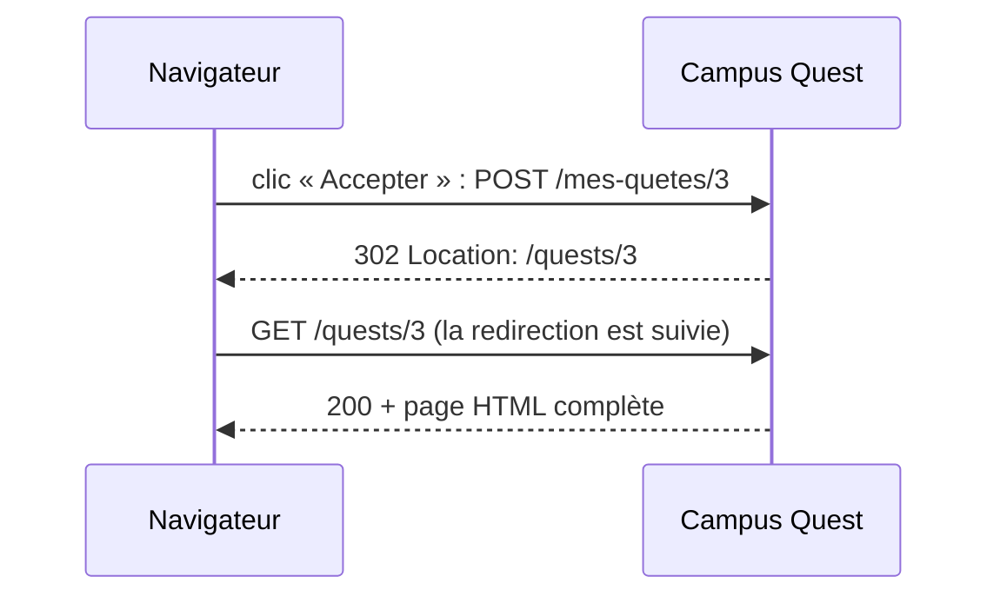
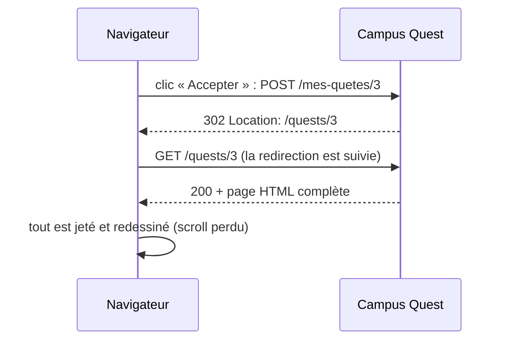

# Le cycle requête / réponse

- Décrire ce qui se passe vraiment quand on clique « Accepter »
- Lire l'onglet Réseau des DevTools et l'onglet Queries de la Debugbar
- Formuler l'objectif : une requête en arrière-plan, une page à moitié refaite

<!--
Transition : la S6 a rendu le site interactif — chaque joueur a ses quêtes. Mais chaque clic coûte une page entière.
Rappel : ce chapitre ne contient AUCUN code nouveau — il mesure le prix du fonctionnement actuel (tag s7-ch1-cycle = état fin S6, comme le fait la S6 pour son chapitre 08).
Découpage : ≈ 8 min de slides (≈ 6 slides), démo flash ≈ 4 min — moments : onglet Réseau filtré « Doc », clic « Accepter », les 2 documents et leurs statuts ; Debugbar : les requêtes SQL de la fiche rejouées ; micro-pratique ≈ 8 min (slide « À vous », étape A1 du README).
Moment léger : « un clic, deux allers-retours complets — et le serveur renvoie 30 ko de HTML pour dire « c'est noté » ».
Tag Campus Quest de fin de chapitre : s7-ch1-cycle.
-->

---
transition: slide-up | slide-down
---

# À votre avis ?

<Quiz
  question="Connecté à Campus Quest, vous cliquez sur « Accepter la quête ». Combien de requêtes de type document (page HTML) partent vers le serveur ?"
  :options="[
    'Une seule : le POST du formulaire, qui renvoie la page',
    'Deux : le POST, puis le GET de la page de destination (la redirection est suivie)',
    'Trois : le POST, le GET, puis un rechargement du CSS',
    'Une par requête SQL que le serveur exécute pour la fiche'
  ]"
  :answer="1"
/>

<!--
Faites voter : « une seule » est l'intuition la plus répandue — on oublie que la 302 est une instruction, pas une page.
« Trois » confond document et assets : le CSS est demandé une fois puis mis en cache par le navigateur (filtre « Doc » de l'onglet Réseau).
« Une par requête SQL » confond le plan HTTP et le plan SQL : la base ne voit jamais le navigateur.
Réponse : le POST reçoit une 302 qui dit « va voir /quests/3 » ; le navigateur obéit et renvoie un GET. Deux documents. Slide suivante.
-->

---
layout: two-cols-bottom
layoutClass: gap-x-6 !grid-cols-[minmax(0,13fr)_minmax(0,7fr)]
transition: slide-up | slide-down
---

# Ce que fait réellement le clic

::left::

<v-switch>
<template #0>

</template>
<template #1>

</template>
<template #2>

</template>
</v-switch>

::right::

Le formulaire part comme prévu : `POST`, jeton `_token`, cookie de session (S5, S6).

La réponse n'est **pas** la page : c'est une **302** qui dit « va voir `/quests/3` ». Le navigateur obéit et renvoie un **GET**.

Le serveur reconstruit la fiche **entière** — et rejoue **toutes** ses requêtes SQL (Debugbar). Le navigateur, lui, jette la page affichée et la redessine : scroll perdu, saisies perdues.

::bottom::

Retenez : pour changer **un badge**, on paie **deux pages complètes** et tout le SQL de la fiche. C'est le prix à mesurer — et à réduire.

<!--
Dérouler les trois temps : POST+302, GET+200, puis le constat « tout est jeté ».
Le message flash « Quête acceptée ! » (S6) ne s'affiche qu'au rechargement : la 302 l'emporte dans la session, le GET suivant l'affiche une fois.
Piège à nommer : la 302 n'est pas une erreur — c'est le pattern redirect-after-POST de la S5, qui évite le double envoi au F5.
-->

---
layout: two-cols-header
layoutClass: gap-x-6
transition: slide-up | slide-down
---

# L'onglet Réseau des DevTools

::left::

<Browser url="localhost/quests/3" title="Campus Quest — DevTools">
  

    

      NomStatutTypeTaille
    

    
mes-quetes/3302document≈ 0 o

    
quests/3200document28,4 ko

    
app.css200stylesheet4,1 ko

  

</Browser>

::right::

**Onglet Réseau** (`F12` → *Network*) : chaque ligne = une requête HTTP.

- Filtre **« Doc »** : ne garder que les **documents** — les pages HTML, pas les images ni le CSS
- **Statut** : `302` = « va voir ailleurs », `200` = page livrée
- **Taille** : le HTML de la fiche pèse sa vingtaine de ko — pour afficher « c'est noté »

<v-click>

Côté serveur, la **Debugbar** (S4) raconte l'autre moitié : la fiche rejoue toutes ses requêtes SQL — catégorie, lieux, et l'utilisateur connecté.

</v-click>

<!--
Démo : F12 > Réseau > cocher « Preserve log »/« Conserver le journal » (sinon le journal s'efface à la navigation), filtre « Doc », clic « Accepter ».
Montrer les deux lignes document : mes-quetes/3 en 302 (taille quasi nulle : c'est une instruction), puis quests/3 en 200 avec sa taille.
Le « Preserve log » est indispensable : sans lui, le rechargement de la 302 efface la trace du POST.
Puis Debugbar > Queries : recompter les requêtes de la fiche — elles ont toutes été rejouées pour rien.
-->

---
layout: statement
transition: slide-up | slide-down
---

# Le navigateur sait envoyer une requête **en arrière-plan** — et n'écrire qu'**un morceau** de la page.

Ce qu'on appelle de l'<KeyTerm>interactivité</KeyTerm> : la page réagit sans se reconstruire.

<!--
C'est LA phrase à retenir de la séance : elle résume les chapitres 02 et 03.
L'idée n'est pas nouvelle pour eux (les applis mobiles le font depuis toujours) — mais sur un site serveur-rendu,
elle demande un petit pont : c'est le chapitre suivant.
-->

---
transition: slide-up | slide-down
---

# À vous : mesurer votre propre clic

<Exercise title="WishFlix — le prix d'un ajout à la wishlist" duration="8 min" level="guidé"
  :criteria="[
    'L\'onglet Réseau est ouvert avec « Preserve log » et le filtre Doc',
    'Le clic « Ajouter à ma wishlist » a été observé : nombre de documents et statuts notés',
    'La taille du HTML reçu est notée dans REPONSES.md, section « Séance 7 — Avant / après »'
  ]"
  :hints="[
    'F12 > Réseau : activez « Preserve log » AVANT de cliquer, sinon le POST disparaît',
    'Le filtre « Doc » isole les pages : vous devez voir deux lignes',
    'Une ligne 302 de taille quasi nulle, puis une 200 : c\'est la page complète'
  ]">

**Exercice** `07-interactivite-optimisation` — étape **A1** du README.

Connecté à WishFlix, ouvrez l'onglet Réseau et ajoutez un jeu à votre wishlist. Notez ce que le navigateur a vraiment échangé.

</Exercise>

<!--
Pas de code ici : la séance 7 commence par une mesure, pas par une écriture — le « avant » sera comparé à la fin du chapitre 03.
Palier de rattrapage : tag Campus Quest s7-ch1-cycle (aucun code : c'est l'état de fin de S6).
-->

