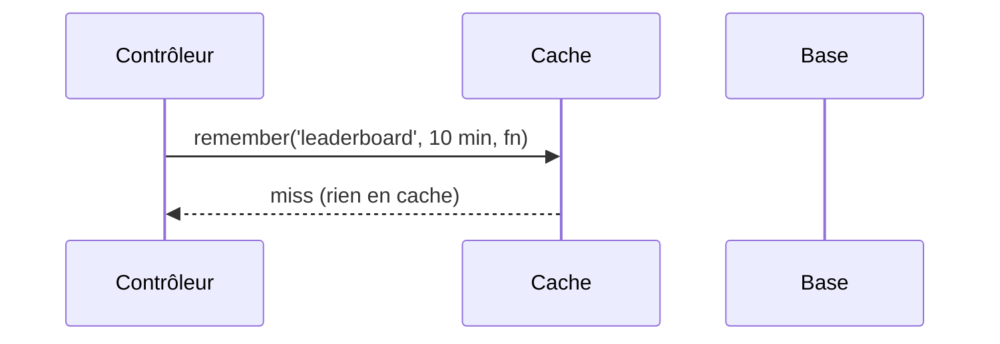
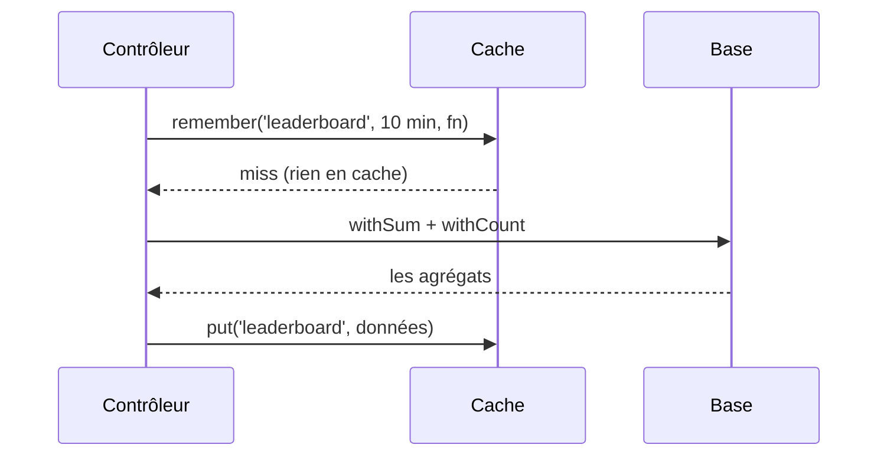
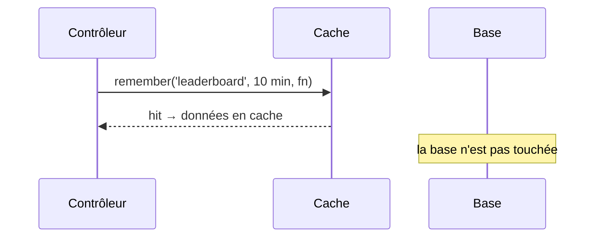

# Le cache applicatif

- Comprendre le cache : une copie temporaire d'une donnée coûteuse
- Mettre en cache une requête avec `Cache::remember()` et sa durée de vie
- Invalider le cache quand la donnée change, et mesurer le gain

<!--
Transition : dernière douleur de la séance — le classement recalcule ses agrégats à chaque visite pour un résultat qui change rarement.
C'est la compétence « Optimiser » du programme : un gain mesuré, réutilisable en soutenance.
Découpage : ≈ 14 min de slides (≈ 8 slides), démo flash ≈ 6 min — moments : /classement deux fois → Debugbar (1er : agrégats + écriture cache, 2e : une lecture cache) ; quête 1000 XP créée avec le forget commenté → classement périmé ; remis → à jour ; sail artisan cache:clear ; micro-pratique ≈ 25 min (slide « À vous », étape A4 + point de contrôle 3, fin du socle).
Moment léger : « le classement ne change qu'à chaque quête créée — le faire recalculer 10 000 fois par jour, c'est payer 10 000 fois pour la même addition. »
Tag Campus Quest de fin de chapitre : s7-ch4-cache.
-->

---
transition: slide-up | slide-down
---

# À votre avis ?

<Quiz
  question="Vous mettez le classement en cache pour 10 minutes avec `Cache::remember`. Le Maître du jeu crée une quête à 1000 XP juste après. Que se passe-t-il au prochain affichage de `/classement` ?"
  :options="[
    'La quête apparaît en tête : le cache est recalculé à chaque requête',
    'Le classement affiché est l\'ancien, figé jusqu\'à la fin du TTL — sauf si on l\'invalide',
    'Une erreur 500 : le cache ne supporte pas les données qui changent',
    'La quête apparaît, mais les autres chiffres restent périmés'
  ]"
  :answer="1"
/>

<!--
Faites voter : « recalculé à chaque requête » est la réponse de ceux qui n'ont pas encore compris ce qu'est un cache —
si c'était recalculé à chaque fois, le cache ne servirait à rien.
« Erreur 500 » : le cache ne juge pas les données, il les sert telles quelles.
« La quête apparaît » : seulement si quelque chose l'invalide — c'est le sujet de la fin du chapitre.
Réponse : le cache fige la réponse pour son TTL. Données fraîches ou périmées, c'est le prix de la vitesse — on gère ça par l'invalidation.
-->

---
layout: default
transition: slide-up | slide-down
---

# Le cache, en une image

<Definition term="Cache" translation="(Antémémoire)">

Une **copie temporaire** d'une donnée coûteuse à produire, relue au lieu d'être recalculée.

</Definition>

<v-click>

<Analogy title="Le menu du jour au vitrine" icon="🍽️">

Le chef ne recalcule pas les prix toutes les minutes : il les écrit **une fois** et les change quand la recette change. Entre-temps, le client lit le panneau — pas la cuisine.

</Analogy>

</v-click>

<!--
Le TTL (Time To Live) est la durée de vie de la copie : passé ce délai, on recalcule — c'est la « péremption ».
L'invalidation, c'est le « la recette a changé, on réécrit le panneau tout de suite » — sans attendre la fin du TTL.
-->

---
layout: two-cols-header
layoutClass: gap-x-6 !grid-cols-[minmax(0,13fr)_minmax(0,7fr)]
transition: slide-up | slide-down
---

# `Cache::remember` : miss puis hit

::left::

<v-switch>
<template #0>



</template>
<template #1>



</template>
<template #2>



</template>
</v-switch>

::right::

<div>

`Cache::remember($key, $ttl, $fn)` : le cache est consulté **en premier**, avant tout calcul.

</div>

<div v-click="1">

**Miss** : la closure s'exécute — les agrégats sont calculés — puis `put` range le résultat pour toute la durée de vie.

</div>

<div v-click="2">

**Hit** : les données reviennent directement du cache — **la base n'est pas touchée**. C'est le gain, mesuré au chapitre suivant.

</div>

<!--
Trois temps : la demande, le miss complet (calcul + stockage), puis le hit (lecture seule).
La closure n'est qu'un fn () => [...] : elle ne s'exécute QUAND le cache est vide — c'est toute la mécanique.
Comparer avec Cache::get/put manuels : remember évite d'écrire soi-même le « si absent alors calcule puis stocke ».
-->

---
layout: two-cols-bottom
layoutClass: gap-x-6 !grid-cols-[minmax(0,13fr)_minmax(0,7fr)]
transition: slide-up | slide-down
---

# Le classement en cache

`app/Http/Controllers/LeaderboardController.php`

::left::

```php {all|1|7-14|16|all}
use Illuminate\Support\Facades\Cache;

class LeaderboardController extends Controller
{
    public function index()
    {
        $data = Cache::remember('leaderboard', now()->addMinutes(10), fn () => [
            'categories' => Category::withSum('quests', 'xp')
                ->orderByDesc('quests_sum_xp')
                ->get(),
            'locations' => Location::withCount('quests')
                ->orderByDesc('quests_count')
                ->get(),
        ]);

        return view('leaderboard.index', $data);
    }
}
```

::right::

<div v-click="1">

La façade `Cache`, comme `DB::` ou `Auth::` en S3-S6.

</div>

<div v-click="2">

`remember('leaderboard', now()->addMinutes(10), fn () => […])` : la **clé**, la **durée de vie** (TTL), et la closure qui produit la valeur. Toute la mécanique de la S4 part **dans** la closure : elle ne tourne qu'au miss.

</div>

<div v-click="3">

`view('leaderboard.index', $data)` **inchangée** : le contrôleur ne sait pas si les données viennent du cache ou de la base — la mise en cache est transparente.

</div>

::bottom::

<div v-click="4">

<Alert type="tip">

Retenez : on cache le **résultat**, pas la requête — la vue ne change pas, le calcul est juste fait une fois par TTL.

</Alert>

</div>

<!--
La closure renvoie un TABLEAU (categories + locations), pas des modèles : il est sérialisé tel quel dans le cache.
Si on cachait une collection de modèles, l'eager loading (with) devrait être DANS la closure — sinon les modèles cachés ne portent pas leurs relations.
now()->addMinutes(10) : le TTL s'exprime en Carbon — on reverra addMinutes() au Panorama.
-->

---
layout: two-cols-header
layoutClass: gap-x-6
transition: slide-up | slide-down
---

# Où vivent les données, et le gain

::left::

| | 1er affichage | Affichages suivants |
|---|---|---|
| **Requêtes SQL** | ≈ 6 (agrégats + écriture) | 1 (`select … from cache`) |

::right::

<div v-click="1">

Le store par défaut est **`database`** (Laravel 12) : la table `cache` existe depuis la migration d'origine. La Debugbar montre donc un `select … from cache` **à la place** des agrégats.

</div>

<div v-click="2">

Mesurer : Debugbar → onglet **Queries**, `/classement` deux fois de suite — les `withSum` / `withCount` disparaissent au second chargement.

</div>

<div v-click="3">

Le gain **grandit avec le volume** : rejouer `Quest::factory(470)->recycle(Category::all())->create()` (S4) rend l'écart visible — c'est la mesure à montrer en soutenance.

</div>

<!--
Le ≈6 → 1 est un ordre de grandeur : les requêtes de session et d'authentification restent, ce qui disparaît ce sont les agrégats.
Avec CACHE_STORE=file (config possible), la lecture du cache n'apparaît pas dans l'onglet Queries — le gain reste mesurable par le nombre de requêtes et le temps.
Sur WishFlix : .env fraîchement généré → CACHE_STORE=database déjà en place, table cache migrée par la migration d'origine.
-->

---
layout: two-cols-bottom
layoutClass: gap-x-6 !grid-cols-[minmax(0,13fr)_minmax(0,7fr)]
transition: slide-up | slide-down
---

# Invalider le cache

`app/Http/Controllers/QuestController.php` — `destroy()`

::left::

```php {all|3-4|6|8|all}
public function destroy(Quest $quest)
{
    $quest->locations()->detach();
    $quest->delete();

    Cache::forget('leaderboard');

    return redirect()->route('quests.index')->with('success', 'Quête supprimée !');
}
```

<Terminal
  title="bash" prompt="$"
  :lines="[
    { cmd: 'sail artisan cache:clear', out: '   INFO  Application cache cleared successfully.' }
  ]"
/>

::right::

<div v-click="1">

La quête est modifiée — le classement va changer… mais le cache, lui, ne le sait pas.

</div>

<div v-click="2">

`Cache::forget('leaderboard')` **jette** l'entrée : le prochain affichage recalculera. Même geste dans `store()` et `update()` — le `QuestService` de la S5 reste tel quel. Et pour tout vider d'un coup : `sail artisan cache:clear` (terminal de gauche).

</div>

<div v-click="3">

Le `forget` passe dans l'action, avant le `return` : la réponse part sur des données fraîches.

</div>

::bottom::

<div v-click="4">

<KeyPoint variant="rule" title="Règle d'or" icon="📏">

Ne mettez en cache que des données **partagées**. Ce qui dépend de l'utilisateur ou des paramètres (page, filtre) doit entrer dans la **clé** — sinon tout le monde voit la page de quelqu'un d'autre.

</KeyPoint>

</div>

<!--
La démo provoque l'erreur : créer une quête 1000 XP avec le forget commenté → /classement figé → décommenter → à jour → cache:clear pour repartir propre.
Oublier le forget est LE bug classique du cache : les données ne sont pas fausses, elles sont VIEILLES — plus difficile à repérer.
Alternative non enseignée (note) : les model events (booted()/saved) peuvent invalider automatiquement — puissant mais magique, on le cite sans le faire.
-->

---
transition: slide-up | slide-down
---

# Panorama : le cache

<script setup>
import cache from '/references/cache'
</script>

<Panorama :items="cache" doc="https://laravel.com/docs/12.x/cache" at="s7-ch4" />

<!--
Survol de 30 s, pas d'explication détaillée : montrer ce qui a été vu (badges « vu ») et où trouver le reste.
remember, forget et cache:clear sont allumés depuis la micro-pratique A4 ; get/put/has/flexible restent estompés — ils serviront au bonus.
Pendant le « À vous », les apprenants peuvent revenir sur cette slide comme aide-mémoire.
-->

---
transition: slide-up | slide-down
---

# À vous : les mieux notés en cache

<Exercise title="WishFlix — cacher la section « Mieux notés »" duration="25 min" level="guidé"
  :criteria="[
    'La section « Mieux notés » de l\'accueil passe par Cache::remember sous la clé home.top-rated, 10 min',
    'Cache::forget(\'home.top-rated\') est appelé dans store, update et destroy de GameController',
    'Le gain est mesuré dans la Debugbar et noté dans REPONSES.md',
    'Une note passée à 5 apparaît tout de suite sur l\'accueil (invalidation vérifiée)'
  ]"
  :hints="[
    'La requête : Game::with(\'category\')->orderByDesc(\'rating\')->limit(6)->get() — la closure la contient ENTIÈRE',
    'Le contrôleur de l\'accueil envoie les données à la vue : enrobez la valeur calculée, pas le retour de la vue',
    'Test : notez un jeu 5 en base, rechargez / — s\'il n\'apparaît pas, le forget manque dans update()'
  ]">

**Exercice** `07-interactivite-optimisation` — étape **A4** du README, puis **point de contrôle 3** (fin du socle).

Le même pattern que le classement : `remember`, un `forget` par écriture, une mesure avant/après.

</Exercise>

<!--
Point de contrôle 3 après A4 (palier : tag s7-ch4-cache — fin du socle, tout le reste est « chez vous »).
Commit attendu : « perf: cache des mieux notés ».
Piège probable : cacher la COLLECTION de modèles sans le with('category') dans la closure → les modèles cachés n'ont pas leur catégorie → N+1 ou erreur au hit.
Piège 2 : oublier que rating peut être null → orderByDesc gère, mais le test « note à 5 » doit vraiment changer le top 6 pour être visible.
-->
